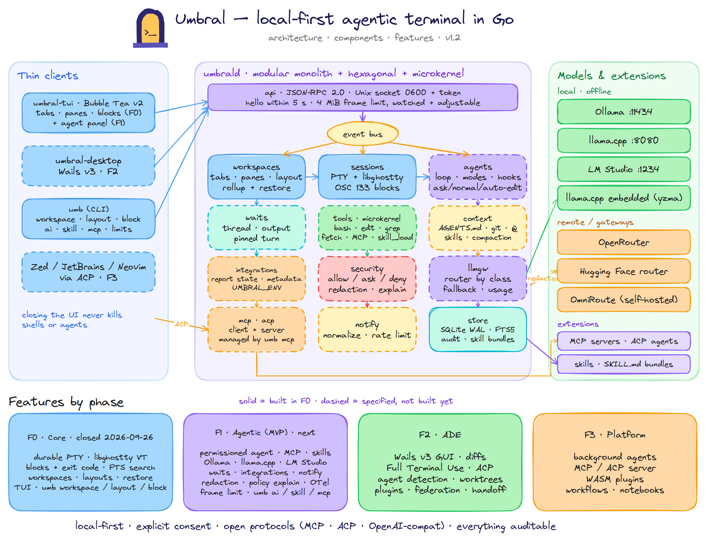
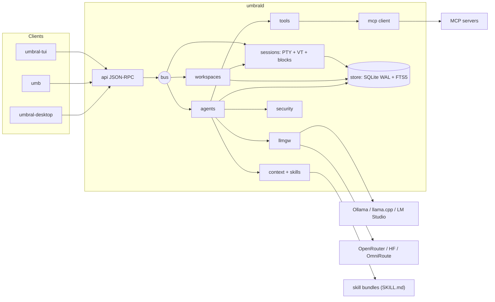

<p align="center">
  
</p>

<h1 align="center">Umbral</h1>

<p align="center">
  <b>A local-first agentic terminal, written in Go.</b><br>
  Command blocks, an agent with explicit permissions, and local models (Ollama, llama.cpp, LM Studio) as first-class citizens.
</p>

<p align="center">
  <a href="https://github.com/ecrespo/umbral/actions/workflows/ci.yml"></a>
  
  
  
</p>

> *Umbral* is Spanish for **threshold**: the stone step under a door, the exact point between inside and outside.

---

## Status

🚧 **Pre-alpha. F0 and F1 are closed, every F2 slice is built, and the Hardening phase before
release 0.1 is under way.** Nothing has been released yet: there is no tag and no published
package. The full SDD package (constitution, PRD with EARS, API, technical design, data model,
plan, tasks and Analyze) stays the current truth, and [`AGENTS.md`](AGENTS.md) carries the
detailed status.

**What is built** — verified against a running daemon, phase by phase:

- **The terminal core (F0, closed 2026-09-26).** `umbrald` owns durable PTY sessions with a
  libghostty emulator and streams them over a 0600 JSON-RPC socket. One block per command from
  the shell integration (bash, zsh, fish), searched across 100,000 blocks in a few milliseconds.
  Workspaces, tabs and panes addressed as `w1`, `w1:t2` and `w1:p3`, with portable layouts;
  after a `kill -9` the tree comes back, and a stored command is typed at the prompt, never run.
- **The agent (F1, closed 2026-10-22).** A permissioned agent in `ask` / `normal` / `auto-edit`
  modes, with approvals, a destructive-command floor and secret redaction; a model gateway over
  Ollama, OpenAI-compatible providers and OpenRouter with fallback; MCP servers (`umb mcp`) and
  skills (`umb skill`); waits a script can drive (`umb thread`, `umb wait`); OpenTelemetry
  traces; signed rule bundles. On an idle local `gpt-oss:20b` the reference scenario passed
  18 of 20 runs with no request leaving the machine.
- **The agentic development environment (F2, built; F2a closed 2026-10-24).**
  - *F2a:* git worktrees per thread with reviewed squash merges, parallel turns, `full-auto`
    inside a worktree, third-party agents hosted over ACP (OpenCode) with every permission
    mediated, and a policy router.
  - *F2b:* `terminal_interact` on the thread's PTY, an embedded llama.cpp provider, and Active
    AI suggestions from a local model.
  - *F2c:* a Wails v3 desktop client with per-hunk review and a file tree.
  - *F2d:* live handoff of running sessions to a new daemon, and remote daemons over ssh.
  - *F2e:* Windows 11 (named pipe, ConPTY, Job Objects, PowerShell 7).
  - *F2f:* declarative plugins and pane graphics.
- **Clients.** `umb` drives all of it from a script and publishes the protocol
  (`umb api schema --json`); `umbral-tui` has tabs, splits, a block list and an agent panel;
  `umbral-desktop` is built and smoke-tested in CI.
- **Packaging.** A `.deb` with a `systemd --user` unit, and tar.gz archives for Linux and
  macOS, each built and checked in CI. A release workflow that signs what a tag builds is
  written and has not run yet.
- **Gates, not prose.** Three of the four performance NFRs fail CI on a regression, and CI runs
  on Linux, macOS and Windows.

**What is open** — the [hardening tasks](specs/tasks/umbral-hardening-tasks.md):

- **Release 0.1 gates, the maintainer's:** a week of the TUI as the main terminal (`T-REL-01`),
  the F1 manual QA walk (`T-REL-02`), and the release workflow's first run (`T-REL-03`).
- **A sandbox** around hosted agents and `full-auto` (`T-HRD-15` … `17`), in progress: today
  they are bounded by what Umbral decides and by the worktree, not by the kernel.
- **Smaller items:** an unchecked libffi load path on macOS and Windows (`T-HRD-18`), an
  architecture-lint notice (`T-HRD-19`), a model relay for confined agents (`T-HRD-20`), the
  macOS app icon (`T-PKG-05`).
- **Verdicts still to give:** the F2b … F2f slices are built and not yet closed, and the F2b
  reference scenario, a local model driving `vim` through a rebase, went 0 of 10
  ([report](docs/reports/usf2-002-2026-10-30.md)).

## What Umbral is

- **A modern terminal:**
  - VT emulation with libghostty;
  - durable sessions that survive closing the UI;
  - **blocks** per command (output, exit code, cwd, duration) with search.
- **An agent that asks first:**
  - reads blocks, files, git and project rules (`AGENTS.md`, `CLAUDE.md`…);
  - proposes and applies changes with explicit approval, in `ask` / `normal` / `auto-edit` modes;
  - is extended with MCP servers (`umb mcp`) and **skills** (`umb skill`): local `SKILL.md` bundles
    whose descriptions it always sees and whose bodies it loads only when a task needs them, as
    untrusted content that can never widen a permission.
- **Truly local-first:**
  - works offline with Ollama, llama.cpp or LM Studio;
  - whatever leaves the machine is redacted and logged.
- **Structure that scripts can drive:**
  - workspaces, tabs and panes owned by the daemon, with portable layouts;
  - one glance tells you which project is blocked, working or ready to review;
  - waits (`thread.wait`, `send --wait`) so another agent or a shell script can drive a thread.
- **Open protocols:** MCP for tools, ACP for external agents (Claude Code, Gemini CLI, Codex…) and OpenAI-compatible APIs for models.



<sub>Editable source: [`docs/diagrams/umbral-architecture.excalidraw`](docs/diagrams/umbral-architecture.excalidraw) (open it at excalidraw.com).</sub>



## Roadmap

| Phase | Content | Status |
|---|---|---|
| F0 Core | daemon, PTY, libghostty, blocks, search, workspaces and layouts, restore, snapshot, TUI, `umb` for blocks and the workspace tree | ✅ closed 2026-09-26 |
| F1 Agentic (MVP) | handshake deadline and frame limit (`umb limits`), permissioned agent, model gateway, MCP (`umb mcp`), skills (`umb skill`), redaction, waits, integrations, notifications, OTel | ✅ closed 2026-10-22 |
| F2a Orchestration | worktrees, parallel threads, `full-auto`, ACP-hosted agents, policy router | ✅ closed 2026-10-24 |
| F2b Full Terminal Use | `terminal_interact`, embedded llama.cpp provider, Active AI | 🧪 built, awaiting close |
| F2c Desktop | Wails v3 client, per-hunk review, file tree | 🧪 built, awaiting close |
| F2d Handoff and remote | live PTY handoff, remote daemons over ssh | 🧪 built, awaiting close |
| F2e Windows | Windows 11 x86_64 | 🧪 built, awaiting close |
| F2f Plugins | declarative plugins, pane graphics | 🧪 built, awaiting close |
| Hardening → release 0.1 | signed releases, a sandbox for hosted agents and `full-auto`, the release gates | ⏳ in progress |
| F3 Platform | background agents, MCP/ACP server, WASM plugins | 🔭 horizon, not specified yet |

## Documentation

| Document | Purpose |
|---|---|
| [`docs/ARCHITECTURE.md`](docs/ARCHITECTURE.md) | research (Warp, Wave, Crush, Zed/ACP) and conceptual architecture |
| [`docs/adr/`](docs/adr/) | architectural style (ADR-0001) and orchestration surface (ADR-0002) |
| [`specs/constitution.md`](specs/constitution.md) | non-negotiable principles |
| [`specs/`](specs/README.md) | PRD, API, technical design, data model, plan, tasks and Analyze |
| [`changes/`](changes/) | change proposals (deltas): the folded ones under `_archive/`, the open ones beside it |
| [`docs/checkpoints/`](docs/checkpoints/) | verified state at each milestone, including the [F0](docs/checkpoints/2026-09-26-f0-closed.md), [F1](docs/checkpoints/2026-10-22-f1-closed.md) and [F2a](docs/checkpoints/2026-10-24-f2a-closed.md) closures |
| [`docs/GETTING-STARTED.md`](docs/GETTING-STARTED.md) | how to start development with Claude Code |
| [`assets/branding/umbral-icons/`](assets/branding/umbral-icons/README.md) | icons for Linux, Windows and macOS |

## Development

The project follows **Spec-Driven Development** in *spec-anchored* mode:

1. `specs/` is the current truth.
2. Every task cites its requirements (`REQ-XXX-NNN`).
3. Every test cites the requirement it verifies.
4. Changes to specified behavior enter as a Delta in `changes/`.

Read [`CONTRIBUTING.md`](CONTRIBUTING.md) and [`AGENTS.md`](AGENTS.md) before opening a PR.

```bash
python3 tools/sdd_check.py     # REQ → task coverage and schema validation
node tools/mermaid_check.mjs   # validates Mermaid diagrams (run npm install --prefix tools first)
```

## Rule-signing key

Rule bundles that arrive over the network are verified against a public key built into the
binary (Constitution Art. 5, [`docs/runbooks/rule-signing.md`](docs/runbooks/rule-signing.md)).
The current key, `umbral-rules-2026a`, has the fingerprint:

```
SHA256:KDVQHGXp79RqucL/1XN2bweYM/CsTnGyLrzNYgDDH9c
```

## License

[Apache-2.0](LICENSE) © 2026 Ernesto Crespo
