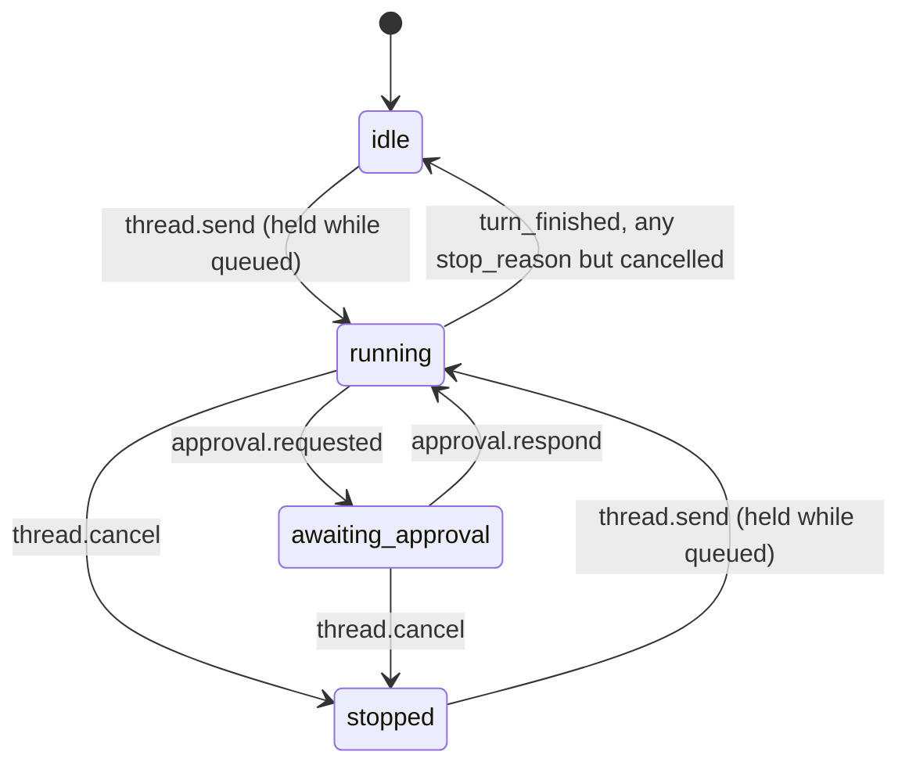
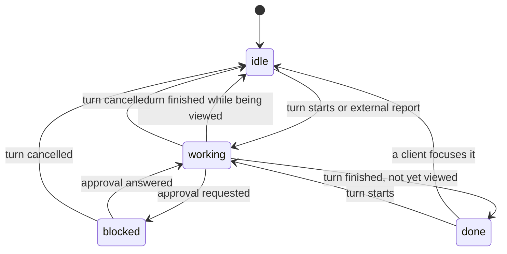
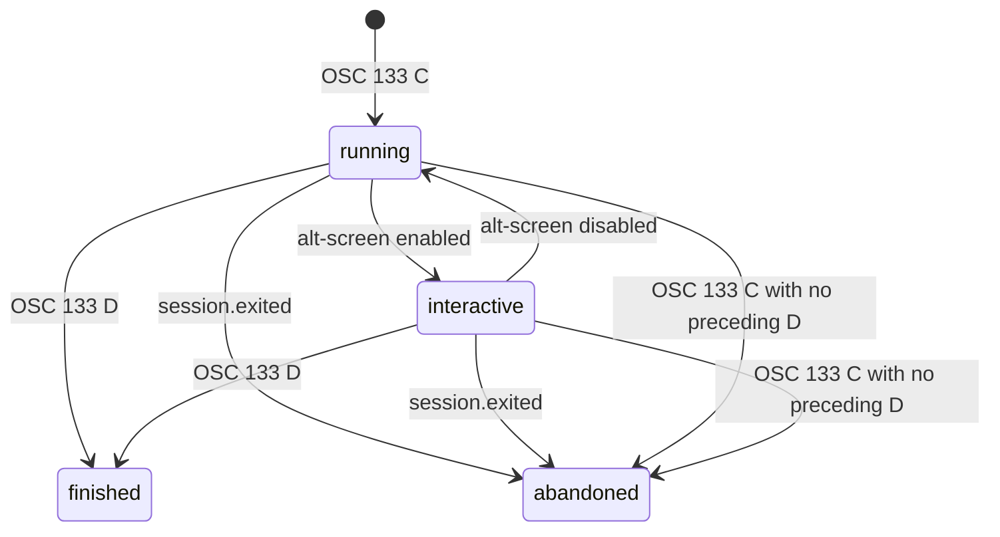

# Umbral Daemon API — API Specification

## Metadata

| Field | Value |
|---|---|
| **Author** | Ernesto Crespo · assisted draft |
| **Status** | `DRAFT` |
| **API version** | v1.55 (`protocol_version = 1`; every version since 1.0 is additive) |
| **Date** | 2026-09-11 |
| **Related PRD** | `specs/prd/umbral-mvp.md` |
| **Transport** | JSON-RPC 2.0 over Unix socket `$XDG_RUNTIME_DIR/umbral/umbral.sock` (macOS: `~/Library/Application Support/Umbral/umbral.sock`; Linux without `XDG_RUNTIME_DIR`: `$TMPDIR/umbral-<uid>/umbral.sock`, see §2) |

---


## 1. Overview

This is the single contract between `umbrald` and its clients: `umbral-tui` (MVP), `umb` (CLI, MVP)
and `umbral-desktop` (F2). There is no public HTTP API.

The channel is bidirectional:

- the client invokes **methods** (request/response);
- the daemon emits **notifications** (no `id`) for output streams and events.

Framing: JSON messages delimited by `\n` (NDJSON). A message is at most **the connection's frame
limit** including its delimiter, in both directions. Before the handshake that limit is 4 MiB
(4 194 304 bytes) and fixed. From a successful `system.hello` on, it is the limit the hello result
announces in `max_message_bytes` (§5.1): the daemon's configured `[api] max_message_bytes`, between
1 MiB and 64 MiB and 4 MiB by default, as it stood when the connection was greeted. A connection
keeps that limit for its whole life; a change made with `limits.set` (§5.38) reaches only
connections opened afterwards. The limit before the handshake does not follow the setting, so an
unauthenticated peer cannot make the daemon reserve more than 4 MiB for it.

- **Inbound.** Past the limit the daemon replies `VALIDATION_ERROR` with `id: null` — it has not
  read the id — and closes the connection, because the framing cannot be recovered; before the
  handshake the reply is `UNAUTHORIZED` instead (§2). A client may see its own write fail with
  `EPIPE` or `ECONNRESET` and SHOULD read the reply first.
- **Outbound.** THE SYSTEM SHALL NOT write a frame over the connection's limit (REQ-API-005). A
  response that would exceed it is replaced by `RESULT_TOO_LARGE` (§3) under the request's id, with
  `data.size_bytes` and `data.limit_bytes`, and the connection stays open: the framing was never
  broken. A notification that would exceed it is replaced by `limits.notification_dropped` (§6)
  under the **same** `seq`, so the loss is announced rather than left as a gap. `block.get` shortens
  its output instead (§5.17). A client SHOULD read with the limit the hello announced; one that
  ignores the field keeps reading at 4 MiB, and with a raised limit may have to refuse a large
  frame.

A notification carries a sequence number in its envelope, beside `jsonrpc`, `method` and
`params`:

```json
{"jsonrpc":"2.0","method":"workspace.created","seq":42,"params":{"id":"w1","label":"api"}}
```

§6 says what `seq` counts. A client that ignores the member behaves exactly as one written
before it existed, which is why adding it left `protocol_version` at 1 (§9).

**One deviation from JSON-RPC 2.0.** §4.1 of JSON-RPC says a server does not reply to a
notification. The daemon does, in exactly two cases, both with `UNAUTHORIZED`, `id: null` and a
close (REQ-SEC-018, §2):

- a notification from a peer that has not completed the handshake. JSON-RPC's rule assumes a
  session the peer is entitled to; this reply is the connection-level refusal of §2 step 3, not the
  answer to a call;
- a `system.hello` without an `id`, at any point in the connection.

After the handshake, a notification to any other method keeps its JSON-RPC meaning and gets no
reply.

**Responses come in the order their answers are ready.** The daemon reads a connection's requests in
order and does, in that order, everything a request must do before the next one is read. A wait —
`thread.wait`, `block.wait_output`, `thread.send` with `wait` — then answers later, when it settles,
and the daemon keeps reading and answering that connection's other requests meanwhile: the
`approval.respond` that unblocks a wait may arrive on the same connection. A client matches a
response to its request by `id`, as JSON-RPC 2.0 requires. Closing the connection ends its pending
waits, and nothing is written for them.

## 2. Authentication and Authorization

1. On installation the daemon creates `$XDG_RUNTIME_DIR/umbral/token` (32 random bytes in hex,
   permissions `0600`).
2. The first call on every connection MUST be `system.hello` with that token (REQ-SEC-003).
3. Any earlier call, or a call with an invalid token, receives `UNAUTHORIZED` and the connection is
   closed. A line that is not JSON, is not a JSON-RPC request, or is past the frame limit (§1)
   counts as an earlier call: before the handshake it receives no protocol error in its place. So
   does a JSON-RPC notification, which is answered with `id: null` (§1, REQ-SEC-018).

   3a. IF a connection has not completed `system.hello` within **5 s** of being accepted, THEN THE
   SYSTEM SHALL reply `UNAUTHORIZED` with `id: null` and close it (REQ-SEC-017). The clock starts at
   accept and nothing the peer sends moves it: not blank lines, not a partial line. A peer that
   never speaks would otherwise hold a connection for the life of the daemon. It is a
   constant, not a setting; the official client completes connect and handshake within its 2 s
   dial timeout.
4. The socket is created with permissions `0600` (REQ-SEC-007).
5. `system.hello` MUST carry a non-null `id`. IF it has none, or `"id": null`, THEN THE SYSTEM
   SHALL reply `UNAUTHORIZED` with `id: null` and close the connection, **whatever its token**
   (REQ-SEC-018). That check comes before the token comparison: an answer that cannot be delivered
   is not a handshake, and a connection must not be authenticated without learning which daemon,
   protocol and capabilities it is talking to. After it, THE SYSTEM SHALL compare the token before
   validating any other `system.hello` parameter. REQ-SEC-003 admits no exception, so no
   validation error may answer first and leave the connection open for another attempt.
6. IF `system.hello` arrives on a connection that already completed the handshake, THEN THE SYSTEM
   SHALL reply `UNAUTHORIZED` and close the connection — with `id: null` if the repeated hello
   carries no id (step 5). That check precedes the token comparison, so an authenticated
   connection cannot be reused to test tokens.

### Runtime directory

The socket and the token live together in a directory only their owner can enter (`0700`):

| Platform | Directory |
|---|---|
| Linux with `XDG_RUNTIME_DIR` | `$XDG_RUNTIME_DIR/umbral` |
| macOS | `~/Library/Application Support/Umbral` |
| Linux without `XDG_RUNTIME_DIR` (bare `su`, container without systemd) | `$TMPDIR/umbral-<uid>` |

The third parent is world-writable, so THE SYSTEM SHALL refuse to use that directory when it
already exists and is not a directory owned by the current user with permissions exactly `0700`.
Without the check another local user could pre-create it and read the token, defeating REQ-SEC-003
before the daemon starts.

### Client kinds

| `client_kind` | Description | Allowed methods |
|---|---|---|
| `tui` | Interactive client | All |
| `desktop` | Wails client (F2) | All |
| `cli` | `umb` | `system.*`, `api.*`, `limits.get`, `limits.set`, `block.*`, `workspace.*`, `tab.*`, `pane.*` except `pane.move`, `layout.*`, `thread.create`, `thread.send`, `thread.cancel`, `thread.get`, `thread.wait`, `model.list`, `notification.show`, `policy.explain`, `rules.*`, `wait.list`, `wait.cancel`, `skill.*`, `mcp.server.list`, `mcp.server.add`, `mcp.server.remove`, `agent.explain`, `model.route`, `worktree.list`, `worktree.get`, `worktree.diff`, `worktree.merge`, `worktree.discard` |

### An agent's terminal

The kind a client claims is not what an agent's command can be told from: anything a turn runs
can open the socket. So the daemon also asks the kernel which process connected (`SO_PEERCRED`,
`LOCAL_PEERPID`), and refuses a client running **inside an agent's terminal** — a thread's PTY
shell, or a hosted ACP agent's process (§5.19), is its process or one of its parents, or leads
its POSIX session — the methods that would
land, drop or approve the agent's own work, change what decides for it, or start a process
outside its terminal, with `PERMISSION_DENIED`, whatever its kind (REQ-ORC-004, delta `2026-10-full-auto`):
`worktree.merge`, `worktree.discard`, `worktree.close_group`, `approval.respond`, `thread.update`,
`skill.install`, `skill.set_enabled`, `skill.remove`, `mcp.server.add`, `mcp.server.remove`,
`rules.key.add`, `rules.key.remove`, `rules.key.rotate`, `rules.rollback`, `rules.reset`,
`session.input`, `thread.take_over`, `thread.hand_back` (REQ-FTU-002: an agent must not hand its
own terminal back to itself), and every method that starts a process — `session.create`, `pane.split`,
`tab.create`, `workspace.create` and `layout.apply` — since its command, shell or environment
(`BASH_ENV`, say) would run outside the agent's terminal. Reads stay open.

- This holds in every mode: an `umb skill install`, `umb mcp add` or `umb worktree merge` the
  user approved in an agent's turn now fails there, and the user runs it in their own pane.
- A hosted agent counts from its launch, before it speaks ACP, and leads its own session, so a
  process it starts and leaves behind is still its own. On Linux, when it exits, everything
  left in its session is killed before it stops counting; on macOS it counts until its thread's
  agent is closed (delta `2026-10-hosted-agent-peer`). Its
  isolated `HOME` sits under the runtime directory, beside the socket and its token, so it can
  find and dial the daemon: the refusal is what stops it.
- The verdict taken when the connection starts holds for the connection, so a process that
  connects and leaves the socket to a child is still refused.
- While any agent's terminal is open or any hosted agent runs, a peer whose process cannot be read — no pid, or one that
  has exited — is refused them too. Only Linux and macOS report a peer's pid; elsewhere every
  client is refused them once the check is wired.
- Not recognised: a process that leaves its session with `setsid` and then forks away from its
  parents, and a command handed to a launcher outside the terminal (`systemd-run --user`, `at`,
  `ssh localhost`). The destructive patterns of REQ-SEC-005 still ask before the `umb` commands
  for these methods; under `full-auto` that is a textual barrier only.

### Handshake

```json
{"jsonrpc":"2.0","id":1,"method":"system.hello",
 "params":{"token":"9f2c…","client_kind":"tui","client_version":"0.1.0","protocol_version":1}}
```

```json
{"jsonrpc":"2.0","id":1,"result":{
  "daemon_version":"0.1.0","protocol_version":1,
  "capabilities":["sessions","blocks","threads","mcp","models","workspaces","layouts","waits","integrations","notifications","policy_explain","wait_admin","rules","skills","limits","config","agent_detection","worktrees"],
  "connection_id":"con_01J9Z3K8T2QH6W4V5X7Y8Z9A0B","max_message_bytes":4194304}}
```

- `protocol_version` is **required**. IF it is missing or not compatible → `UNSUPPORTED_PROTOCOL_VERSION`
  (the daemon reports the accepted versions in `data.supported`). Treating an absent field as
  compatible would silently pair this daemon with a client built for a version it never declared.
- Each entry of `capabilities` names a method namespace (`sessions`, `blocks`, `threads`, `mcp`,
  `models`, `workspaces`, `layouts`, `waits`, `integrations`, `notifications`, `policy_explain`,
  `wait_admin`, `rules`, `skills`, `limits`, `config`, `agent_detection`, `worktrees`) whose methods the daemon **serves at that moment**. THE SYSTEM SHALL derive
  the list from its method table rather than declaring it statically, SHALL advertise a namespace
  when at least one of its methods is served by this build, and SHALL NOT advertise one whose
  methods are all unserved: a client that branches on the advertisement must not be sent down a path
  that cannot work. `approval.*` belongs to the agent, so it is advertised under `threads`. `thread.wait` and
  `block.wait_output` are advertised under `waits`, `pane.report_state` and
  `pane.release_state` under `integrations`, and `notification.show` under `notifications`, which their prefixes would not give them: a
  method may name its own namespace.
- **Registered is not the same as served.** Every method of the protocol stays in the table whether
  or not this build has the module behind it, which is what lets an unserved one answer
  `NOT_IMPLEMENTED` instead of `METHOD_NOT_FOUND` (§9). So the list is derived from what the daemon
  can do, not from what its table contains — the two differ exactly when a module is missing, which
  is the case the list exists for.
- The grain of a capability is the namespace; the grain of an answer is the method. An absent
  namespace means "this daemon cannot do any of that". A present one does not promise every method
  in it: a client that needs to know about one method calls it and reads the error, or asks
  `api.schema`, which reports `served` per method.
- `system` and `api` are never listed. Every client may always call `system.*`, and `api.schema` is
  how a client finds out what the daemon speaks — a capability that had to be granted before a
  client could ask what it had been granted would be circular. An empty list is valid, and is what a
  daemon serving only those two returns.

## 3. General Conventions

### Identifiers
- Type-prefixed ULIDs: `ses_`, `blk_`, `thr_`, `msg_`, `tc_`, `apr_`, `mcp_`, `con_`, `trn_` for a turn (`turn_id`, T-F1-13), `wt_` for a wait (`wait_id`, T-F1-31), `skl_` for a skill (T-F1-34), `wtr_` for a worktree (T-F2-01; not `wt_`, which is a wait's), and `key_` for a trust key — fixed by the binary's trust seed for the project's keys, so every install shows the same id, and minted at `rules.key.add` otherwise
  (Constitution Art. 6). Example: `blk_01J9Z3K8T2QH6W4V5X7Y8Z9A0B`.
- **Structural identifiers** are the documented exception to that rule (Art. 6, amendment of
  2026-09-20): a workspace is `w<n>`, a tab `w<n>:t<m>` and a pane `w<n>:p<m>`, with `n` and `m`
  decimal and starting at 1. Examples: `w1`, `w1:t2`, `w1:p3`. They are allocated by the daemon,
  unique and stable within a session while the object exists, and never reused while it lives
  (REQ-WS-002). A pane's previous identifier stays resolvable as an alias after a move
  (REQ-WS-007), and an alias follows the same grammar.

### Time and money
- Every timestamp is an `integer` in UTC epoch ms (`*_at` fields).
- Every cost is an `integer` in micro-USD (`*_micro_usd` fields).

### Error format

```json
{"jsonrpc":"2.0","id":7,"error":{
  "code":-32004,"message":"permission denied by policy",
  "data":{"domain_code":"PERMISSION_DENIED","details":[{"field":"tool","issue":"deny rule rm-rf"}],
          "trace_id":"4bf92f3577b34da6a3ce929d0e0e4736"}}}
```

`trace_id` carries the OpenTelemetry trace id of the turn that produced the error. When the failing
work ran outside a turn THE SYSTEM SHALL put the `connection_id` there instead, and SHALL leave the
field empty when the error precedes the handshake and there is no connection id yet. Requests are
not traced, only turns are (Tech §7.3), and a turn's failure is a stop reason rather than an error
response, so today every `INTERNAL_ERROR` carries the `connection_id`. THE SYSTEM SHALL NOT
mint an identifier that correlates to nothing: an id appearing in no other log line is worse than an
absent one. The field is present on `INTERNAL_ERROR` only (Art. 7).

### Error codes

| JSON-RPC `code` | `domain_code` | When |
|---|---|---|
| -32700 | `PARSE_ERROR` | Invalid JSON |
| -32600 | `INVALID_REQUEST` | Message is not valid JSON-RPC |
| -32601 | `METHOD_NOT_FOUND` | Method name this build does not know at all, or not allowed for the `client_kind` |
| -32602 | `VALIDATION_ERROR` | Invalid parameters |
| -32001 | `UNAUTHORIZED` | No `system.hello`, handshake deadline passed, `system.hello` without an id, or invalid token (§2) |
| -32002 | `NOT_FOUND` | Unknown ID |
| -32003 | `CONFLICT` | Incompatible state (e.g. `thread.send` while a turn is running) |
| -32004 | `PERMISSION_DENIED` | `deny` policy; a method an agent's terminal may not call (§2) |
| -32005 | `PROVIDER_UNAVAILABLE` | No model candidate available (includes offline mode) |
| -32006 | `BUDGET_EXCEEDED` | Thread token/cost budget exhausted |
| -32007 | `UNSUPPORTED_PROTOCOL_VERSION` | Incompatible version |
| -32008 | `INPUT_LOCKED` | Input to a session locked by the agent |
| -32009 | `CONFIG_INVALID` | Configuration rejected (e.g. plaintext secret) |
| -32010 | `THREAD_BLOCKED` | `thread.send` with `wait` on a thread awaiting approval |
| -32011 | `TIMEOUT` | A wait reached its deadline. `data.last_state` is what it last observed: the pinned turn's state for a thread wait, the last line evaluated for `block.wait_output` (`""` when none was). Nothing was resent or retried (REQ-AUT-004) |
| -32012 | `NOT_IMPLEMENTED` | A method this build knows by name but whose capability is switched off; see §9 |
| -32013 | `CANCELLED` | The wait was cancelled with `wait.cancel` |
| -32014 | `RESULT_TOO_LARGE` | The result would exceed this connection's frame limit (§1). `data.size_bytes` is the size it would have had and `data.limit_bytes` the limit, both numbers; the connection stays open (REQ-API-005) |
| -32603 | `INTERNAL_ERROR` | Unexpected error (always with `trace_id`) |

### A refusal's reason

A worktree request the daemon refuses (§5.41) carries `data.reason`, a stable word naming why, on
`VALIDATION_ERROR` when the request is at fault and on `CONFLICT` when the repository's or the
thread's state is. A `conflict` refusal carries `data.paths`, the conflicting paths, and a
`commit_failed` one `data.output`, the first 4 KiB of git's error output (REQ-WT-004). A
`thread.create` whose `agent` is refused carries `data.reason` too, on `VALIDATION_ERROR` (§5.19,
REQ-ACP-009). The fields are absent on every other error.

```json
{"jsonrpc":"2.0","id":9,"error":{"code":-32003,"message":"worktree: conflict: a.txt",
  "data":{"domain_code":"CONFLICT","reason":"conflict","paths":["a.txt"]}}}
```

### Cursor pagination

Parameters `limit` (1-200, default 50) and `cursor` (opaque). Response:
`{"items":[…],"next_cursor":"…|null"}`. Descending order by `started_at` or `created_at` unless
stated otherwise.

`block.search` is the one method that states otherwise: see §5.18. A cursor belongs to the
method and the ordering that produced it, so one handed to a different method is refused with
`VALIDATION_ERROR` rather than misread.

## 4. Schemas

### Session
```json
{"id":"ses_…","shell":"/usr/bin/zsh","cwd":"/home/u/repo","cols":120,"rows":40,
 "state":"alive","integration":"osc133","input_owner":"human","owner_thread_id":null,
 "exit_code":null,"created_at":1757592000000,"exited_at":null}
```
- `state`: `alive` | `exited`
- `integration`: `pending` | `osc133` | `none`
- `input_owner`: `human` | `agent`
- `owner_thread_id`: `string | null`; the thread that owns this PTY, so a client can tell agent
  sessions from human ones. `null` for a session created by the user (REQ-AGT-003).

### Workspace
```json
{"id":"w1","label":"api","cwd":"/home/u/repo","order_index":0,
 "rollup_state":"blocked","tab_ids":["w1:t1"],"created_at":1757592000000,"closed_at":null}
```
- `rollup_state`: `blocked` | `working` | `done` | `idle` | `unknown` (REQ-WS-006). `unknown` is
  what the requirement's last clause propagates: it appears when every pane and thread of the
  workspace is `unknown`, and a client must render it rather than treat it as `idle`. An *empty*
  workspace is `idle`, not `unknown`. In F0 the two are easy to tell apart, because nothing
  reports a pane state yet and so every workspace holding a pane is `unknown`

### Tab
```json
{"id":"w1:t1","workspace_id":"w1","label":"agents","order_index":0,
 "focused_pane_id":"w1:p1","created_at":1757592000000,"closed_at":null}
```

### Pane
```json
{"id":"w1:p2","tab_id":"w1:t1","workspace_id":"w1","session_id":"ses_…","thread_id":null,
 "label":"tests","cwd":"/home/u/repo","aliases":["w1:p2"],
 "command":["sh","-c","go test ./..."],"env":{"UMBRAL_ROLE":"tests"},
 "attention_state":"working","state_source":"umbral:agent",
 "metadata":{"title":"go test","tokens":{"summary":"unit"}},
 "detected_agent":null,
 "created_at":1757592000000,"closed_at":null}
```
- `attention_state`: `blocked` | `working` | `done` | `idle` | `unknown`. `unknown` is the
  starting value and the one that survives until some source reports another: it is the absence of
  a report, not a report of nothing.
- `state_source`: who owns the state. Exactly one source decides, in DD-012's order (delta
  `2026-10-integration-surface`):
  1. `umbral:agent`, when the pane's live session is a thread's PTY; the state is that thread's
     `attention_state` and `thread_id` names it. Nothing displaces it (REQ-INT-006).
  2. The `source` of an external integration (§5.31, REQ-INT-002): the one that reported most
     recently, among those that have not released the pane.
  3. `umbral:shell`, derived from the block lifecycle of the pane's live session: its latest block
     `running` or `interactive` is `working`; `finished` or `abandoned` is `idle`; no block yet,
     with `integration: osc133`, is `idle` (a shell at its first prompt).
  4. Otherwise `null` with `unknown`: no live session, or a session whose integration is `pending`
     or `none` and that no one reports for.

  A change of either field is announced as `pane.state_changed` (§6).
- `thread_id`: the thread whose PTY the pane's live session is, `null` for any other pane
- `metadata`: display only (§5.32, REQ-INT-004): `{title?, display_name?, state_labels?: {state: label}, tokens?: {name: value}}`, each member present only when some source set it and its TTL has not passed; `{}` when none has. When two sources set one member, the later write wins. It never feeds `attention_state`, `state_source`, the rollup or a wait
- `detected_agent`: `{name, state_source}` of the third-party agent detection last found in
  the pane's live session (REQ-XAG-001), or `null`. `state_source` is what its manifest declares,
  `hooks`, `acp` or `none`: how the agent could report, not that it does. It is a label only —
  never an input of `attention_state` or `state_source` above (DD-012) — kept in the daemon's
  memory and found again after a restart. §5.39 explains it.
- `command_pending`: the pane has a `command` that Umbral has not run. Set by `layout.apply` and
  by a restart, never by `pane.split` — a client asking for a command now is asking for it to run,
  while a layout and a restart replay an intention from another time, and REQ-TERM-011 forbids
  acting on one unasked. The command is typed at the pane's prompt without a newline, so the user
  sees it and presses Enter to run it. **Omitted when false**, like `command`
- `command` and `env`: what the pane runs instead of a shell, and the environment overrides it
  runs with. They arrive through `pane.split` or `layout.apply`, are stored, and are what
  `layout.export` carries into a portable tree (REQ-WS-004, REQ-WS-005). **Both are omitted when
  empty**, which is the common case: a pane running a plain shell has neither, and a client should
  read their absence as "a shell" rather than as a field the daemon forgot. A pane with a `command`
  gets no shell integration and therefore no blocks — there is nothing to inject a bootstrap into —
  so it settles on `integration: none` (REQ-BLK-003)
- `metadata` is display-only (REQ-INT-004)

### Layout
```json
{"workspace_id":"w1","tab_id":"w1:t1","focused_pane_id":"w1:p1",
 "root":{"type":"split","direction":"right","ratio":0.6,
         "first":{"type":"pane","pane_id":"w1:p1","label":"editor","cwd":"/repo"},
         "second":{"type":"pane","pane_id":"w1:p2","label":"tests","cwd":"/repo",
                   "command":["sh","-c","go test ./..."],"env":{"UMBRAL_ROLE":"tests"}}}}
```
- `direction`: `right` | `down`; `ratio` is the fraction taken by `first`

### Block
```json
{"id":"blk_…","session_id":"ses_…","origin":"user","thread_id":null,
 "command":"go test ./...","cwd":"/home/u/repo","host":"thinkpad",
 "state":"finished","exit_code":1,"started_at":1757592001000,"ended_at":1757592005200,
 "duration_ms":4200,"output_bytes":1834,"output_truncated":false}
```
- `output_truncated`: the **stored** capture was cut at 16 MiB raw or 1 MiB plain (Data Model §2.2).
  Those bytes are gone.
- **Purged output.** Data Model §4's retention removes a closed block's raw chunks after
  `retention.raw_output_days` and its transcript after `retention.plain_output_days`. The block
  stays, with its `output_bytes`; `block.get` then answers an empty `output_raw_b64` or
  `output_plain`. `output_bytes > 0` with nothing returned is how a client tells purged output
  from output that never existed, and `output_truncated` does not change.
- `output_response_truncated_bytes` (optional, `block.get` only): how many bytes of the stored
  output **this response** leaves out to fit the frame limit (§5.17). Absent when nothing was left
  out. Raising the limit (§5.38) brings those bytes back; it cannot bring back what
  `output_truncated` reports.
- `origin`: `user` | `agent`
- `state`: `running` | `interactive` | `finished` | `abandoned`
- `abandoned` means the block ended without reporting how. There are two ways: the session
  died with the block open, or a second `OSC 133;C` arrived with no `OSC 133;D` in between,
  which is a shell starting a command without saying how the last one finished. `exit_code`
  is `null` on such a block: not knowing how a command ended and knowing it succeeded are
  different facts, and the second one is what reaches the agent's context.

### Thread
```json
{"id":"thr_…","title":"Fix TestParse","mode":"normal","model":"ollama/gpt-oss:20b",
 "model_class":"code","cwd":"/home/u/repo","state":"idle",
 "max_steps":50,"budget_tokens":400000,"tokens_used":12840,"cost_micro_usd":0,
 "created_at":1757592010000,"updated_at":1757592100000}
```
- `mode`: `ask` | `normal` | `auto-edit` | `full-auto`. `full-auto` is reported while the thread's `full_auto` flag is set (REQ-ORC-004, §5.22); the flag clears when the thread's worktree leaves `active`, and `mode` is then the one the thread held under it. A turn also needs the worktree on disk to decide under `full-auto`: one deleted behind the daemon's back reads `full-auto` until the missing check marks it and clears the flag, and turns meanwhile decide under the thread's own mode
- `state`: `idle` | `running` | `awaiting_approval` | `stopped`
- `attention_state`: `blocked` | `working` | `done` | `idle` | `unknown` — what the sidebar rolls up and what waits observe. `done` is a finished turn no client has viewed yet (REQ-AGT-016)
- `stalled`: `true` while the thread's running turn is marked stalled (REQ-AUT-008, §5.33); the mark is the daemon's and is not stored
- `queued`: `true` while the thread's turn is accepted but held for a slot under `[agents] max_concurrent_turns` (REQ-ORC-002). The thread is `running` and `working` meanwhile; the turn starts when a turn of any thread ends, in the order the sends arrived, and `queued` is `false` from then on. A held turn is never `stalled`
- `workspace_id`: the workspace the thread was created in, `null` for none (REQ-ORC-003)
- `worktree_id`: the thread's latest worktree, whatever its state, `null` for none. While that worktree is `active` the thread's turns run in it: the worktree is their write root and their cwd is the worktree's directory matching `cwd`, or the worktree's top when it has none; `cwd` itself does not change (REQ-WT-002)
- `agent`: the `[[acp.agents]]` entry hosting the thread, `null` for Umbral's own agent (REQ-ACP-001). A hosted thread's turns are its agent's: it runs where Umbral's turns would — the active worktree's directory, or `cwd` without one, which is then its write root — and its `model` and `model_class` are not Umbral's to choose
- `egress_visibility`: `observed` | `unobserved` (REQ-ACP-007). `unobserved` for a hosted thread: Umbral does not see the agent's own network traffic — its model calls and anything else its process sends — nor its file reads, so `egress_log` and `usage` hold none of them

### Worktree
```json
{"id":"wtr_…","thread_id":"thr_…","repo_root":"/home/u/repo","origin_branch":"main",
 "base_commit":"9f2c…","branch":"umbral/thr_…",
 "path":"/home/u/.local/share/umbral/worktrees/1a2b3c4d5e6f7a8b/thr_…","state":"active",
 "created_at":1757592010000,"updated_at":1757592010000}
```
- `state`: `active` | `merged` | `discarded` | `missing` (REQ-WT-006: its directory or branch was removed outside Umbral)
- `origin_branch`: the branch a merge squashes into; `null` for a worktree made from a detached `HEAD`, which no merge can land
- `path` is outside the repository, in `worktrees/<repo_id>/<thread_id>` beside the database (REQ-WT-001)

### Message
```json
{"id":"msg_…","thread_id":"thr_…","turn_id":"trn_…","role":"assistant","content":"…",
 "attachments":[{"kind":"block","ref":"blk_…","bytes":1834,"truncated_bytes":0}],
 "created_at":1757592020000}
```
- `role`: `user` | `assistant` | `tool` | `system_note`
- `attachments[].kind`: `file` | `dir` | `block` | `stdin`
- `attachments[].ref`: the path or block id the message named; `stdin` for a `stdin` attachment, whose data arrived inline (§5.20)

### ToolCall
```json
{"id":"tc_…","thread_id":"thr_…","message_id":"msg_…","tool":"run_command",
 "risk":"Exec","args":{"command":"go test ./..."},"status":"ok",
 "result_summary":"exit 0","block_id":"blk_…","started_at":1757592030000,"ended_at":1757592034000}
```
- `risk`: `ReadOnly` | `WriteFS` | `Exec` | `Network`
- `status`: `pending` | `ok` | `error` | `denied_by_user` | `denied_by_policy` | `invalid_args`
- A hosted agent's call (REQ-ACP-007) is named `acp:<kind>` after the kind it reports — `read`, `edit`, `delete`, `move`, `search`, `execute`, `think`, `fetch`, `other`, any other kind it sends (`switch_mode` included) named `other` — never after its free-text title; its `args` are `{title, raw_input?}`, the agent's own description; its `risk` is REQ-ACP-003's for the kind; and it is `pending` until the agent reports it `completed` (`ok`) or `failed` (`error`)
- A request a hosted agent makes of Umbral is a call of its own (REQ-ACP-004, REQ-ACP-005): `acp:fs/read_text_file` and `acp:fs/write_text_file` with `args` `{path}` and `{path, bytes}`, `acp:terminal/create` with `{command, cwd}`; it ends `ok`, `error`, `denied_by_policy` or `denied_by_user`, and an approval for it points at it

### Approval
```json
{"id":"apr_…","thread_id":"thr_…","tool_call_id":"tc_…","tool":"run_command","risk":"Exec",
 "reason":"policy","summary":"go test ./...","diff":null,"state":"pending",
 "decision_scope":null,"created_at":1757592029000,"decided_at":null}
```
- `reason`: `policy` | `destructive` | `tainted` | `outside_write_root`
- `state`: `pending` | `approved` | `denied` | `expired`
- `decision_scope`: `once` | `thread` | `always`

### Model
```json
{"id":"ollama/gpt-oss:20b","provider":"ollama","local":true,
 "caps":{"tools":true,"vision":false,"reasoning":true,"json_schema":true,"context_window":32768},
 "price_in_micro_usd_per_mtok":0,"price_out_micro_usd_per_mtok":0,"health":"ok"}
```
- `health`: `ok` | `degraded` | `down` | `unknown`
- `reason` (absent when there is nothing to say): why the model is not `ok`. It is its provider's —
  a credential reason of §5.28 (`keyring_unavailable`, `env_secret`, …), `discovery_failed` when the
  provider did not answer its model list, `no_adapter` for a provider type this build cannot call
  yet, `invalid_config` for an entry no adapter accepts, `offline` for a remote provider while
  `router.offline = true`.
- `caps.context_window` is 0 when the provider does not say; prices are 0 when it publishes none.

### McpServer
```json
{"id":"mcp_…","name":"gitlab","transport":"stdio","trust":"trusted","state":"connected",
 "tools":["get_issue","list_mrs"],"last_error":null}
```
- `transport`: `stdio` | `http`
- `trust`: `trusted` | `untrusted`
- `state`: `connecting` | `connected` | `unavailable` | `disabled`

### Skill
```json
{"id":"skl_…","name":"release-check","description":"Steps to cut a release.","version":"1.2",
 "source":"/home/me/skills/release-check","sha256":"9f2c…","size_bytes":4210,"enabled":true,
 "installed_at":1760800000000}
```
- `name`: 1–64 of `[a-z0-9-]`, not starting with `-`; unique, and how methods address a skill
- `version`: `null` when the front matter has none
- `source`: the path it was installed from, for display only — the stored copy is what is used
- `sha256`: the bundle's digest (§5.42)

## 5. Methods

### 5.1 `system.hello`
**Params:** `{token, client_kind, client_version, protocol_version}`. See §2 for what each one means
and for the order they are validated in. REQ-SEC-003.
**Result:** `{daemon_version, protocol_version, capabilities, connection_id, max_message_bytes}`.
`max_message_bytes` is this connection's frame limit from now on, in both directions (§1).

### 5.2 `system.status`
**Params:** `{}`. Returns `{daemon_version, uptime_ms, sessions_alive, threads_running, providers:[{id, health, reason?}], mcp:[{name, state}], frames}`.
A provider's `reason` says why it is `down` or `degraded` — `keyring_unavailable`
(REQ-SEC-008), `env_secret` (REQ-SEC-012) and the others of §5.28 — and is absent otherwise.
Used by `umb status` (REQ-CLI-003).

`frames` reports how close traffic has come to the frame limit **this daemon run** (REQ-OBS-005);
a restart starts every counter again:

```json
"frames": {"limit_bytes":4194304, "largest_in_bytes":12288, "largest_out_bytes":3250000,
           "refused_in":0, "refused_out":2, "near_limit_out":5}
```

- `limit_bytes`: the limit a new connection gets once greeted.
- `largest_in_bytes` / `largest_out_bytes`: the largest frame read and written, the `\n` counted.
- `refused_in`: inbound frames over the limit, each of which closed its connection.
- `refused_out`: responses answered `RESULT_TOO_LARGE` plus notifications replaced by
  `limits.notification_dropped`.
- `near_limit_out`: frames written above 75 % of their connection's limit.

THE SYSTEM SHALL log every refusal, and the run's first frame above 75 %, at `warn` with the method
and the size and never the content (Art. 7). An inbound refusal is the exception that proves the
rule: the line was never parsed, so it has no method to name, and its size is logged as
`size_bytes_at_least`, one byte past the limit, because reading stopped there.

### 5.3 `session.snapshot` — REQ-API-001, REQ-API-002
**Params:** `{}`.
**Result:** `{seq, focused:{workspace_id|null, tab_id|null, thread_id|null}, workspaces: Workspace[], tabs: Tab[], panes: Pane[], layouts: Layout[], threads: Thread[]}`.

All three members of `focused` are nullable, and all three are null on a daemon that has nothing
focused yet — the state every client meets on a fresh daemon, before the first `workspace.create`.
Null means "nothing is focused", never "unknown".

`focused.thread_id` is the thread a connection that still views one focused most recently with
`thread.focus` (§5.23), and null while no connection views a thread. It lives for the daemon's
run: a view ends with its connection, so a restart starts with none. `threads` holds what
`thread.list` returns — the threads that are not ephemeral — each with its `attention_state`, which
is the base `thread.attention_changed` updates (REQ-AGT-016).

The `seq` is the envelope counter of §6, read **before** the tree: the daemon persists before it
notifies (DD-007), so an event whose `seq` has been assigned is already stored, and reading the
counter first guarantees that everything at or below the reported number is in this result. The
result may additionally reflect a few events *above* it, which makes a client re-apply something it
already has — safe, because every tree notification carries the whole record. The other direction
is not safe, which is why the order is specified rather than left to an implementation.

The discard rule covers what this result contains: the `workspace.*`, `tab.*`, `pane.*`,
`layout.*` and `thread.*` notifications. It does **not** cover `session.output`, which this result
carries no screen to have contained; a terminal is bootstrapped by `session.subscribe` against that
method's own per-session `seq` (§5.11), and discarding output on the envelope counter would lose
bytes with nothing to notice.

Bootstrap without gaps, for clients that keep their own cache:

1. open a second connection and complete `system.hello` on it; tree notifications go to every
   authenticated connection and need no subscription, so from that point nothing is missed;
2. buffer the stream while calling `session.snapshot`;
3. install the snapshot and apply the buffered events whose `seq` is greater than the snapshot's `seq`;
4. keep streaming. Call `session.snapshot` again after reconnecting.

### 5.4 `workspace.create` / `list` / `focus` / `rename` / `close` — REQ-WS-001, REQ-WS-002, REQ-WS-006
`create` params: `{cwd, label?, tab_label?, focus?: true}`.
`create` result: `{workspace: Workspace, tab: Tab, root_pane: Pane}` — the three objects in one response.
`close` params: `{workspace_id, close_panes?: true}`; it fails with `CONFLICT` if a thread of that workspace is `running`.
`list` params: `{}`. `focus` params: `{workspace_id}`. `rename` params: `{workspace_id, label}`.

### 5.5 `tab.create` / `list` / `focus` / `rename` / `close` — REQ-WS-001
`create` params: `{workspace_id, label?, focus?: true}`. `create` result: `{tab: Tab, root_pane: Pane}`.
`list` params: `{workspace_id}`. `focus` params: `{tab_id}`. `rename` params: `{tab_id, label}`.
`close` params: `{tab_id}`.

### 5.6 `pane.split` / `list` / `get` / `focus` / `rename` / `move` / `close` — REQ-WS-003, REQ-WS-007
`split` params: `{pane_id, direction:"right"|"down", ratio?: 0.1-0.9 (default 0.5), cwd?, command?: string[], env?: object, focus?: true}`.
`split` result: `{pane: Pane, layout: Layout}`.

`move` params: `{pane_id, destination:{type:"tab"|"new_tab"|"new_workspace", …}}`. The pane keeps its terminal and its process; it receives a new identifier and the previous one remains a resolvable alias while that terminal lives (REQ-WS-007). The daemon emits `pane.moved`, never a `pane.closed` / `pane.created` pair.

`list` params: `{tab_id}`. `get` params: `{pane_id}`. `focus` params: `{pane_id}`.
`rename` params: `{pane_id, label}`. `close` params: `{pane_id}`.

`close` terminates the pane's session following the `session.close` rules.

### 5.7 `layout.export` — REQ-WS-004
**Params:** `{tab_id?}` (default: the focused tab). **Result:** `Layout`.

### 5.8 `layout.apply` — REQ-WS-005, REQ-TERM-011
**Params:** `{workspace_id, tab_label?, root, focus?: true}`.
**Result:** `{tab: Tab, panes: Pane[], warnings: ["live processes and scrollback are not reproduced", "commands are pending: they are typed at each pane's prompt and run when you press Enter"]}`.

Every pane it creates runs a **shell**. A node carrying a `command` gets that command stored and
`command_pending` set, typed at the pane's prompt without a newline — REQ-TERM-011: "it returns the
commands as pending, never as launched". A layout is an intention from another time and possibly
another machine, so applying one is not consent to run what it carries; `pane.split`, where a
client asks for a command now, is unaffected. The second warning is present only when the tree
carried at least one command.

### 5.9 `session.create` — REQ-TERM-001, REQ-BLK-005
**Params:**

| Field | Type | Rule |
|---|---|---|
| `shell` | string | Optional; default `$SHELL`; must be executable |
| `cwd` | string | Optional; default `$HOME`; must exist |
| `env` | object<string,string> | Optional; at most 64 keys |
| `cols`, `rows` | integer | 20-1000 and 5-500 |
| `shell_integration` | boolean | Default `true` |

**Result:** `Session`.
**Errors:** `VALIDATION_ERROR` (invalid shell/cwd), `INTERNAL_ERROR` (`forkpty` failure).

### 5.10 `session.list` → `{items: Session[]}`
**Params:** `{}`.

### 5.11 `session.subscribe` — REQ-TERM-003, REQ-TERM-004
**Params:** `{session_id, scrollback_lines?: 0-10000 (default 10000)}`.

**Result:** `{snapshot: {format:"vt", data_b64, cursor:{x,y}}, seq}`.

After the response, the daemon emits `session.output` starting at `seq + 1`.

**Errors:** `NOT_FOUND`.

### 5.12 `session.unsubscribe` → `{}`
**Params:** `{session_id}`. Unsubscribing from a session with no subscription is not an error: the
caller wanted none and has none.

### 5.13 `session.input` — REQ-TERM-008
**Params:** `{session_id, data_b64}` (at most 64 KiB per message).

**Errors:** `INPUT_LOCKED`, `NOT_FOUND`, `CONFLICT` (session `exited`).

### 5.14 `session.resize` — REQ-TERM-007
**Params:** `{session_id, cols, rows}`. Notifies `session.resized`.

### 5.15 `session.close` → `{}`
**Params:** `{session_id}`.
Sends SIGHUP; after 3 s, SIGKILL.

### 5.16 `block.list`
**Params:** `{session_id?, thread_id?, origin?, state?, exit_code?, limit?, cursor?}`.
**Result:** page of `Block`.

### 5.17 `block.get` — REQ-CLI-002, REQ-BLK-007
**Params:** `{block_id | "last", session_id?, include?:"none"|"plain"|"raw"}`.
**Result:** `Block` plus `output_plain` or `output_raw_b64`, and `output_response_truncated_bytes`
when the output was shortened.

**It fits the frame limit instead of failing** (REQ-API-005). A result that would exceed the
connection's limit keeps the block and shortens its one output field until the whole response fits:
`output_raw_b64` on a 3-byte boundary before encoding, so it is a prefix of what a larger limit would
return, and `output_plain` on a UTF-8 boundary, measured as encoded JSON. How many stored bytes were
left out goes in `output_response_truncated_bytes` (§4). `output_truncated` keeps its meaning.

The reserved id `"last"` means the most recent **closed** block: `finished` or `abandoned`,
never one still running. With `session_id` it is that session's last closed block; without
one it is the last closed block of the whole history. Both are useful and they are not
interchangeable, so a client that means "this terminal" has to say which session it is in:
`umb` reads `UMBRAL_SESSION_ID` for exactly that (REQ-CLI-002, REQ-INT-001). `NOT_FOUND`
when there is no closed block to return.

### 5.18 `block.search` — REQ-BLK-006
**Params:** `{query (FTS5, 1-256 chars), session_id?, limit?, cursor?}`.
**Result:** page of `{block: Block, snippet}`.

Hits come back in **descending insertion order**, not by `started_at` as §3 otherwise
specifies, and not by relevance. The two orderings agree in practice, because a block's row is
written when `OSC 133;C` opens it, so insertion order is start order by construction. The
reason for the exception is cost: ordering by `started_at` puts a temporary B-tree over the
whole match set, so a term matching half the history sorts fifty thousand rows to return
fifty (139 ms at 100,000 blocks), and no index helps, because rows arrive from the full-text
index in rowid order. Ordering by that rowid lets SQLite walk the index backwards and stop at
the limit: 0.93 ms, which is how REQ-BLK-006's 200 ms budget is met.

`query` is passed to SQLite as written, so it is FTS5 syntax and not free text: a bare path
such as `internal/sessions` is a syntax error in that grammar, because an unquoted `/` is not
a bareword character. A client offering a search box SHALL quote what the user typed when it
is not already a valid expression. A malformed query returns `VALIDATION_ERROR`.

### 5.19 `thread.create`
**Params:** `{mode?:"normal", model?, model_class?:"code", cwd, title?, ephemeral?:false, max_steps?:1-200, budget_tokens?, workspace?, worktree?:false, agent?}`.
**Result:** `Thread`, plus `worktree_refused?: {reason, message}` when a worktree was asked for and git refused it, and `agent_unavailable?: {reason, message}` when the thread's agent did not start.

- `workspace` is an open workspace (`w<n>`) the thread belongs to (REQ-ORC-003); another is
  `VALIDATION_ERROR`. `umb thread create` sends the pane's own, `UMBRAL_WORKSPACE_ID`, unless told
  otherwise.
- `worktree: true` creates the thread's worktree with it, as `worktree.create` would (§5.41).
  - When git refuses one with a `VALIDATION_ERROR` reason of §5.41 (`not_git`, `bare`, `old_git`,
    `no_commit`), the thread is created without isolation and keeps working in `cwd` (REQ-WT-008):
    the answer has `worktree_id: null` and `worktree_refused` with that `reason` and its message.
  - Any other failure of the worktree is the answer, and no thread is created.
  - A daemon without the worktree engine answers `NOT_IMPLEMENTED`.
  - `umb` may ask for one (`umb thread create --worktree`): a worktree made at a thread's birth
    moves nothing a turn uses. `worktree.create` on an existing thread stays interactive (§2).
- `mode: "full-auto"` is `VALIDATION_ERROR`: a thread enters it with `thread.update` once its
  worktree is active (§5.22).
- `agent` names an `[[acp.agents]]` entry of `config.toml` that hosts the thread (REQ-ACP-001):
  - Refused with `VALIDATION_ERROR` before anything is written, with `data.reason` (§3):
    `unknown_agent` (no such entry), `no_manifest` (no manifest makes it ask before every side
    effect), `config_key` (its `config` sets a key the manifest does not allow), `project_config`
    (`cwd`, or a directory above it up to the repository's top, holds the agent's own
    configuration — for OpenCode `opencode.json`, `opencode.jsonc` or `.opencode/`) (REQ-ACP-009).
    `model` or `model_class` with `agent` is `VALIDATION_ERROR` as well.
  - Once written, the thread's worktree is made if one was asked for, and the agent is launched
    where its turns will run, with `initialize` and `session/new`. When it does not start the
    thread is kept and the answer carries `agent_unavailable`: `project_config` when the worktree
    holds the agent's configuration, `launch_failed` otherwise. The next `thread.send` launches it
    again, as after a crash (§5.20).
  - The answer's `egress_visibility` is `unobserved`, which is what a client shows the user at
    creation (REQ-ACP-007).

### 5.20 `thread.send` — REQ-AGT-001, REQ-AGT-015, REQ-CTX-002, REQ-CLI-001
**Params:** `{thread_id, text (1-100000 chars), attachments?:[{kind, ref | data_b64}], client_msg_id?}`.

- `client_msg_id`: optional ULID chosen by the client, unique per thread. `umbral-tui` and `umb`
  always send it, so that a retry after a disconnect does not duplicate the turn or re-run its
  commands. A repeated `client_msg_id` in the same thread returns the original `{turn_id, message_id}`
  with no new turn (REQ-AGT-015), including while that first turn is still running.

**Optional `wait`:** `{until: ["idle"|"done"|"blocked"|"stopped"], timeout_ms: 1000-3600000}`. Submitting the message and starting the wait in a single request removes the race between two calls (REQ-AUT-001, REQ-AUT-002).

**Result:** `{turn_id, message_id, final_state?}`. The content arrives through notifications; `final_state` is only present when `wait` was requested.

With `wait`, the wait is validated before anything is sent: an invalid `until` or `timeout_ms` is
`VALIDATION_ERROR` and nothing is persisted. It is pinned to the turn this send started — or, for a
repeated `client_msg_id`, to the turn that id names — before the next request on the connection is
read, and `final_state` is what §5.29 would have answered. `THREAD_BLOCKED` is checked before a
repeated `client_msg_id` is looked up, so a retry against a paused thread is refused too. A daemon
built without the wait engine answers a send that carries `wait` with `NOT_IMPLEMENTED` and sends
nothing. An attachment names a `ref` (a path relative to the thread's
cwd, or a block id), except `stdin`, which carries its data inline (REQ-CLI-001, delta
`2026-10-umb-ai`): `{kind: "stdin", data_b64, truncated?: false}`. Only `stdin` carries
`data_b64`, and it carries no `ref`; every other kind carries a `ref` and neither `data_b64` nor
`truncated`. A message has at most one `stdin` attachment, of at most 1 MiB once decoded
(§8); an empty `data_b64` is accepted. `truncated: true` says the client stopped reading
stdin before its end, and the context tells the model the rest was never read. The data then
goes through the 256 KiB cap of every attachment (REQ-CTX-005), and is recorded with
`ref: "stdin"`. Any client kind that may call `thread.send` may send it.
The message persisted, and `thread.get` returns, is the text with its attachments' content
appended, which is what the model read (REQ-AGT-011).

**Turns over the limit.** At most `[agents] max_concurrent_turns` turns (3 by default), of all
threads, run at once (REQ-ORC-001, REQ-ORC-002). A send over it is accepted like any other: the
message is persisted and the answer is the same. Its turn is held with `queued: true` in `Thread`
until a running turn ends, and held turns start in the order the daemon admitted their sends
(after their attachments were read). A held turn is a
turn: a second send to its thread is `CONFLICT`, `thread.cancel` drops it (§5.21), and a daemon
stop recovers it `stopped` (Data Model §6). Its first `thread.delta` or `thread.tool_call` shows
it started; no other notification says so.

**A hosted thread** (`agent`, §5.19) sends the persisted message to its agent as `session/prompt`,
launching the agent first when it is not running — never started, crashed, or ended by a previous
turn's `agent_error`; a relaunch opens a new ACP session, so the agent does not remember earlier
turns. The agent's message chunks are `thread.delta` `text` and the turn's assistant message, its
thought chunks `thread.delta` `reasoning` and not kept, and its tool calls `thread.tool_call` (§4
`ToolCall`); plans and command lists are not mapped (REQ-ACP-002). ACP's stop reasons map onto §6's:
`end_turn` and `refusal` → `end_turn`, `max_tokens` → `budget`, `max_turn_requests` → `max_steps`,
`cancelled` → `cancelled`. `PROVIDER_UNAVAILABLE` and `BUDGET_EXCEEDED` do not apply: Umbral neither
routes nor prices the agent's model calls. A turn ends `agent_error` when the agent exits, sends a
line that is not a JSON-RPC 2.0 message, sends nothing for `[acp] silence_timeout` while no approval
of its thread is pending and no request it made of Umbral is unanswered, or is refused at the
relaunch (REQ-ACP-006); the thread keeps its history.

**Errors:**
- `CONFLICT`: a turn is already running or held (not raised for a duplicate `client_msg_id`).
- `THREAD_BLOCKED`: with `wait`, the thread is already awaiting approval; nothing is persisted or sent.
- `TIMEOUT`: the wait expired; the message was already sent, so do not resend it blindly.
- `BUDGET_EXCEEDED`: the thread has spent its token budget, or reached the cost cap
  `router.max_cost_usd_per_thread` where one is set (REQ-AGT-008); nothing is persisted. Both are
  checked with the conflict check, after `PROVIDER_UNAVAILABLE`.
- `PROVIDER_UNAVAILABLE`: none of the thread's candidates — its model, or its class's — is known
  to the catalog and not down; nothing is persisted. A candidate that fails once the turn runs
  ends it with `stop_reason = provider_error` instead.
- `VALIDATION_ERROR`: unknown attachment, `client_msg_id` that is not a ULID, `data_b64` or
  `truncated` on a kind other than `stdin`, a `ref` on `stdin`, a second `stdin`, `stdin` data
  over 1 MiB, or `data_b64` that is not base64.

### 5.21 `thread.cancel` — REQ-AGT-007 → `{stopped_at}`
**Params:** `{thread_id}`.
**Result:** `{stopped_at: int | null}`.

- The running turn's context is cancelled: a model call ends, a pending approval becomes
  `expired`, and `run_command` sends SIGTERM to the process groups the thread's shell launched
  and SIGKILL 300 ms later, keeping the shell (§5.3b of the Tech Design).
- The call returns once the turn has recorded its end, within 500 ms (REQ-AGT-007); a hosted
  thread's turn can take up to 5 s, as the last item says.
  `stopped_at` is that moment. The turn ends with `thread.turn_finished`, whose
  `stop_reason = cancelled`, and the thread is left `stopped` (§7).
- A thread with no turn running is left as it is, and `stopped_at` is `null`. That cancel lost
  the race with the turn's own end, which is not an error for a script that cancels
  defensively (as `thread.wait` returns at once on a thread already in its target state,
  §5.29). So is a cancel that found the turn already recording another end, and one whose end
  could not be written (`storage_error`). The cancel takes the same per-thread lock as
  `thread.send`, so a cancel issued after a send has answered always finds that send's turn.
- 500 ms is a budget, not a deadline: the answer waits for the turn, bounded only by the
  request.
- A turn held for a slot (§5.20) is dropped before it calls a model or runs a tool: it ends
  `cancelled` like a running one, the thread is `stopped` with `queued: false`, and the turns held
  behind it move up (REQ-ORC-002).
- A hosted thread's turn (§5.20, REQ-ACP-008; delta `2026-10-acp-cancel-traces`) first kills the
  commands of the agent's terminals, as `run_command`'s are killed, keeping their sessions, then
  sends `session/cancel`; the agent's process is killed if the turn has not ended 5 s later. The
  500 ms are the terminals': the answer comes when the turn has ended, as soon as the agent ends
  it and at most 5 s after the cancel.

**Errors:** `NOT_FOUND` (an unknown thread), `VALIDATION_ERROR` (no `thread_id`).

### 5.22 `thread.update` — REQ-AGT-010
**Params:** `{thread_id, mode?, model?, title?}`.
- A `model` change applies from the next turn.
- `mode: "full-auto"` (REQ-ORC-004, delta `2026-10-full-auto`) sets the thread's `full_auto` flag
  and keeps its own mode beside it. It needs an active worktree, checked again in the write that
  sets the flag; a thread without one is `VALIDATION_ERROR`. While the flag is set and the
  worktree is active, a turn decides under `full-auto` (Tech Design §5.3): `WriteFS` inside the
  worktree and `Exec` whose cwd is inside it are allowed unasked; `Network`, the destructive
  patterns (and a command line the policy cannot read statically) and a tainted turn still ask. Any other `mode` sets it and clears the flag. When the
  worktree leaves `active` (merged, discarded, missing) the flag clears in the same write, and the
  thread is back in its own mode.
- A client inside an agent's terminal is refused `thread.update` (`PERMISSION_DENIED`, §2).
- **Errors:** `CONFLICT` when changing `mode` during a turn.

### 5.23 `thread.list` / `get` / `focus`

`list` params: `{}`. **Result:** `{items: Thread[]}`, the threads that are not ephemeral, most
recently updated first.

`get` params: `{thread_id, include_messages?, limit?, cursor?}`. **Result:** the `Thread`, and
with `include_messages` a page of its `messages` (`limit` 1-1000, default 100), oldest first;
`next_cursor` is the last message id of the page when more follow, and passing it as `cursor`
returns the next page. An unknown thread is `NOT_FOUND`; a `cursor` that names no message of the
thread is `VALIDATION_ERROR`.

`focus` params: `{thread_id: string | null}`. **Result:** `{}`. The connection now views the
thread, or no thread for `null` (REQ-AGT-016, delta `2026-10-attention-focus`):

- Viewing is per connection, one thread at a time; a later `focus` replaces the connection's view,
  and the view ends when the connection closes. A thread is **viewed** while at least one
  connection views it.
- Focusing a thread records `seen_at`, and moves a `done` thread to `idle` with
  `thread.attention_changed`. A thread in any other attention state keeps it, and nothing is
  announced.
- A turn that ends while its thread is viewed ends `idle` instead of `done`, and records `seen_at`
  (§7). Reading a thread — `thread.get`, `thread.list`, `session.snapshot` — is not viewing it, so
  a script never clears the `done` a person has not seen.
- `thread_id` is required, `null` included: a missing member is `VALIDATION_ERROR`, so a client
  that forgot it is not read as unfocusing. An unknown thread is `NOT_FOUND`, and the
  connection's view is left as it was.
- `list` and `focus` are the interactive clients' (§2): `umb` drives threads but views none. `get` is
  every kind's, so a script reads what a thread answered (`umb thread get`, REQ-CLI-009).

### 5.24 `approval.list` → `{items: Approval[]}` (only `pending` by default)
**Params:** `{thread_id?, all?}`. `all` includes decided and expired approvals; `thread_id`
narrows to one thread. Oldest first. Interactive clients only (§2).

### 5.25 `approval.respond` — REQ-AGT-004, REQ-AGT-005
**Params:** `{approval_id, decision:"approve"|"deny", scope:"once"|"thread"|"always"}`.

Rules:
- `scope = always` persists an `allow` or `deny` rule (table `policy_rules`).
- Destructive patterns ignore `always` (REQ-SEC-005).
- `scope = thread` persists the rule for that thread only. The rule's pattern is the call's
  target (`summary`: the command line, the path, the URL). A destructive command, and a target
  holding `*` or `?` — which a rule's glob would read as a wider pattern — and a compound command
  line — which the rules read one command at a time — are decided `once`
  whatever the scope asked; the result's `decision_scope` says so.
- The decision is persisted, then the paused turn resumes; a denial gives the model a
  `denied_by_user` result and the turn goes on (REQ-AGT-005). A turn cancelled while it waits
  leaves the approval `expired`.
- **Errors:** `NOT_FOUND`; `CONFLICT` if already decided or expired; `VALIDATION_ERROR` for a
  `decision` or `scope` outside the lists. Interactive clients only (§2).

### 5.26 `model.list` — REQ-LLM-002
**Params:** `{refresh?: false}`. **Result:** `{items: Model[]}`.

The catalog of every configured provider's models, ordered by id; a provider removed from
`models.toml` takes its models with it. The daemon discovers them at start and after a
`config.reload`, in the background, so an empty list right after start can mean discovery is still
running. `refresh: true` discovers again before answering; a provider that does not answer is not an
error of the call — its models come back `down` with `discovery_failed`. A provider down for its
credential is never contacted, not even to list models (REQ-SEC-008), and neither is a remote
provider while `router.offline = true` (REQ-LLM-004). Every discovery request to a host that is not
loopback is recorded in `egress_log` before it is sent, like a model call (REQ-SEC-002). A provider
that was never discovered has no models to list. Open to `umb` (§2). A daemon with no gateway
answers `NOT_IMPLEMENTED`. How the router would order a class is `model.route` (§5.40).

### 5.27 `mcp.server.list` / `mcp.server.add` / `mcp.server.remove` — REQ-MCP-001, REQ-MCP-002
`mcp.server.list` params: `{}`. **Result:** `{items: McpServer[]}`, by name, each with its live
state and the tools it offers, by the server's own names.

`mcp.server.add` params: `{name, transport, command?, args?, url?, env_refs?, trust?:"untrusted"}`.
**Result:** the `McpServer`, `connecting`. The server is persisted, then connected in the
background; its tools reach the registry once it is `connected`, and a thread offers them from
its next turn (REQ-MCP-002). `name` is 1-32 characters of `a-z` and `0-9`, so that
`mcp_<name>_*` names one server's tools only. A `stdio` server needs `command` (with `args`) and
takes no `url`; an `http` server needs an `http` or `https` `url` and takes no `command`, `args`
or `env_refs`. A `url` with credentials in it, or one the redaction rules would change, is
`CONFIG_INVALID`: it would be stored in clear (REQ-SEC-004).

`mcp.server.remove` params: `{name}`. **Result:** `{}`. The server is disconnected, its tools
leave the registry, and its row is deleted.
`env_refs` maps environment variable names to `keyring:<path>` references (column `mcp_servers.env_refs_json`); plaintext values are rejected with `CONFIG_INVALID` (REQ-SEC-004). When the keyring is unavailable and the fallback is enabled, an `env:<VAR>` reference is accepted instead and the daemon reports the degraded mode (REQ-SEC-012, Art. 5 amendment of 2026-09-20).
Errors: `VALIDATION_ERROR`, `CONFIG_INVALID`, `CONFLICT` (a name already taken, at `add`),
`NOT_FOUND` (an unknown name, at `remove`). Interactive clients and the `cli` kind, which is
`umb mcp` (§2, REQ-CLI-008). A server a `cli` client adds is always untrusted: `umb mcp add`
sends `trust: "untrusted"`, and the daemon answers any other `trust` from a `cli` connection
with `VALIDATION_ERROR`, adding nothing.

### 5.28 `config.get` / `reload` — REQ-SEC-004, REQ-SEC-008, REQ-SEC-012
`get` params: `{}`. `reload` params: `{}`. Interactive clients only (§2). Both return
`{settings, providers, rejected}`:

- `settings`: `{pane_history, max_message_bytes, allow_env, otel_endpoint?}`, as `config.toml`
  sets them. `otel_endpoint` is the collector traces and metrics are exported to, absent when
  nothing is exported. It is the one the daemon started with: the key needs a restart, so a
  reload never changes it.
- `providers`: one per entry of `models.toml` (Tech Design §5.1), `{id, type, base_url?,
  credential?, health, reason?}`. `credential` is the reference the file writes —
  `keyring:<path>` or `env:<VAR>` — and never a value. `health` is `unknown`, `degraded` or
  `down`, with `reason` saying why: `keyring_unavailable` (REQ-SEC-008), `env_secret`
  (REQ-SEC-012), `env_secret_not_allowed`, `secret_not_found`, `keyring_error`, or
  `plaintext_secret` for an entry refused at start.
- `rejected`: `[{provider_id, field, issue}]`, the entries refused at start. The daemon starts
  without them rather than aborting; the issue names what to write instead and never repeats
  the value it refused (REQ-SEC-004).

`config.reload` re-reads `config.toml` and `models.toml`, validates both **before applying
anything**, probes the keyring again and resolves every credential afresh. A malformed file, or
any provider entry it would refuse, is `CONFIG_INVALID` with one `details` entry per problem — `providers.<id>.<field>` for an
entry, the file's name for a file that does not parse — and
the daemon keeps the configuration it had. It applies the providers, `models.toml`'s `[router]`
table — the cost cap among it, from the next model call — and `[secrets] allow_env`;
every other key still needs a restart, except the live `api.max_message_bytes`, which `limits.set`
changes (§5.38).

### 5.29 `thread.wait` — REQ-AUT-001, REQ-AUT-004
**Params:** `{thread_id, until: string[], timeout_ms}`.
**Result:** `{thread_id, turn_id: string | null, state, waited_ms}`.

The daemon pins the turn in progress when the wait starts: a later turn does not satisfy it. If the thread is already in one of the target states, it returns immediately. On expiry it returns `TIMEOUT` with `data.last_state`.

- **What a wait observes** is the thread's `attention_state` (§4) — `idle`, `working`, `blocked`
  or `done` — or `stopped` for a stopped thread. `until` holds one or more of `idle`, `done`,
  `blocked` and `stopped`; `working` is observed and reported but is not a target. An empty or
  unknown `until`, and a `timeout_ms` outside §8's 1 s to 1 h, are `VALIDATION_ERROR`.
- **The pinned turn** is the thread's turn in progress or, when none is running, its latest one.
  A thread that never had a turn pins none: `turn_id` is `null`, and the wait answers at once with
  the thread's state, whatever `until` says.
- **Once the pinned turn has ended**, the only change left without a new turn is a client
  viewing it, `done` to `idle` (§7). When that cannot reach a target, the wait answers at once with
  the state the turn ended in rather than running to its deadline: a turn cancelled into `stopped`
  answers `stopped` although `stopped` is not a target, and a turn that ended `done` answers `done`
  unless `idle` is a target. A later turn ends the wait the same way, with the pinned turn's last
  state. This is a result, not an error: the client compares `state` with its `until`.
- **A pinned turn already replaced** — a later turn is what the daemon reads, before it has seen
  the pinned turn end — answers with the pinned turn's own end, from its end event or from the
  daemon's memory of the turns that ended during its run. When neither tells, as for a turn
  that ended before the daemon started or one whose end could not be written, it answers
  `unknown`, and a timeout reached first reports `unknown` as its `data.last_state`. A later turn's state never answers
  for the pinned one.
- Nothing moves `done` to `idle` until a client views the thread with `thread.focus` (§5.23,
  REQ-AGT-016), so until then a wait for `idle` alone after a turn ends runs to its deadline. A
  turn that ends while its thread is viewed ends `idle` directly.
- `blocked` is reported when the pinned turn asks for an approval, even if the approval is
  answered before the daemon reads the thread again.
- The answer comes when the wait settles; the connection keeps serving meanwhile (§1). A wait
  sent as a JSON-RPC notification has nobody to answer and ends at once; a `thread.send` sent so
  has still sent its message.
- **Errors:** `NOT_FOUND` (an unknown thread), `VALIDATION_ERROR`, `TIMEOUT`. Every client kind
  (§2), so a script waits through `umb thread wait` (REQ-CLI-009). Advertised under `waits`.

### 5.30 `block.wait_output` — REQ-AUT-003
**Params:** `{session_id | block_id, regex (RE2), lines?: 1-2000 (default 200), timeout_ms}` —
exactly one of `session_id` or `block_id`; sending both or neither returns `VALIDATION_ERROR`.
Matching includes output already on screen when the wait started.
**Result:** `{block_id, matched_line, line_number}`.

It evaluates the pane's recent output line by line, including what was already on screen when the call started. It does not interpret agent state.

- **The window.** With `session_id`, the last `lines` lines of the pane's screen as plain text —
  the screen as rendered, without the blank lines below the last one written — then the output
  that follows, read through the same escape-sequence stripper as a block's `output_plain`.
  Line numbers count from the first line of that window, from 1. When the daemon dropped output
  on its way to the wait, it reads the screen again and numbering restarts from that new window.
- **The line still being written** — a prompt waiting for input — is evaluated too, and can
  match: `matched_line` is then the line as it stood, which may be the start of a longer one. A
  line the wait finds half written — the cursor past its start, on the last row written — is
  evaluated with its trailing blanks and continued by the output that follows rather than cut in
  two. A cursor elsewhere, as a full-screen program leaves it, opens no line.
- `lines` defaults to 200 only when absent; an explicit `0` is `VALIDATION_ERROR`.
- Only a live session can be waited on: a session of an earlier daemon run is `NOT_FOUND`.
- **With `block_id`:** a closed block's window is the last `lines` lines of its stored output,
  and nothing follows it. A running block's window is its pane's, as with `session_id`, followed
  while that block is open.
- **`block_id` in the result** is the block named, or else the block that was running when the
  line was read, or else the session's most recent block; `null` when the session has none.
- A closed block, a session that exits or a block that ends without a match does not answer
  early: the wait runs to its deadline. Nothing is resent or retried.
- **Errors:** `NOT_FOUND` (an unknown session or block), `VALIDATION_ERROR` (an invalid RE2
  expression, both or neither of the ids, `lines` or `timeout_ms` out of range), `TIMEOUT` with the
  last line evaluated as `data.last_state`. Every client kind (§2's `block.*`). Advertised under
  `waits`.

### 5.31 `pane.report_state` / `pane.release_state` — REQ-INT-002, REQ-INT-003, REQ-INT-005
`report_state` params: `{pane_id, source, agent?, state:"idle"|"working"|"blocked"|"done", message?, seq?}`.

- `source` identifies the reporter (1-80 chars, `[A-Za-z0-9:._-]`) and owns the pane's authority while it reports. Names starting `umbral:` are Umbral's own (§4) and are a `VALIDATION_ERROR`.
- `agent?` is at most 80 characters and `message?` at most 240; both are stored as sent and shown by nothing yet; whatever displays them normalizes them first, as REQ-NTF-001 does.
- A `seq` lower than or equal to the last accepted one for that `source` on that pane returns `{}` and changes nothing. A report without `seq` always applies and keeps the stored one, so a numbered report after it is still compared with the last number; a source that has sent no number yet has accepted none, so its first numbered report applies, `0` included. A `release_state` forgets the source's number.
- Umbral's own agent always owns the panes of its threads; an external `source` cannot take that authority (`PERMISSION_DENIED`), and nothing is stored.
- With several sources on one pane, the one that reported last decides; a release hands the pane to the most recent of the others.
- `pane_id` may be an alias of a moved pane (REQ-WS-007): a hook keeps the `UMBRAL_PANE_ID` it was started with. A closed or unknown pane is `NOT_FOUND`.
- Reports live until released or until the daemon restarts (Data Model §6 step 8); a closed pane's are never read again. A moved pane keeps its reports under its new id.

`release_state` params: `{pane_id, source}` — the pane returns to Umbral's own detection. Releasing a pane the source never reported for changes nothing and is not an error.

Both answer `{}`. Every client kind may call them (§2: `umb` has `pane.*` but `pane.move`); the capability is `integrations`.

### 5.32 `pane.report_metadata` — REQ-INT-004
**Params:** `{pane_id, source, title?, display_name?, state_labels?, tokens?: object, ttl_ms?: 1-86400000, seq?}`.

Display only: it never alters waits, rollups or notifications. Normalization: control characters removed, whitespace collapsed, 80-character cap per value. Limits: at most 16 token keys per report and 32 live keys per pane; a `null` value clears the key.

- **Members.** `title` and `display_name` are strings; `state_labels` maps one of `idle`, `working`, `blocked`, `done`, `unknown` to a label; `tokens` maps a name of 1-26 characters of `[A-Za-z0-9._-]` to a value. A report needs at least one of the four. A member absent from the report stays as it was; a `null` member, or a value that normalizes to nothing, clears it. `state_labels: null` clears every label the source set and `tokens: null` every token, and either alone is a report. Each source owns its own keys: one source's `null` never clears another's, and where two sources set the same member the later write is shown.
- **Normalization** removes control and format characters (an escape sequence loses its `ESC` and shows as text), collapses every run of whitespace to one space (a tab or a newline counts as whitespace, not as a control character), trims, and cuts at 80 characters.
- **`ttl_ms`** applies to every key the report sets, which is no longer read once it passes; without it they live 24 hours from their last write, the most any key lives (Data Model §4), unless cleared first or the daemon restarts (Data Model §6 step 8). An expiry is not announced: a client sees it on its next read or the pane's next `pane.updated`.
- **Limits** refuse the whole report with `VALIDATION_ERROR` and write nothing: more than 16 `tokens` in one report, or more than 32 live keys on the pane counting every source's.
- **`seq`** follows §5.31's rule, kept per pane and source apart from the state reports' numbers.
- **Who.** `source` follows §5.31, the reserved `umbral:` prefix included. A pane hosting a thread of Umbral's own agent accepts metadata (REQ-INT-006). An alias reaches a moved pane, whose metadata moves with it; a closed or unknown pane is `NOT_FOUND`.
- **Result** `{}`. A written report is announced as `pane.updated` with the `Pane`, its `metadata` included — never `pane.state_changed` or `workspace.updated`.

### 5.33 `wait.list` / `wait.cancel` — REQ-AUT-005, REQ-AUT-006, REQ-AUT-007, REQ-AUT-008

`wait.list` params: `{}`. **Result:**
```json
{"items":[{"wait_id":"wt_01K5…","connection_id":"con_01K5…","target":{"thread_id":"thr_…"},
  "until":["done","blocked"],"regex":null,"age_ms":4210,"stalled":false}]}
```

`wait.cancel` params: `{wait_id}`. **Result:** `{}`.

Delta `2026-10-wait-monitoring` (T-F1-31):

- **Every wait is registered** — `thread.wait`, `thread.send`'s `wait` and `block.wait_output` — from the moment it is validated until it answers, with an id `wt_` + ULID (§3).
- **`wait.list`** returns every connection's open waits, oldest first. A thread wait's `target` is `{thread_id}` and its `until` the states it waits for. An output wait's `target` is `{block_id}` when it observes a block and `{session_id}` when it watches a session's output; its `until` is `[]` and `regex` is its pattern (`null` for a thread wait). `age_ms` counts from its start. `stalled` is the target thread's stall mark (below); an output wait's is `false`.
- **`wait.cancel`** ends the wait: the waiting request answers `CANCELLED` (§3), and the turn, the process and the pane it observed are not touched — for `thread.send` the message stays sent. Any connection allowed to call it may cancel any wait. An unknown or already ended `wait_id` is `NOT_FOUND`, and so is a second cancel: a cancelled wait leaves the inventory at once. A cancelled `thread.send` answers `CANCELLED` without `turn_id` or `message_id`; the message is stored, and `thread.get` finds both.
- **The limit.** A connection holding 32 open waits (§8), of any kind, gets `VALIDATION_ERROR` for the next — `"too many concurrent waits: the limit is 32 per connection"`, with `details: [{field: "timeout_ms", issue: "the connection already holds 32 waits"}]` — before anything is subscribed, sent or read. The connection is not closed, other connections are not affected, and a place frees when a wait ends.
- **The report rate.** `pane.report_state` and `pane.report_metadata` share one sliding window per `source`: at most 10 kept reports in any second (§8). Validation and the pane's resolution run first, so a malformed report, an unknown pane and an agent's pane answer their errors; a report past the rate then answers its normal result and writes, announces and resolves nothing. A report counts when it is written: a discarded, refused or stale one does not. `pane.release_state` is not limited.
- **Stalls.** A running turn with no activity — a model event, the start or end of a tool call, an answered approval, output from its own pane — for its window is marked stalled, announced once with `thread.stalled` (§6) and shown by `stalled` in `Thread` (§4) and here. It is never cancelled; the next activity clears the mark silently. A turn awaiting an approval is waiting for the user and does not stall, whatever its pane writes meanwhile; nor does a turn held for a slot (§5.20), or one whose model call waits behind other calls for its provider's `max_parallel` (REQ-ORC-005), whose clock starts again when the call goes ahead. The windows are `[waits] stall_local_s` (120) when any candidate of the thread's model or class is a local provider, and `stall_remote_s` (30) otherwise.
- **Who.** Both methods are advertised under `wait_admin`, and every client kind may call them (§2), so `umb wait ls` and `umb wait cancel WAIT_ID` work.

### 5.34 `rules.status` / `rules.key.list` / `rules.key.add` / `rules.key.remove` / `rules.key.rotate` / `rules.rollback` / `rules.reset` — REQ-SEC-011, REQ-SEC-013, REQ-SEC-014, REQ-SEC-015, REQ-SEC-016
`rules.status` params: `{}`. Result:
```json
{"active_bundle":{"version":7,"sha256":"…","source":"remote","verified_with":"key_01K5…"},
 "previous_bundle":{"version":6,"sha256":"…"},
 "local_override":true,
 "remote_updates":"enabled",
 "trust_keys":[{"id":"key_01K5…","fingerprint":"SHA256:…","source":"builtin","added_at":1758326400000,"revoked_at":null}],
 "last_rejection":{"reason":"unknown_key","at":1758320000000}}
```
- `active_bundle.verified_with` is `null` for the built-in rules (`source: "builtin"`, version 0). `previous_bundle` is the newest stored `remote` bundle that is not active, or `null`; `last_rejection` is `null` until a bundle is rejected. `local_override` says whether the override directory contributed any rule.
- `remote_updates`: `enabled` | `disabled_by_config` | `disabled_fail_closed` (no valid key, or three consecutive failures — REQ-SEC-015).
- `last_rejection.reason`: `unsigned` | `unknown_key` | `invalid_signature` | `invalid_bundle` | `downgrade` (delta `2026-10-signed-rule-bundles`, decision 2).

Keys are named by fingerprint. `rules.key.list` params: `{}`; it answers `{trust_keys}`, the entries of `rules.status`.

`rules.key.add` params: `{public_key, confirm_fingerprint}`. It answers `{key}`, one `trust_keys` entry.
- `rules.key.add` and `rules.key.rotate` require `confirm_fingerprint` matching the key's SHA-256; otherwise `VALIDATION_ERROR`.
- A key with a `revoked_at` is not valid.
- `rules.key.add` takes the public key as base64 of its 32 raw bytes; anything else is `VALIDATION_ERROR`.
  - A fingerprint on the binary's seed `revoked` list is `CONFLICT`, whether or not the store holds it.
  - Adding a fingerprint the store holds as revoked clears the revocation.
  - Adding one it holds as valid, such as a key the seed inserted, changes no row but is still recorded.
  - Any successful add leaves `disabled_fail_closed`, and it is the only thing that does: a newer binary's seed adds keys but does not reopen updates.
- `trust_keys[].source` is `builtin` for any fingerprint the seed carries as current, retired or revoked, and `user` otherwise.

`rules.key.remove` params: `{fingerprint, force?}`. It answers `{key, active_bundle}`: the revoked key and the bundle in force afterwards.
- It revokes the key: it sets `revoked_at`, so a builtin key stays removed. It also discards the bundles the key verified and forgets downgrade rejections. The active bundle stays if it survives; otherwise the newest remaining `remote` bundle, or the built-in rules (version 0), becomes active. On the last valid key it requires `force: true`; otherwise `CONFLICT`. Removing the last valid key fails remote updates closed. An unknown fingerprint is `NOT_FOUND`; an already revoked one changes nothing.

`rules.key.rotate` params: `{fingerprint, public_key, confirm_fingerprint}`. It answers `{added, revoked, active_bundle}`.
- It adds the new key and revokes the old one, with `remove`'s consequences, in one step. It is for a user's own suspected compromise; the project's scheduled key rotation needs nothing from users.

`rules.rollback` params: `{}`. `rules.reset` params: `{}`. Both answer `rules.status`'s result.
- `rules.rollback` with no `previous_bundle` answers `CONFLICT`.
- `rules.rollback` reinstalls `previous_bundle` and `rules.reset` returns to the rules built into the binary. Both work offline, need no valid key, and never touch the local override directory (REQ-SEC-016).
- The bundle a rollback leaves is deleted, and the one a reset leaves stays for a later rollback. Neither is reinstalled by the next check: both are remembered as not to retry. Neither is a rejection.

Every client kind may call them, under the `rules` capability. On the CLI they are `umb rules status`, `umb rules key list`, `umb rules key add PUBKEY --confirm FINGERPRINT`, `umb rules key remove FINGERPRINT [--force]`, `umb rules key rotate FINGERPRINT PUBKEY --confirm FINGERPRINT`, `umb rules rollback` and `umb rules reset`. Without `--confirm`, `add` and `rotate` print the key's fingerprint and exit 1 without calling the daemon.

### 5.35 `notification.show` — REQ-NTF-001, REQ-NTF-002
**Params:** `{title, body?, source, sound?: "none"|"done"|"request"}`.
**Result:** `{shown: bool, reason: "shown"|"disabled"|"rate_limited"|"no_client"}`.

Delta `2026-10-notifications` (T-F1-27):

- **Normalization.** Control and Unicode format characters are removed, whitespace runs collapse to one space, the ends are trimmed, and the title is cut at 80 characters and the body at 240, never refused.
- **Validation.** These answer `VALIDATION_ERROR`, and nothing is counted against the source:
  - a title that normalizes to nothing;
  - a `source` outside §5.31's rule (1–80 characters of `[A-Za-z0-9:._-]`);
  - a source with the reserved `umbral:` prefix;
  - an unknown `sound`.
  An absent `sound` is `none`. The daemon plays nothing; the sound is a hint for the client.
- **Order of the checks.** `disabled` when `[notifications] enabled = false`, then `rate_limited`, then `no_client`, then `shown`. A request that reaches the rate check counts against its source whether or not a client receives it, since the limit is on what a source asks for. The window slides: at most 5 requests per source in any 60 s. A discarded request is never delivered later, and other sources are unaffected.
- **The foreground client** is the authenticated interactive connection (`tui` or `desktop`) that last sent a request, whatever the request and whether or not it succeeded. Only it receives `notification.posted` (§6), so a user with two windows open is told once. A `cli` connection is never the foreground client. With no interactive connection the answer is `no_client`.
- **Delivery never waits on the client.** Each interactive connection queues up to 16 notifications for its own writer. A foreground client whose queue is full has stopped reading and counts as absent: the answer is `no_client`. `shown` therefore means handed to the foreground connection, not seen by the user.
- **Callers.** Every client kind may call it, under the `notifications` capability. A hook calls it as `umb notify TITLE --source S [--body B] [--sound …]`, which prints `shown` or `not shown: <reason>` and exits 0 either way. The daemon's own components use the same path, so the same normalization and limit apply to them.
- **External `blocked` (decision 15 of `2026-10-integration-surface`).** A `pane.report_state` that makes a pane `blocked` raises a notification under the reporter's own `source`:
  - title `<agent or source> needs you`;
  - body the report's `message`, or `pane <id> is waiting for you`;
  - sound `request`.
- **A rejected rule bundle (delta `2026-10-signed-rule-bundles`)** raises `Rule update rejected` under the daemon's own source `umbral:rules`, its body naming the reason, sound `request`, with the same normalization, limit and foreground client.
  A report that leaves the pane as it was, or a stale one, raises none, and neither do `done`, `working` or `idle`. A pane already `blocked` that another source's newer `blocked` report now decides is a new request, and raises one under that source.

### 5.36 `policy.explain` — REQ-SEC-009
**Params:** `{thread_id?, mode?, tool, risk, target, tainted?: false}`.
**Result:**
```json
{"decision":"ask",
 "deciding_rule":"destructive_pattern",
 "reason":"destructive",
 "allow_always":false,
 "trace":[{"step":"exposure","matched":false,"decided":false},
          {"step":"destructive_pattern","matched":true,"decided":true,"detail":"rm_recursive"},
          {"step":"deny_rules","matched":false,"decided":false},
          {"step":"taint","matched":false,"decided":false},
          {"step":"mode","matched":false,"decided":false,"detail":"normal"},
          {"step":"allow_rules","matched":true,"decided":false,"detail":"run_command rm *","note":"overridden by destructive_pattern"},
          {"step":"mode_default","matched":true,"decided":false,"detail":"normal"}]}
```
It is a read-only evaluation: it neither runs the tool nor creates approvals, and it writes nothing.

Delta `2026-10-policy-explain` (T-F1-28):

- **What it evaluates with.** The engine a turn decides with, and the same destructive patterns.
  - A `thread_id` lends the thread's mode, the write root found from its directory, and its own rules with the global ones.
  - A thread with an active worktree lends the worktree's directory and write root instead, as its turn would run in them (§5.41, REQ-WT-002; delta `2026-10-worktree-methods`).
  - A `mode` overrides the thread's, to ask "what if".
  - A thread in `full-auto` lends `full-auto` while its worktree is active, as its turn would decide; `mode: "full-auto"` asks the same of any thread, with the thread's write root (delta `2026-10-full-auto`).
  - Without a thread only the global rules apply and there is no write root, so `auto-edit` cannot allow a write.
- **What it refuses.** These are `VALIDATION_ERROR`:
  - a request with neither `thread_id` nor `mode`;
  - a `mode` other than `ask`, `normal`, `auto-edit` and `full-auto`;
  - a `risk` other than `ReadOnly`, `WriteFS`, `Exec` and `Network`;
  - a `tool` that is empty or longer than 128 characters;
  - a `risk` other than the one a registered tool declares, since no turn could form that action.

  An unknown thread is `NOT_FOUND`. A tool that is not registered, such as one of an MCP server not connected yet, is evaluated with the `risk` given. `target` may be empty.
- **The target is shaped as a turn shapes it.**
  - For `ReadOnly` and `WriteFS`, the file tools' risks, the target is a path. It is made absolute against the thread's directory and its symlinks are resolved, as the built-in tools do, so a rule on the real path matches a relative target.
  - Without a thread, a relative path stays as given.
  - For `Exec` and `Network` the target is the command line or the URL, as given.
  - `tainted` is the caller's: the thread's current taint belongs to a running turn, not to the thread.
- **The trace.**
  - It has seven entries in DD-006's order, preceded by `exposure` (delta `2026-09-policy-precedence`). Every entry is evaluated, and exactly one is `decided`.
  - `detail` names what matched: the destructive pattern, the rule as `tool pattern`, or the mode. When no pattern matched but the line cannot be read statically, the destructive step's `detail` is `dynamic_word`, `stdin_script` or `unparseable` (Tech Design §5.3); a rule file may not name a pattern with one of these (delta `2026-10-shell-parser`).
  - A step that matched and did not decide carries `note: "overridden by <step>"`. `mode_default` always matches.
  - `reason` is absent for an allow. `allow_always: false` means an approval of this action is never remembered as `always`, which is the case for a destructive command.
- **Callers.** Every client kind may call it, under `policy_explain`. On the CLI it is `umb policy explain --tool T --risk R (--mode M | --thread ID) [--tainted] [--] TARGET…`. The positionals are joined into the target with single spaces, and after `--` they may look like flags. A command that relies on shell quoting is passed as one quoted argument.

### 5.37 `api.schema` — REQ-API-004
**Params:** `{}`. **Result:** `{schema}` — the protocol document built into the binary. Exposed on
the CLI as `umb api schema --json`, which needs no running daemon: the document describes the build,
so a client can read it before it has anywhere to connect.

Every `params` and `result` in it, and every notification payload, is a **JSON Schema (draft
2020-12)** and declares the dialect in its own `$schema`, so a client or a test can take the one it
cares about and hand it straight to a validator — which is what REQ-API-004 asks for. Nullability is
written as JSON Schema spells it, `"type": ["string", "null"]`, and not with OpenAPI's `nullable`
keyword, which a JSON Schema validator ignores: a member ignored that way would be rejected on every
fresh daemon, since §5.3's `focused` is null until something is focused. A member whose shape is not
yet constrained — `threads` until F1 — carries no `type` at all, which is the schema `{}`. CI
validates all of them against the metaschema, because a schema nothing validates is a description
with a misleading name.

The document itself is an index, not a schema: it carries `protocol_version` and the four lists
below.

`methods`, each with its name, the `client_kinds` of §2 allowed to call it — written out in full,
never an empty list standing for "everyone" — whether this build `served` it (§9), and the schemas
of its parameters and result; `notifications`, the §6 table with each payload's schema; and
`errors`, the whole §3 code table rather than the subset this build can currently raise, because a
client switching on `domain_code` needs the complete set to be exhaustive.

THE SYSTEM SHALL generate the document from the types it serves with rather than from a written
copy, and CI SHALL compare it against this specification. The comparison is blocking for method
names, required parameters and error codes, and non-blocking for descriptions and added optional
fields (REQ-API-004); `tools/api_schema_check.py` is the check and `task schema` runs it.

### 5.38 `limits.get` / `set` — REQ-OBS-005, REQ-CLI-007
Every client kind may call both (§2). The `limits` capability announces them.

`get` params: `{}`. `set` params: `{max_message_bytes}`.

- `limits.get` — **Result:** `{frames, configured_max_message_bytes}`: the
  counters of §5.2 and the limit a new connection is greeted with, which is also what the settings
  file holds.
- `limits.set` — `max_message_bytes` is an integer, in bytes. **Result:**
  `{max_message_bytes, applies_to: "new_connections"}`.
  - THE SYSTEM SHALL validate the value first: outside 1 048 576–67 108 864 it is
    `VALIDATION_ERROR` and the settings file is not touched.
  - It then rewrites **that one line** of `$XDG_CONFIG_HOME/umbral/config.toml` atomically — a
    temporary file in the same directory, then a rename — keeping every other line byte for byte,
    and applies the value to connections opened afterwards. A live connection keeps its limit (§1).
  - The file cases: an absent file is created with `[api]` and the key only; a file that does not
    parse is `CONFIG_INVALID` and is not touched; the key written as a dotted key
    (`api.max_message_bytes = …`) or inside an inline table (`api = {…}`) is `CONFIG_INVALID` naming
    the line, because this is an edit to one key and not a TOML writer; a trailing comment on the
    key's line is kept; a symlinked `config.toml` is resolved and its target rewritten, so the link
    survives.
  - A daemon with no settings file location answers `NOT_IMPLEMENTED` rather than raising a limit it
    cannot persist.

### 5.39 `agent.explain` — REQ-XAG-001, REQ-XAG-002, REQ-XAG-003
Open to `tui`, `desktop` and `cli` (§2), under the `agent_detection` capability. On the CLI it is
`umb agent explain PANE [--json]`.

**Params:** `{pane_id}`. **Result:**
```json
{"pane_id":"w1:p2",
 "detected_agent":{"name":"opencode","state_source":"acp"},
 "manifest":{"name":"opencode","display_name":"OpenCode","origin":"builtin"},
 "rule":{"kind":"executable","pattern":"opencode","pid":48211,"executable":"opencode"},
 "state_authority":{"attention_state":"idle","state_source":"umbral:shell"},
 "skipped_manifests":[{"file":"/home/u/.config/umbral/agents/aider.toml","reason":"…"}]}
```
- The pane is scanned afresh, so the answer is current and a changed label is announced as
  `pane.updated` exactly as a periodic scan would (every 2 s).
- `detected_agent`, `manifest` and `rule` are `null` together when nothing matched, the pane has no
  live session, or the platform lists no processes (neither Linux nor macOS).
- `manifest.origin` is `builtin` or the path of the local file it was loaded from
  (`$XDG_CONFIG_HOME/umbral/agents/*.toml`, read once at start; a local manifest replaces the
  built-in one of its name).
- `rule.kind` is `executable` (a basename compared with the basename of `argv[0]`) or `argv` (an
  RE2 pattern against the argv joined by single spaces). The process is named by its `pid` and
  its executable's basename only: its arguments can carry a secret and are never answered,
  stored or logged.
- Matching is deterministic: the pane's root process — its shell, or the agent itself when the
  pane was launched with it as its command or its shell ran `exec` — then the processes under it
  are taken breadth first and in pid order within a level (at most 8 levels below the root, 256
  processes), and for one process the manifests in name order, an executable rule before an
  argv rule.
- `state_authority` is the pane's `attention_state` and `state_source` as DD-012 resolved them
  (§4). Detection never feeds them.
- `skipped_manifests` lists every local file skipped at start with its reason — unreadable, over
  64 KiB, not a regular file once a symlink is followed, not valid TOML, a field of the wrong
  type, an unknown key, or a field out of bounds — `[]` when none. A reason names the field, the
  key or the line and never quotes a value from the file.
- Errors: no `pane_id` is `VALIDATION_ERROR`; an unknown pane `NOT_FOUND`.

### 5.40 `model.route` — REQ-RTR-001, REQ-RTR-002, REQ-RTR-003
Every client kind may call it (§2), under the `models` capability. It sends nothing to any
provider and takes no breaker's probe.

**Params:** `{class?, model?, tools?, vision?, json_schema?, reasoning?, input_tokens?}` — exactly
one of `class` (`fast`, `code`, `plan` or `embed`) and `model` (a catalog id, as a thread pins
one), and the request's shape: what it needs from a model, and `input_tokens`, the estimated prompt
plus response reserve (0 needs no particular window). **Result:**
```json
{"class":"code","policy":"local-first","candidates":[
 {"model_id":"ollama/gpt-oss:20b","rank":1,"kept":true,"reason":"eligible","provider":"ollama",
  "local":true,"health":"ok","price_in_micro_usd_per_mtok":0,"price_out_micro_usd_per_mtok":0,
  "context_window":32768,"declared_index":1},
 {"model_id":"or/moonshotai/kimi-k2","rank":null,"kept":false,"reason":"breaker_open","provider":"or",
  "local":false,"health":"ok","price_in_micro_usd_per_mtok":600000,"price_out_micro_usd_per_mtok":2500000,
  "context_window":131072,"declared_index":0}]}
```
- The result echoes `class`, or `model` for a pinned one. The kept candidates come first, ranked
  from 1 in the order a call of that shape would try them now; the dropped ones follow,
  `rank: null`, in declared order. A `not_in_catalog` candidate has `provider` and `health` empty,
  `local: false`, and zero prices and window. `declared_index` is the
  candidate's place in the class as `models.toml` writes it.
- `reason` is `eligible` for a kept candidate, and for a dropped one the first filter that
  dropped it, in this order: `not_in_catalog`; `down` (any health `down`, offline included, or a
  provider that may not be called); `no_tools`, `no_vision`, `no_json_schema`, `no_reasoning`,
  `window_too_small` (REQ-RTR-001); `breaker_open` (REQ-RTR-002).
- `policy` is `[router] policy` (REQ-RTR-003). `local-first` puts local candidates before remote
  ones; `cost` orders by input plus output price, a local model costing nothing and a remote one
  with no published price after every priced one; `quality` keeps the declared order. Ties keep
  the declared order. A pinned `model` is never reordered.
- A breaker opens after `[router] breaker_failures` consecutive failed calls to its provider — a
  429, a 5xx, a transport failure or a first token that does not arrive; a 4xx, an unsupported
  request or a cancel does not count — and stays open `breaker_cooldown` seconds. Then one call
  probes it: a first event closes it at once, a failure opens it for another cooldown. Until the
  probe's first event or failure the provider reads `breaker_open`. While a breaker is open only
  the probe counts: a call that started before it opened moves it neither way. Each opening and
  closing is logged with the provider. Breakers live in the daemon's memory. A thread pinned to
  a model behind an open breaker has no other candidate, so its call is `PROVIDER_UNAVAILABLE`
  until the probe succeeds.
- A class `models.toml` does not declare answers no candidates. An unknown class name, both
  `class` and `model` or neither, or a negative `input_tokens` is `VALIDATION_ERROR`.

### 5.41 `worktree.create` / `list` / `get` / `diff` / `merge` / `discard` / `close_group` — REQ-WT-001, REQ-WT-002, REQ-WT-003, REQ-WT-004, REQ-WT-005, REQ-WT-006, REQ-WT-007, REQ-WT-008
A thread's isolated copy of its repository, under the `worktrees` capability. `umb` may call
`list`, `get`, `diff`, `merge` and `discard` (§2); `create` and `close_group` are the interactive
clients'. Every method that returns a worktree checks it first: an `active` one whose directory or
branch has gone is answered, and stored, `missing` (REQ-WT-006).

`create` params: `{thread_id, base?}`. `list` params: `{thread_id?, workspace_id?}`. `get` params: `{worktree_id}`. `diff` params: `{worktree_id}`. `merge` params: `{worktree_id, message?, revision?}`. `discard` params: `{worktree_id, confirm?}`. `close_group` params: `{workspace_id?, thread_ids?, discard?, confirm?}`.

- **`create`** makes the thread's worktree on `umbral/<thread_id>` from the repository's `HEAD`, or
  `base`, and answers the `Worktree`. A thread has at most one `active` worktree (`CONFLICT`
  `exists`). From the thread's next turn on, its turns run there (§4 `Thread`).
- **`list`** answers `{items: [Worktree]}`, oldest first: one thread's, a workspace's threads', or
  every worktree with neither. `thread_id` and `workspace_id` together are `VALIDATION_ERROR`.
- **`get`** answers the `Worktree`.
- **`diff`** answers the changes since the base commit, untracked files included, and the
  `revision` they were read as:
  ```json
  {"worktree_id":"wtr_…","revision":"4b825d…","files":[{"path":"a.go","status":"modified","binary":false,
   "hunks":[{"id":"3f9a1c0d2e4b5a6c","header":"@@ -1,3 +1,3 @@","lines":[" package a","-old","+new"]}]}]}
  ```
  `status` is `added`, `modified` or `deleted`; a binary file has no hunks. A hunk's `id` stays the
  same while the hunk does, whatever happens to the hunks before it (REQ-WT-003).
- **`merge`** squashes the worktree into one commit on its origin branch in the main working copy,
  with `message` or a generated one, running the repository's hooks and signing, without checking
  out anything; then it removes the worktree's directory and branch and answers
  `{worktree, commit}` — `commit` is `null` when the worktree changed nothing. With `revision`, a
  `diff`'s, it lands exactly what that diff showed or nothing (`CONFLICT` `changed`); `umb worktree
  merge` always passes the revision it showed (delta `2026-10-worktree-engine`, decision 19).
  Once the commit has landed the merge stands: a directory or branch that cannot be removed is
  logged and left, and the answer still carries the commit.
- **`discard`** removes the worktree's directory and branch and keeps its record `discarded`. It
  needs `confirm: true` (REQ-WT-005).
- **`close_group`** names a group by `workspace_id` — the threads created in that workspace — or
  `thread_ids`, exactly one of the two. It answers `{items: [{worktree, changes, discarded}]}`,
  every worktree of the group's threads oldest first. `changes` is `changed` or `clean` for a
  worktree that was `active`, `null` otherwise. It discards only the `active` worktrees `discard`
  names, which needs `confirm: true`; a named worktree that is not active has nothing to discard,
  and one outside the group is `VALIDATION_ERROR` `not_in_group`. Every check, the running turns'
  included, is made before the first discard, and the discards run while every one of their
  threads is held from starting a turn, so a refused request discards nothing (REQ-WT-007).
- **No change under a running turn.** `create`, `merge`, `discard` and a `close_group` that
  discards answer `CONFLICT` `running` while the worktree's thread has a turn running (its state is
  `running` or `awaiting_approval`), and hold off a new turn while they run: a turn keeps the
  directory and write root it started with. A turn has ended once `thread.turn_finished` is sent.
- **Refusals** carry `data.reason` (§3). `VALIDATION_ERROR`: `not_git`, `bare`, `old_git` (git
  older than 2.34), `no_commit`, `bad_thread`, `confirm_required`, `not_in_group` (REQ-WT-008: the
  thread keeps working without isolation). `CONFLICT`: `dirty`, `other_branch`, `detached` (the
  main copy has uncommitted changes, is on another branch, or on a detached `HEAD`), `conflict`
  (with `data.paths`), `commit_failed` (a hook, signing or `[worktrees] commit_timeout`, with
  `data.output`), `changed`, `exists`, `not_active` (the worktree is merged, discarded or missing)
  and `running`. Every refusal leaves the main copy and the worktree as they were. An unknown
  worktree is `NOT_FOUND`.
- **Not from an agent's terminal.** `merge`, `discard` and `close_group` are refused with
  `PERMISSION_DENIED` to a client running inside an agent's terminal (§2): landing or dropping a
  turn's work is the user's review, and `full-auto` runs commands unasked (REQ-ORC-004).

### 5.42 `skill.inspect` / `skill.install` / `skill.list` / `skill.get` / `skill.set_enabled` / `skill.remove` — REQ-SKL-001, REQ-SKL-002, REQ-SKL-006

Skills are instruction bundles for Umbral's own agent (delta `2026-09-skills-cli`): a directory
with a `SKILL.md` whose front matter gives `name`, `description` (1–1024 characters) and an
optional `version`. Nothing in a skill is executed by these methods. Every client kind may call
them (§2); they are advertised under `skills`.

`skill.inspect` params: `{path}`. **Result:**
```json
{"name":"release-check","description":"Steps to cut a release.","version":"1.2",
 "files":[{"path":"SKILL.md","size_bytes":4100},{"path":"scripts/check.sh","size_bytes":110}],
 "size_bytes":4210,"sha256":"9f2c…"}
```
It checks the bundle and copies nothing.

`skill.install` params: `{path, expected_sha256, replace?}`. **Result:** the `Skill`.

`skill.list` params: `{}`. **Result:** `{items: Skill[]}`, by name.

`skill.get` params: `{name, include?}`, `include` `none` (the default) or `body`. **Result:**
`{skill: Skill, body}`, `body` SKILL.md after its front matter when asked and `null` otherwise.

`skill.set_enabled` params: `{name, enabled}`. **Result:** the `Skill`.

`skill.remove` params: `{name}`. **Result:** `{}`.

- **The source.** `path` is classified before anything resolves it: one containing `://`,
  starting `git@` or of scp-like form `user@host:path` is not local and is `VALIDATION_ERROR`
  (REQ-SKL-006). A local `path` must be absolute — `umb` resolves it — and name a directory or a
  `.tar.gz`/`.tgz` readable by the daemon's user. A tarball whose entries all sit under one top
  directory holding `SKILL.md` is read as that directory.
- **The checks.** A bundle breaking any is `VALIDATION_ERROR` naming the entry and the rule:
  only regular files and directories (no symlink, hardlink, device, FIFO or socket); no absolute
  path, no `..` and no backslash; no file and directory under one path; at most 1 MiB per file,
  8 MiB per bundle and 256 entries, enforced on decompressed bytes as a tarball is read, and a
  tarball's whole stream, headers included, bounded too; a `SKILL.md` at the root with valid
  front matter. A directory's files are opened without following a link, so one swapped for a
  symlink between the walk and the read is refused.
- **The digest** is the SHA-256 of the files sorted by path, each written `path NUL size NUL
  sha256(content) LF`. Directories are not part of it, and an empty directory is not installed.
  The same files give the same digest from a directory and from a tarball.
- **Install.** The bundle is checked again; a digest other than `expected_sha256` is `CONFLICT`,
  so what is installed is exactly what was inspected. An installed `name` without `replace` is
  `CONFLICT`. Files are copied with mode `0644` and directories `0755` — no exec, setuid, setgid
  or sticky bit survives — through a staging directory renamed into place. A replace keeps the
  skill's `id` and whether it is enabled. A skill installed while 64 are enabled is stored
  disabled.
- **Enabling** a 65th is `VALIDATION_ERROR`; disable one first. Setting the state a skill already
  has is answered with the `Skill` and announces nothing.
- **Errors.** An unknown `name` is `NOT_FOUND`. A refused install leaves the store and the stored
  copies as they were (REQ-SKL-002).
- **Announced** with `skill.changed` (§6) once stored.

### 5.43 `thread.take_over` / `thread.hand_back` — REQ-FTU-002

The take-over chord's two halves, for the `tui` and `desktop` kinds; refused to an agent's
terminal (§2).

`take_over` params: `{thread_id}`. **Result:** `{session_id}`.

`hand_back` params: `{thread_id}`. **Result:** `{}`.

- **`thread.take_over`** → `{session_id}`: the thread's PTY — the session `run_command` and
  `terminal_interact` use — passes to the user at once, under the lock every write to it takes,
  and `session.input_owner` (§6) announces `human`. The client subscribes to `session_id` and
  types with `session.input`. While the user holds it, every `terminal_interact` call of the
  agent returns the result `taken_over` and writes nothing, `run_command` is refused, and a turn
  whose cwd moved does not replace it. A thread with no PTY is `NOT_FOUND`. When the connection
  that took a terminal over closes, whatever it still holds is handed back.
- **`thread.hand_back`** → `{}`: the input goes back to the agent, announced the same way; a
  terminal not taken over is left as it is. The daemon types nothing then: the agent's next
  write at the prompt starts with ctrl+e ctrl+u, so what the user left on the line is dropped
  (in the line editors' default emacs bindings; a vi command mode or a continuation line is
  not fully cleared).
- **Errors.** An unknown thread, or one without a PTY, is `NOT_FOUND`; a missing `thread_id`
  is `VALIDATION_ERROR`.
- The daemon never reads the chord from `session.input`: a byte sequence there could be typed or
  echoed by a program (delta `2026-10-terminal-interact`).

## 6. Notifications (daemon → client)

| Method | Payload | REQ |
|---|---|---|
| `session.output` | `{session_id, seq, data_b64}` | REQ-TERM-006 |
| `session.resized` | `{session_id, cols, rows}` | REQ-TERM-007 |
| `session.exited` | `{session_id, exit_code, exited_at}` | REQ-TERM-005 |
| `session.integration` | `{session_id, integration}` | REQ-BLK-003 |
| `session.input_owner` | `{session_id, input_owner}` | REQ-TERM-008, REQ-FTU-002 |
| `session.unsubscribed` | `{session_id, reason}` | REQ-TERM-004 |
| `block.started` | `Block` | REQ-BLK-001 |
| `block.updated` | `{block_id, state}` (e.g. `interactive`) | REQ-BLK-004 |
| `block.closed` | `Block` | REQ-BLK-002 |
| `block.suggestion` | `{block_id, session_id, text, model}` — one line from a local `fast` model for a user's block that finished with an exit code other than 0 and 130, while `[active_ai] enabled`; at most `per_minute` in a sliding minute and one at a time, never from a remote model, never persisted. `text` is at most 200 characters with no escape sequence, control or format character; it is model output shaped by the command's output, so a client treats it as untrusted. `model` is the catalog id that answered, `provider/name` (delta `2026-10-active-ai`) | REQ-AAI-001, REQ-AAI-003 |
| `thread.delta` | `{thread_id, turn_id, kind:"text"\|"reasoning", text}` | REQ-AGT-001 |
| `thread.tool_call` | `ToolCall` (on every `status` change) | REQ-AGT-003 |
| `approval.requested` | `Approval` | REQ-AGT-004 |
| `thread.turn_finished` | `{thread_id, turn_id, stop_reason, usage:{in_tokens,out_tokens,cost_micro_usd}}` | REQ-AGT-008, REQ-LLM-005 |
| `context.compacted` | `{thread_id, before_tokens, after_tokens}` | REQ-CTX-004 |
| `model.health_changed` | `{model_id, health}` | REQ-LLM-003 |
| `mcp.server_state` | `{name, state, last_error}` | REQ-MCP-003 |
| `workspace.created` / `.updated` / `.closed` / `.focused` | `Workspace` | REQ-WS-001, REQ-WS-006 |
| `tab.created` / `.closed` / `.focused` | `Tab` | REQ-WS-001 |
| `pane.created` / `.updated` / `.closed` / `.focused` | `Pane` — `.updated` also after a written `pane.report_metadata` (§5.32) and when `detected_agent` changes (§5.39) | REQ-WS-003, REQ-INT-004, REQ-XAG-001 |
| `pane.moved` | `{pane, previous_pane_id, previous_workspace_id, layout}` | REQ-WS-007 |
| `notification.posted` | `{title, body, source, sound}` — the normalized notification, sent to the foreground client only, never broadcast (§5.35) | REQ-NTF-001 |
| `pane.state_changed` | `{pane_id, attention_state, state_source}` — after a pane's effective state or its source changes (§4), once what decided it is written: a report or release, a block starting or ending, a session's integration verdict or exit, a thread's attention. A workspace whose rollup moved with it gets `workspace.updated` | REQ-INT-002 |
| `layout.updated` | `Layout` | REQ-WS-004 |
| `thread.attention_changed` | `{thread_id, attention_state}` — after every change written: a turn starts (`working`), asks for an approval (`blocked`), is answered (`working`), ends (`done`, or `idle` when viewed or cancelled), or a `done` thread is focused (`idle`). Not sent for the changes Data Model §6 makes at start, before any client connects | REQ-AGT-016 |
| `thread.stalled` | `{thread_id, turn_id, idle_ms, last_event}` — once per stall of a running turn (§5.33); `last_event` is the last activity seen: `turn_started`, `text`, `reasoning`, `tool_call`, `tool_result`, `output` or `approval` | REQ-AUT-008 |
| `skill.changed` | `{name, change}` — `change` one of `installed`, `replaced`, `enabled`, `disabled`, `removed` — once the change is stored (§5.42) | REQ-SKL-007 |
| `rules.update_rejected` | `{reason, version, source}` — `reason` as §5.34's `last_rejection`, `version` the bundle's own when its signature verified and 0 otherwise — unverified bytes are never parsed — `source` `"remote"`. Sent to every client once per bundle: a bundle already rejected is not announced again. The daemon also raises a user notification for it under its own source `umbral:rules` (§5.35) | REQ-SEC-013 |
| `limits.notification_dropped` | `{method, size_bytes, limit_bytes}` — in place of a notification over the frame limit, under that notification's `seq` (§1) | REQ-API-005 |

Every notification carries `seq` in its envelope (§1): a counter that increases by one per **event
the daemon dispatches**, scoped to **one daemon run** and shared by every connection, so the same
event carries the same number for everyone (REQ-API-002). It starts at 0 when the daemon starts, and
a client SHALL NOT carry one across a reconnect — the connection dies with the daemon, and a number
from the previous run names nothing in this one.

**The counter is monotonic in assignment, not in arrival.** A number is taken when the daemon
dispatches the event; output then travels through the per-subscription queue of §8, where it may be
batched, while control notifications travel through the connection's own queue, in dispatch order (`notification.posted` has its own, §5.35). A connection subscribed to a session can
therefore see a higher number before a lower one. The only comparison a client may make is against
the `seq` reported by `session.snapshot`; comparing against the last number it saw would discard
live events. THE SYSTEM does not promise per-connection ordering of `seq`, and a client SHALL NOT
assume it.

**Gaps are expected and are not loss.** A client receives only the notifications it is eligible for
— output for the sessions it subscribed to, nothing for a subscription that was dropped — so its
`seq` values skip. A missing number means "an event that was not yours", never "an event you lost".
Loss has its own signal, `session.unsubscribed`.

**This is not `session.output`'s `seq`.** That one lives in the parameters, counts per PTY session,
and anchors the screen to the byte stream (§5.11, REQ-TERM-004). The two are different numbers with
the same name in different places: the envelope one orders events across the whole daemon, the
parameter one orders bytes within one terminal.

**Nor is it the `seq` of `report_state` and `report_progress`.** That third one is a request
*parameter*, counts per `source`, and exists to drop a stale report (§5.15, §5.16). Three numbers
share the name; only the envelope one is the subject of REQ-API-002.

`session.snapshot` reports the envelope `seq` it contains, and a client applies only the events
above it — for the notifications that snapshot actually carries. §5.3 says which.

`stop_reason`: `end_turn` | `cancelled` | `max_steps` | `budget` | `tool_error` | `provider_error` | `storage_error` | `context_overflow` | `agent_error`. `agent_error`: a hosted ACP agent exited, sent a message that is not ACP, or fell silent (REQ-ACP-006, §5.20). `storage_error`: a write failed, so the turn stopped without running or announcing what it could not record (Analyze C-01). `context_overflow`: what must be sent does not fit the model's window even compacted (REQ-CTX-004). Delta `2026-09-agent-runtime`.

`session.unsubscribed`'s `reason`: `slow_client`.

WHEN THE SYSTEM drops a subscription for exceeding the per-client queue limit of §8, THE
SYSTEM SHALL emit `session.unsubscribed` for that session before it stops delivering. A
client that receives it and still wants the session SHALL call `session.subscribe` again.
Nothing is lost by the drop: the fresh snapshot already contains everything the dropped
subscription had not delivered, so the screen is re-sent rather than the backlog.

## 7. State machines







## 8. Limits

| Limit | Value |
|---|---|
| JSON message | 4 MiB including the `\n`; past it, `VALIDATION_ERROR` (before the handshake `UNAUTHORIZED`) and the connection is closed (§1) |
| `session.input` | 64 KiB per message |
| `stdin` attachment (§5.20) | 1 MiB once decoded, one per message |
| Concurrent connections | 32 |
| Handshake deadline | 5 s from accept; past it, `UNAUTHORIZED` with `id: null` and a close (§2 step 3a) |
| Frame limit after the handshake | `[api] max_message_bytes`: 1 MiB to 64 MiB, 4 MiB by default, fixed per connection at `system.hello` and announced there; outbound frames over it become `RESULT_TOO_LARGE` or `limits.notification_dropped` (§1) |
| `session.output` notifications | batched every 4 ms or 32 KiB, whichever comes first |
| Concurrent waits per connection | 32 of any kind, `thread.send`'s `wait` included; beyond that the new wait is `VALIDATION_ERROR` naming the limit and the connection stays open (§5.33) |
| Wait timeout | 1 s to 1 h; there is no wait without a deadline |
| State/metadata reports | 10 kept per second per `source`, `pane.report_state` and `pane.report_metadata` together; the excess returns the normal result and is discarded (§5.33) |
| Live metadata keys | 16 per report, 32 per pane |
| Queue per subscription | 8 MiB; beyond that the daemon drops the subscription, announces it with `session.unsubscribed` (§6), and the client re-subscribes (receiving a new snapshot) |
| Control notifications per slow client | 8 MiB queued per connection, written by its own writer so no other client waits; beyond that the daemon closes the connection without dropping any of them, and the client reconnects and takes a new snapshot (REQ-API-006). The limit also closes a client that reads but falls 8 MiB behind a burst; a single notification over it is written when the queue is empty. `notification.posted` keeps its own queue (§5.35) |

## 9. Versioning

- `protocol_version` is an integer. Additive changes (optional fields, new methods) do not bump it.
- Removing a field or changing its meaning bumps the major version. The daemon supports N and N-1
  for 6 months.
- **Optional capabilities:** `system.hello` returns the namespaces the daemon **serves** at that
  moment (§2). The protocol's namespaces are `sessions`, `blocks`, `threads`, `mcp`, `models`,
  `workspaces`, `layouts`, `waits`, `integrations`, `notifications`, `policy_explain`, `wait_admin`,
  `rules`, `skills`, `limits`, `config`, `agent_detection` and `worktrees`; `graphics`, `plugins` and `federation` are reserved for later. The §2
  example shows the full list and is illustrative: what a given daemon returns is whatever it can
  actually do, which is narrower than what its method table holds whenever a module is absent.
- **Which error a missing method gets.** A name this build does not know receives
  `METHOD_NOT_FOUND`; a name it knows whose capability is switched off in this build receives
  `NOT_IMPLEMENTED`. Both keep the connection open and disable only that action, so neither client
  nor daemon need to be on the same build (REQ-API-003). `TestUnknownMethodKeepsConnection_REQ_API_003`
  and `TestUnservedMethodIsNotImplemented_REQ_API_003` cover the two cases.
- **The mechanism the second case needs.** THE SYSTEM SHALL keep in its method table every method
  **it implements**, whether or not the module behind it is wired into this build. Dropping the
  unwired ones would make their names unknown, and the only honest answer to an unknown name is
  `METHOD_NOT_FOUND` — which would leave the two codes indistinguishable and the client unable to
  tell an old daemon from a partial one.
- **A method a build does not implement at all is a different case, and `METHOD_NOT_FOUND` is right
  for it.** A daemon built before a phase landed genuinely does not know `thread.send`, which is
  exactly what REQ-API-003's first sentence describes: "a method name that this daemon version does
  not know". `NOT_IMPLEMENTED` is narrower — it says "this version has the method and this build was
  assembled without what it needs" — and claiming it for a method that was never written would tell
  a client to retry against a differently-configured daemon of the same version, which cannot help.
  So the two codes divide by *version* and by *build*, not by whether a name appears in some
  document. `api.schema` reports `served` per method for a client that wants the whole picture at
  once, and lists only what this version implements.
- **Published schema:** the binary can print the JSON Schema of the protocol (`umb api schema --json`).
  CI checks it against this document, so the spec and the implementation cannot drift silently
  (REQ-API-004).

## Example with socat

```bash
TOKEN=$(cat "$XDG_RUNTIME_DIR/umbral/token")
printf '%s\n' \
 "{\"jsonrpc\":\"2.0\",\"id\":1,\"method\":\"system.hello\",\"params\":{\"token\":\"$TOKEN\",\"client_kind\":\"cli\",\"client_version\":\"dev\",\"protocol_version\":1}}" \
 '{"jsonrpc":"2.0","id":2,"method":"block.get","params":{"block_id":"last","include":"plain"}}' \
 | socat - UNIX-CONNECT:"$XDG_RUNTIME_DIR/umbral/umbral.sock"
```

## Change History

| Version | Date | Changes |
|---|---|---|
| 1.0 | 2026-09-11 | Initial version |
| 1.1 | 2026-09-11 | delta `2026-09-analyze-fixes`: `client_msg_id` in `thread.send` (A-04), `owner_thread_id` in `Session` (A-05), `env_keyring_refs` → `env_refs` (A-06) |
| 1.2 | 2026-09-11 | delta `2026-09-api-f0-decisions`: runtime-directory fallback and its ownership check, `trace_id` substitute until tracing exists, `capabilities` derived from the method table, `protocol_version` required, repeated handshake closes the connection, token compared before any other parameter |
| 1.3 | 2026-09-11 | delta `2026-09-slow-client-notification`: `session.unsubscribed` in §6 and the pointer to it in §8. delta `2026-09-block-lifecycle-decisions`: `abandoned` widened in §4 and its two new edges in §7 |
| 1.4 | 2026-09-11 | delta `2026-09-block-query-performance`: `block.search` orders by insertion position (§3, §5.18), and §5.18 says what FTS5 syntax means for a client's search box |
| 1.5 | 2026-09-20 | Adds workspaces, tabs, panes, layouts, snapshot with `seq`, waits, integration reports, notifications, `policy.explain` and `api.schema` (ADR-0002). Additive change: `protocol_version` stays at 1 |
| 1.6 | 2026-09-20 | Closes the Analyze findings: `wait.list`/`wait.cancel`, the `rules.*` family, `thread.stalled`, `rules.update_rejected` and `CANCELLED` |
| 1.7 | 2026-09-20 | delta `2026-09-art6-structural-ids`: §3 documents the structural identifier grammar as the Art. 6 exception (C-05) |
| 1.8 | 2026-09-20 | delta `2026-09-cli-surface`: §5.17 says what the reserved id `"last"` means with and without a `session_id` |
| 1.9 | 2026-09-20 | delta `2026-09-notification-sequencing`: §1 shows the notification envelope with `seq`; §6 states its scope, that it counts events rather than notifications, that it is ordered in assignment and not in arrival, and names the two other numbers called `seq`; §5.3 types `focused` nullable throughout, says which notifications the discard rule covers, pins the read order against DD-007, and replaces the `events.subscribe` bootstrap step with a second connection |
| 1.10 | 2026-09-20 | delta `2026-09-capability-degradation`: §2 derives `capabilities` from the methods a build *serves* and excludes `system` and `api`; §9 states that an unserved method keeps its name, which is what makes `NOT_IMPLEMENTED` reachable; §5.37 describes `api.schema`'s document and the blocking CI comparison |
| 1.11 | 2026-09-20 | delta `2026-09-schema-and-degradation-corrections`: §9 scopes the registration rule to what a build *implements* and says when `METHOD_NOT_FOUND` is the right answer; §9's capability bullet matches §2; §2's `cli` row grants `api.*`; `limit`, `cursor` and `include` become optional in §5.12, §5.13 and §5.18; §5.37 states the JSON Schema dialect, the nullability spelling and the full `client_kinds` list; seventeen methods gain the request shapes they never had |
| 1.12 | 2026-09-20 | delta `2026-09-restore-semantics`: §4's `Pane` gains `command_pending` (omitted when false) and §5.8 states that `layout.apply` returns a tree's commands as pending, never as launched. Additive within `protocol_version = 1` |
| 1.13 | 2026-09-26 | delta `2026-09-cli-allowlist`: §2's `cli` row gains `workspace.*`, `tab.*`, `pane.*` except `pane.move`, and `layout.*` — the surface REQ-CLI-005 and REQ-CLI-006 give `umb`, which the row refused. `session.*` stays interactive-only. Additive within `protocol_version = 1` |
| 1.14 | 2026-09-26 | delta `2026-09-oversized-message`: §1 says the 4 MiB limit counts the `\n`, and that past it the daemon replies `VALIDATION_ERROR` with a null id and closes; §2 step 3 names unparseable, non-JSON-RPC and oversized lines as earlier calls, which get `UNAUTHORIZED`; §8's row says both |
| 1.15 | 2026-09-27 | delta `2026-09-handshake-hardening` (T-F1-32): §1 records the one deviation from JSON-RPC 2.0 §4.1 — an unauthenticated peer's notification and an id-less `system.hello` are answered; §2 step 3 names notifications among the earlier calls, new step 3a sets the 5 s handshake deadline, step 5 requires a non-null `id` on `system.hello` before the token is compared, and step 6's repeated hello is answered even without an id; §8 gains the deadline row. `protocol_version` unchanged: every conforming client already sends an id and completes the handshake in milliseconds |
| 1.16 | 2026-09-27 | delta `2026-09-frame-limit-monitoring` (T-F1-33): §1 makes the frame limit per connection and two-way — 4 MiB and fixed before the handshake, the configured `[api] max_message_bytes` (1–64 MiB) after it — and says what the daemon writes instead of an oversized response or notification; §2's `cli` row gains `limits.get` and `limits.set` and the capability list gains `limits`; §3 adds `RESULT_TOO_LARGE` (-32014); §4 adds `output_response_truncated_bytes`; §5.1 documents the hello result with `max_message_bytes`; §5.2 adds `frames`; §5.17 shortens instead of failing; new §5.38 `limits.get`/`limits.set`; §6 adds `limits.notification_dropped`; §8 and §9 gain the limit row and the capability. Additive within `protocol_version = 1` |
| 1.17 | 2026-09-27 | T-F1-02: §5.28 specifies `config.get` and `config.reload` — `{settings, providers, rejected}`, credentials as references only, the health reasons, and a reload that validates before applying and answers `CONFIG_INVALID` per entry; §5.2's providers gain `reason`; the capability lists of §2 and §9 gain `config`. Additive within `protocol_version = 1` Delta `2026-09-provider-config` (proposed). |
| 1.18 | 2026-09-27 | T-F1-05: §4's Model gains `reason`, and says what 0 means for the context window and prices; §5.26 describes `model.list` — background discovery at start and on reload, `refresh`, a provider down for its credential or remote while offline never contacted, and discovery recorded in `egress_log`. Delta `2026-09-provider-config` (proposed). Additive within `protocol_version = 1` |
| 1.19 | 2026-09-27 | T-F1-13: `thread.create`/`send`/`get`/`list`/`update` served; §5.23 gives `thread.list` and `thread.get` their parameters and results; §5.20 says what `wait` and inline attachments answer until their tasks; §3 adds the `trn_` prefix; §6 adds `storage_error` and `context_overflow`; §4's Message gains `turn_id`; §5.20 says when `PROVIDER_UNAVAILABLE` is answered. Additive within `protocol_version = 1`. Delta `2026-09-agent-runtime` (proposed). |
| 1.20 | 2026-09-27 | T-F1-14: `approval.list` (`{thread_id?, all?}`) and `approval.respond` served, with `approval.requested`; §5.25 says what a `thread` scope remembers, which decisions are kept `once`, and what a cancel does to a pending approval. Additive within `protocol_version = 1`. Delta `2026-09-approvals` (proposed). |
| 1.21 | 2026-09-27 | Ratifies deltas `2026-09-agent-runtime` and `2026-09-approvals` as written; §2 says `approval.*` is advertised under `threads`. No wire change. |
| 1.22 | 2026-09-27 | §3 adds `key_`; §5.34: `trust_keys` entries gain `source` (`builtin`/`user`) and `revoked_at`; `rules.key.add` takes base64 and is the only way out of fail-closed; `remove` revokes and discards the bundles the key verified; `rotate` is add plus revoke; `rollback` with nothing to return to is `CONFLICT`; `source` covers the seed's retired and revoked keys; adding a seed-revoked fingerprint is `CONFLICT` and re-adding a valid one is a recorded no-op; the active bundle survives a revocation that did not verify it. Delta `2026-09-rule-signing-custody`. Additive within `protocol_version = 1` |
| 1.23 | 2026-10-01 | Additive within `protocol_version = 1`. §5.21 `thread.cancel` written (T-F1-16, delta `2026-10-thread-cancel`): `{thread_id}` → `{stopped_at}`, returning once the turn has ended, the thread left `stopped`, and `null` when no turn was running |
| 1.24 | 2026-10-01 | Additive within `protocol_version = 1`. Ratifies delta `2026-10-thread-cancel`: in §7 only a cancel leads to `stopped`; every other end of a turn leads to `idle` (attention `done`), its `stop_reason` saying how it ended |
| 1.25 | 2026-10-01 | Additive within `protocol_version = 1`. §5.27 written (T-F1-17, delta `2026-10-mcp-client`): `list` `{}` → `{items}`, `add` → the `McpServer` `connecting`, `remove` `{name}` → `{}`, and `CONFLICT`/`NOT_FOUND`; interactive clients only until T-F1-37 |
| 1.26 | 2026-10-03 | Additive within `protocol_version = 1`. T-F1-23, delta `2026-10-wait-engine` (proposed): §1 says waits answer out of order and end with their connection; §3's `TIMEOUT` carries `data.last_state`; §5.20's `wait` is served — validated before sending, pinned to its own turn, `THREAD_BLOCKED` before a repeated `client_msg_id`; §5.29 and §5.30 say what a wait observes, what it pins, how an ended or replaced turn settles it (`unknown` when its end is no longer known), the output window, line numbers, the line being written and continued, `lines`, live sessions only and `block_id`; a wait sent as a notification ends at once |
| 1.27 | 2026-10-03 | Additive within `protocol_version = 1`. Ratifies delta `2026-10-wait-engine` as written, decisions 3, 3a, 7 and 8 with their proposed options: §2 says `thread.wait` and `block.wait_output` are advertised under `waits` |
| 1.28 | 2026-10-03 | Additive within `protocol_version = 1`. Ratifies delta `2026-10-otel` (T-F1-18): §5.28's `settings` gains `otel_endpoint?`; §1 says an `INTERNAL_ERROR` carries the `connection_id` when the failing work ran outside a turn, which today is every case |
| 1.29 | 2026-10-04 | Additive within `protocol_version = 1`. Ratifies delta `2026-10-umb-ai` (T-F1-19): §5.20 serves the inline `stdin` attachment — `data_b64`, `truncated?`, one per message, 1 MiB — and its `VALIDATION_ERROR` reasons; §4's Message records it as `ref: "stdin"`; §8 lists the limit |
| 1.30 | 2026-10-04 | Additive within `protocol_version = 1`. Ratifies delta `2026-10-retention` (T-F1-22): §4's Block says what retention leaves of a purged output — an empty `output_raw_b64`/`output_plain` with `output_bytes` kept |
| 1.31 | 2026-10-04 | Additive within `protocol_version = 1`. Ratifies delta `2026-10-cost-cap`: §5.20's `BUDGET_EXCEEDED` covers the cost cap too; §5.28's reload applies `models.toml`'s `[router]` table |
| 1.32 | 2026-10-17 | Additive within `protocol_version = 1`. Ratifies delta `2026-10-attention-focus` (T-F1-24): §5.23 adds `thread.focus` — views per connection, a viewed turn ends `idle`, reading is not viewing, interactive clients only; §5.3's `threads` and `focused.thread_id` are filled; §5.29 names `thread.focus`; §6 says when `thread.attention_changed` is sent; §7's attention diagram gains `done → working` and the cancel edges |
| 1.33 | 2026-10-17 | Additive within `protocol_version = 1`. Ratifies delta `2026-10-integration-surface` (T-F1-25): §4 `Pane` says who decides `attention_state` in DD-012's order and maps `umbral:shell` from the block lifecycle, and `thread_id` names the thread whose PTY the pane is; §5.31 gives the bounds, the reserved `umbral:` prefix, the `seq` rule with and without numbers, several sources, aliases, lifetime and the `{}` answer; §6 says when `pane.state_changed` is sent; §2 advertises both methods under `integrations` |
| 1.34 | 2026-10-18 | Additive within `protocol_version = 1`. Ratifies delta `2026-10-display-metadata` (T-F1-26): §5.32 gives `pane.report_metadata`'s key shapes, absent versus `null`, normalization, limits that refuse a report whole, the 24 h default expiry, the metadata `seq` and who may report; §4 `Pane` says what `metadata` holds; §6 sends `pane.updated` after a written metadata report |
| 1.35 | 2026-10-18 | Additive within `protocol_version = 1`. Delta `2026-10-notifications` (T-F1-27): §5.35 gives `notification.show`'s normalization, validation, the order of its checks, the sliding per-source window, the foreground client and decision 15's `blocked` notification; §6 adds `notification.posted`, sent to the foreground client only; §2 advertises the method under `notifications` and adds it to the `cli` row |
| 1.36 | 2026-10-18 | Additive within `protocol_version = 1`. Delta `2026-10-policy-explain` (T-F1-28): §5.36's example matches the trace the daemon returns (`decided`, `detail`, `note`, `reason`, `allow_always`, the `exposure` step), and the section says what a thread lends, what is refused (a risk the registered tool does not declare among it), how the target is shaped as a turn shapes it, and who may call; §2's `cli` row gains `policy.explain` |
| 1.37 | 2026-10-18 | Additive within `protocol_version = 1`. Delta `2026-10-signed-rule-bundles` (T-F1-30): §5.34 names each `rules.*` method with its params and result, keys addressed by fingerprint, the rejection reasons, what rollback and reset leave behind, and the CLI; §6's `rules.update_rejected` says what it carries — the version only of a bundle that verified — that a repeat is not announced, and that a user notification under `umbral:rules` accompanies it (§5.35); §2's `cli` row gains `rules.*` |
| 1.38 | 2026-10-18 | Additive within `protocol_version = 1`. Delta `2026-10-wait-monitoring` (T-F1-31): §5.33 gives `wait.list`'s result and `wait.cancel`'s, wait ids, output-wait targets, the per-connection limit counting every kind, the report rate's shared window and the stall rules; §4 `Thread` gains `stalled`; §6 `thread.stalled` names `last_event`'s values; §8 sharpens both limits; §2's `cli` row gains `wait.list` and `wait.cancel` |
| 1.39 | 2026-10-18 | Additive within `protocol_version = 1`. Delta `2026-09-skills-cli` written by T-F1-34 (with delta `2026-10-skill-store`): §4 `Skill`; §5.37 `skill.inspect`, `install`, `list`, `get`, `set_enabled` and `remove` with their checks, digest and errors; §6 `skill.changed`; §2's `cli` row gains `skill.*` and the `skills` capability; §3 the `skl_` prefix; §9 the namespace |
| 1.40 | 2026-10-18 | Additive within `protocol_version = 1`. Delta `2026-09-cli-mcp` written by T-F1-37 (with delta `2026-10-umb-mcp-panel`): §2's `cli` row gains `mcp.server.list`, `add` and `remove`; §5.27 says so, that `umb mcp add` sends `trust: "untrusted"` and that the daemon refuses any other `trust` from a `cli` connection; the pending-from-F1 note is gone, every ratified F1 delta now being written |
| 1.41 | 2026-10-22 | Additive within `protocol_version = 1`. Ratifies delta `2026-10-cli-thread-wait` (T-F1-38): §2's `cli` row gains `thread.get` and `thread.wait`, and §5.23 and §5.29 say so |
| 1.42 | 2026-10-22 | Additive within `protocol_version = 1`. Delta `2026-10-agent-detection` (T-F2-10): §4 `Pane` gains `detected_agent`; new §5.39 `agent.explain`; §2's `cli` row gains `agent.explain` and the capability list `agent_detection`; §6 `pane.updated` is also sent when a pane's detected agent changes; §9 lists the capability |
| 1.43 | 2026-10-22 | Additive within `protocol_version = 1`. Delta `2026-10-policy-router` (T-F2-11): new §5.40 `model.route`, with each candidate's rank and reason, the policies and the breakers; §2's `cli` row gains `model.route` |
| 1.44 | 2026-10-22 | Additive within `protocol_version = 1`. Delta `2026-10-worktree-methods` (T-F2-03): §3 names `wtr_` and a refusal's `data.reason`, `data.paths` and `data.output`; §4 `Worktree`, and `Thread` gains `workspace_id` and `worktree_id`; §5.19 `thread.create` takes `workspace` and `worktree`; new §5.41 `worktree.*`; §2's `cli` row gains `worktree.list`, `get`, `diff`, `merge` and `discard`, and the capability list `worktrees`; §5.19's `worktree_refused` when git refuses a thread's worktree, which no longer withholds the thread (REQ-WT-008); §5.36 explains a thread in its worktree; §5.41 keeps a landed merge and holds every thread of a discarding `close_group` |
| 1.45 | 2026-10-23 | Additive within `protocol_version = 1`. Delta `2026-10-parallel-turns` (T-F2-04): §4 `Thread` gains `queued`; §5.20 holds a turn over `[agents] max_concurrent_turns` and starts held turns in arrival order, and `CONFLICT` covers a held turn; §5.21 drops a held turn; §7's `running` covers a held turn |
| 1.46 | 2026-10-23 | Additive within `protocol_version = 1`. Delta `2026-10-full-auto` (T-F2-05): §4 `Thread.mode` gains `full-auto`; §5.19 refuses it at creation; §5.22 enters and leaves it; §5.36 explains it; §2 "An agent's terminal" refuses a client inside one the methods that land, drop or approve its work, with `PERMISSION_DENIED` (§3, §5.41) |
| 1.47 | 2026-10-23 | Additive within `protocol_version = 1`. Delta `2026-10-slow-client-queue` (T-HRD-04): §6 says control notifications travel through a per-connection queue in dispatch order; §8 gains its 8 MiB limit, past which the connection is closed (REQ-API-006) |
| 1.48 | 2026-10-23 | Additive within `protocol_version = 1`. Delta `2026-10-acp-client` (T-F2-07): §4 `Thread` gains `agent` and `egress_visibility`, and `ToolCall` names a hosted agent's calls `acp:<kind>`; §5.19 `thread.create` takes `agent`, refuses it with `data.reason` `unknown_agent`, `no_manifest`, `config_key` or `project_config`, and answers `agent_unavailable` when the agent does not start; §5.20 sends a hosted thread's message as `session/prompt` and maps its updates and stop reasons; §6 gains `stop_reason = agent_error` (REQ-ACP-001, 002, 006, 009) |
| 1.49 | 2026-10-24 | Additive within `protocol_version = 1`. Delta `2026-10-acp-mediation` (T-F2-08): §4 `ToolCall` names the rows of a hosted agent's file and terminal requests (REQ-ACP-004, REQ-ACP-005) |
| 1.50 | 2026-10-24 | Additive within `protocol_version = 1`. Delta `2026-10-acp-cancel-traces` (T-F2-09): §5.21 says how a hosted thread's turn is cancelled and when the answer comes (REQ-ACP-008) |
| 1.51 | 2026-10-24 | No change to the protocol. T-HRD-03: `skill.*` was numbered §5.37 like `api.schema`; it moves to §5.42 after `worktree.*`, and §4 `Skill` and §6 `skill.changed` point there. No other section is renumbered |
| 1.52 | 2026-10-24 | No change to the wire. Delta `2026-10-hosted-agent-peer` (T-HRD-05): §2 "An agent's terminal" counts a hosted ACP agent's process and its session, from its launch |
| 1.53 | 2026-10-24 | No change to the wire. Delta `2026-10-shell-parser` (T-HRD-06): §5.22 full-auto still asks for a command line the policy cannot read statically; §5.36 the destructive step's `detail` may be `dynamic_word`, `stdin_script` or `unparseable`, names a rule file may not use |
| 1.54 | 2026-10-26 | Additive within `protocol_version = 1`. Delta `2026-10-terminal-interact` (T-F2-20): §5.43 `thread.take_over` and `thread.hand_back` (REQ-FTU-002); §2 refuses both to an agent's terminal; `session.input_owner` also announces a take-over |
| 1.55 | 2026-10-26 | Additive within `protocol_version = 1`. Delta `2026-10-active-ai` (T-F2-22): §6 `block.suggestion` (REQ-AAI-001) |
