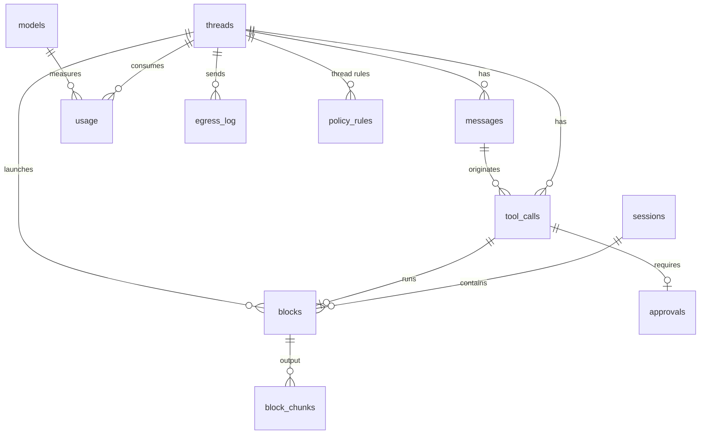

# Umbral — Data Model Specification

## Metadata

| Field | Value |
|---|---|
| **Author** | Ernesto Crespo · assisted draft |
| **Status** | `DRAFT` |
| **Version** | 1.28 |
| **Date** | 2026-10-31 |
| **Database** | SQLite 3 (`modernc.org/sqlite`), WAL, FTS5 |
| **Location** | `$XDG_DATA_HOME/umbral/umbral.db` (native disk; never on FUSE/network mounts) |
| **Related Tech Design** | `specs/technical/umbral-architecture.md` |

---

## 1. Model Overview

There are two subdomains:

- **terminal**: sessions, blocks and their output;
- **agent**: threads, messages, tool calls, approvals and rules.

The model catalog, usage, egress audit and MCP servers cut across both.

The hot access patterns are:

1. writing block output while streaming;
2. reading the last block of a session;
3. full-text search over blocks;
4. reading a thread's history;
5. listing pending approvals.

Conventions (Constitution Art. 6):

- `*_at` = `INTEGER` UTC epoch ms;
- costs = `INTEGER` micro-USD;
- IDs = `TEXT` prefixed ULID, except the workspace tree, whose structural identifiers are `w<n>`, `w<n>:t<m>` and `w<n>:p<m>` (Art. 6 amendment of 2026-09-20);
- JSON in `*_json` columns (validated in the `store` layer).

### Relationship Diagram



## 2. Tables

### 2.1 `sessions`

**Purpose:** PTY sessions. **Volume:** tens alive, thousands historical.

```sql
CREATE TABLE sessions (
  id           TEXT PRIMARY KEY CHECK (id LIKE 'ses\_%' ESCAPE '\'),
  shell        TEXT NOT NULL,
  cwd          TEXT NOT NULL,
  cols         INTEGER NOT NULL CHECK (cols BETWEEN 20 AND 1000),
  rows         INTEGER NOT NULL CHECK (rows BETWEEN 5 AND 500),
  state        TEXT NOT NULL CHECK (state IN ('alive','exited')),
  integration  TEXT NOT NULL DEFAULT 'pending' CHECK (integration IN ('pending','osc133','none')),
  input_owner  TEXT NOT NULL DEFAULT 'human' CHECK (input_owner IN ('human','agent')),
  owner_thread_id TEXT REFERENCES threads(id),       -- not null when the session is a thread's PTY
  exit_code    INTEGER,
  created_at   INTEGER NOT NULL,
  exited_at    INTEGER
);
CREATE INDEX idx_sessions_state ON sessions(state) WHERE state = 'alive';
```

### 2.2 `blocks`

**Purpose:** one command with its output. **Volume:** ~500/day/user; performance target
with 100,000 rows (REQ-BLK-006).

```sql
CREATE TABLE blocks (
  id               TEXT PRIMARY KEY CHECK (id LIKE 'blk\_%' ESCAPE '\'),
  session_id       TEXT NOT NULL REFERENCES sessions(id),
  origin           TEXT NOT NULL CHECK (origin IN ('user','agent')),
  thread_id        TEXT REFERENCES threads(id),
  command          TEXT NOT NULL DEFAULT '',
  cwd              TEXT NOT NULL DEFAULT '',
  host             TEXT NOT NULL DEFAULT '',
  state            TEXT NOT NULL CHECK (state IN ('running','interactive','finished','abandoned')),
  exit_code        INTEGER,
  started_at       INTEGER NOT NULL,
  ended_at         INTEGER,
  duration_ms      INTEGER,
  output_bytes     INTEGER NOT NULL DEFAULT 0,
  output_truncated INTEGER NOT NULL DEFAULT 0 CHECK (output_truncated IN (0,1)),
  output_plain     TEXT,                    -- text without escapes, max 1 MiB (REQ-BLK-007)
  CHECK (origin = 'user' OR thread_id IS NOT NULL)
);
CREATE INDEX idx_blocks_started         ON blocks(started_at DESC, id DESC);
CREATE INDEX idx_blocks_session_started ON blocks(session_id, started_at DESC);
CREATE INDEX idx_blocks_thread_started  ON blocks(thread_id, started_at DESC) WHERE thread_id IS NOT NULL;
CREATE INDEX idx_blocks_open            ON blocks(state) WHERE state IN ('running','interactive');
```

`idx_blocks_started` exists because `block.list` with no filter is the history pane and
`umb block list`, and the other three indexes all begin with a column such a query does not
name. Without it every page is a full scan and a sort of the table: 141 ms at 100,000 blocks
against 0.18 ms with it. `id` is in the index because it is the tie-breaker the cursor pages
on, and an index covering only the first column of the ordering still sorts. It is created by
migration **0002**, not 0001; §5 says why.

Migration **0007** (F2) records how an agent block was run. A command a hosted ACP agent runs
through `terminal/create` is a block like any other agent block, with `via = 'acp'`; `origin`
keeps its `CHECK` (REQ-ACP-005). Its session is one of its own, `owner_thread_id` set, never the
thread's PTY; a user block, and every block written before 0007, is `via = 'shell'`.

```sql
-- migration 0007 (T-F2-01)
ALTER TABLE blocks ADD COLUMN via TEXT NOT NULL DEFAULT 'shell' CHECK (via IN ('shell','acp'));
```

`output_truncated` covers **both** caps: the 16 MiB raw chunk history of §2.3 and the 1 MiB
`output_plain` transcript. A client that sees it `0` is promised the whole of what the
command said, and a transcript cut at 1 MiB breaks that promise just as a cut chunk history
does. REQ-BLK-007 names `output_plain` as the agent's context, so that is the reader the flag
exists for.

### 2.3 `block_chunks`

**Purpose:** raw output (with escapes) in zstd-compressed chunks, for faithful re-rendering and
export.

Two classes of sequence are **not** stored. The shell-integration sequences the daemon
recognises, `OSC 133;A/B/C/D`, `OSC 633;E` and `OSC 7`, are the shell talking to the daemon
rather than output: they are invisible on screen, so keeping them makes no replay more
faithful and every consumer exporting a block would have to filter them. The alternate-screen
mode sequences that bracket an `interactive` stretch are dropped for a different reason:
REQ-BLK-004 already excludes what is painted between them, and an unbalanced `CSI ?1049h` or
`CSI ?1049l` would switch the terminal of whoever replays the block into or out of a screen
it never entered. Every other escape sequence is stored byte for byte.

```sql
CREATE TABLE block_chunks (
  block_id  TEXT NOT NULL REFERENCES blocks(id) ON DELETE CASCADE,
  seq       INTEGER NOT NULL,
  data_zstd BLOB NOT NULL,
  PRIMARY KEY (block_id, seq)
) WITHOUT ROWID;
```

Cap per block: 16 MiB raw. Beyond that, storage stops and `output_truncated = 1` is set; the live
stream to clients is not interrupted.

### 2.4 `blocks_fts` (FTS5, external content)

```sql
CREATE VIRTUAL TABLE blocks_fts USING fts5(
  command, output_plain,
  content='blocks', content_rowid='rowid',
  tokenize='unicode61 remove_diacritics 2'
);
-- the triggers below keep the index in sync
CREATE TRIGGER blocks_fts_ai AFTER INSERT ON blocks BEGIN
  INSERT INTO blocks_fts(rowid, command, output_plain) VALUES (new.rowid, new.command, new.output_plain);
END;
CREATE TRIGGER blocks_fts_ad AFTER DELETE ON blocks BEGIN
  INSERT INTO blocks_fts(blocks_fts, rowid, command, output_plain) VALUES ('delete', old.rowid, old.command, old.output_plain);
END;
CREATE TRIGGER blocks_fts_au AFTER UPDATE OF command, output_plain ON blocks BEGIN
  INSERT INTO blocks_fts(blocks_fts, rowid, command, output_plain) VALUES ('delete', old.rowid, old.command, old.output_plain);
  INSERT INTO blocks_fts(rowid, command, output_plain) VALUES (new.rowid, new.command, new.output_plain);
END;
```

**`VACUUM` invalidates this index.** `blocks_fts` is keyed on `blocks.rowid`, and `blocks` has
a `TEXT` primary key, so its rowids are implicit and SQLite may renumber them when the database
is rewritten. Every row of the full-text index would then describe a different block, and
`block.search` would return the wrong blocks rather than fail. THE SYSTEM SHALL rebuild the
index after any `VACUUM`:

```sql
INSERT INTO blocks_fts(blocks_fts) VALUES('rebuild');
```

The retention job of T-F1-22 is the first thing that will want to reclaim space, and is where
this has to be enforced.

### 2.4b `workspaces`, `tabs`, `panes` (migration 0003)

**Purpose:** the structure the daemon owns and restores (REQ-WS-001, REQ-TERM-009). A pane hosts at
most one live session; `pane_aliases` keeps previous identifiers resolvable after a move
(REQ-WS-007).

```sql
CREATE TABLE workspaces (
  id          TEXT PRIMARY KEY CHECK (id GLOB 'w[0-9]*' AND id NOT GLOB '*[^w0-9]*'),
  label       TEXT NOT NULL,
  cwd         TEXT NOT NULL,
  order_index INTEGER NOT NULL DEFAULT 0,
  -- Which tab is focused inside this workspace, and when the workspace itself was last
  -- focused. The focused workspace is the one with the greatest focused_at. Added by
  -- migration 0004; before it, focus lived only in memory and did not survive a restart.
  focused_tab_id TEXT REFERENCES tabs(id) ON DELETE SET NULL,
  focused_at  INTEGER,
  created_at  INTEGER NOT NULL,
  closed_at   INTEGER
);

CREATE TABLE tabs (
  id           TEXT PRIMARY KEY CHECK (id GLOB 'w[0-9]*:t[0-9]*'),
  workspace_id TEXT NOT NULL REFERENCES workspaces(id) ON DELETE CASCADE,
  label        TEXT NOT NULL,
  order_index  INTEGER NOT NULL DEFAULT 0,
  layout_json  TEXT NOT NULL DEFAULT '{}',   -- portable tree (API Layout)
  created_at   INTEGER NOT NULL,
  closed_at    INTEGER
);
CREATE INDEX idx_tabs_workspace ON tabs(workspace_id, order_index);

CREATE TABLE panes (
  id          TEXT PRIMARY KEY CHECK (id GLOB 'w[0-9]*:p[0-9]*'),
  tab_id      TEXT NOT NULL REFERENCES tabs(id) ON DELETE CASCADE,
  session_id  TEXT REFERENCES sessions(id),   -- NULL while the pane has no live session
  label       TEXT,
  cwd         TEXT NOT NULL,
  command_json TEXT,                          -- argv the pane runs instead of a shell
  -- 1 while that command has not been run by Umbral. Set by `layout.apply` and by restore,
  -- never by `pane.split`: a restart and an applied layout replay an intention from another
  -- time, and REQ-TERM-011 forbids acting on one unasked. Added by migration 0004.
  command_pending INTEGER NOT NULL DEFAULT 0 CHECK (command_pending IN (0,1)),
  env_json    TEXT NOT NULL DEFAULT '{}',
  order_index INTEGER NOT NULL DEFAULT 0,
  created_at  INTEGER NOT NULL,
  closed_at   INTEGER
);
CREATE INDEX idx_panes_tab ON panes(tab_id, order_index);
CREATE UNIQUE INDEX idx_panes_session ON panes(session_id) WHERE session_id IS NOT NULL;

CREATE TABLE pane_aliases (
  alias_id   TEXT PRIMARY KEY CHECK (alias_id GLOB 'w[0-9]*:p[0-9]*'),
  pane_id    TEXT NOT NULL REFERENCES panes(id) ON DELETE CASCADE,
  created_at INTEGER NOT NULL
);
```

### 2.4c `pane_state_reports` and `pane_metadata` (migration 0005)

**Purpose:** external state authority and display metadata, kept apart on purpose (REQ-INT-002 to
REQ-INT-005). Semantic state drives waits, rollups and notifications; metadata never does.

```sql
CREATE TABLE pane_state_reports (
  pane_id    TEXT NOT NULL REFERENCES panes(id) ON DELETE CASCADE,
  source     TEXT NOT NULL,
  agent      TEXT,
  state      TEXT NOT NULL CHECK (state IN ('idle','working','blocked','done')),
  message    TEXT,
  seq        INTEGER NOT NULL DEFAULT 0,
  updated_at INTEGER NOT NULL,
  PRIMARY KEY (pane_id, source)
);

CREATE TABLE pane_metadata (
  pane_id    TEXT NOT NULL REFERENCES panes(id) ON DELETE CASCADE,
  source     TEXT NOT NULL,
  key        TEXT NOT NULL CHECK (length(key) BETWEEN 1 AND 32),
  value      TEXT NOT NULL CHECK (length(value) <= 80),
  expires_at INTEGER,
  updated_at INTEGER NOT NULL,
  PRIMARY KEY (pane_id, source, key)
);
CREATE INDEX idx_pane_metadata_expiry ON pane_metadata(expires_at) WHERE expires_at IS NOT NULL;
```

At most 32 live keys per pane; the `store` layer rejects the excess. Metadata is not restored after
a restart (REQ-INT-004).

How `pane_state_reports` is written (delta `2026-10-integration-surface`, T-F1-25):

- **`seq`** is the last number the source sent for the pane. `-1` means the source has sent none
  yet: an unnumbered report stores it, a later unnumbered one keeps whatever is stored, and the
  first numbered one applies even at `0`. A source never sends a negative `seq`, so `-1` is
  unambiguous; the column has no `CHECK`, and no migration was needed.
- **`updated_at`** is strictly increasing per pane: a write gets the current time, or one past the
  pane's newest report when that is not later. The latest report is therefore never a tie.
- **A move renames the rows.** `pane.move` changes `panes.id`; the reports and metadata are updated
  to the new id in the same transaction, with the foreign-key check deferred to the commit
  (`PRAGMA defer_foreign_keys`). Before T-F1-25 a move of a pane with a report failed.
- **A closed pane's rows stay** until restart step 8 (§6) clears them, and are never read again.

How `pane_metadata` is written (delta `2026-10-display-metadata`, T-F1-26):

- **Keys.** `title`, `display_name`, `label:<state>` for each of the five attention states, and
  `token:<name>` with a name of 1–26 characters of `[A-Za-z0-9._-]`, so every key fits the 32 of
  the `CHECK`. The tree reads the live rows back into API §4's `metadata`; when two sources set
  one member, the later write wins.
- **`#seq`.** A reserved row per pane and source holds the last metadata `seq`, counted apart
  from `pane_state_reports.seq`, with `-1` for unnumbered. It is never displayed, counts toward
  no limit, has no `expires_at`, and moves and is cleared with the pane's other rows. It needed
  no migration.
- **`updated_at`** is strictly increasing per pane, as for `pane_state_reports`.
- **Expiry.** Every displayed row has an `expires_at`: the report's `ttl_ms`, or 24 h after the
  write when the report gives none (§4's cap). An expired row is never read, whether or not it
  has been deleted yet; each write deletes the pane's expired rows, and nothing announces an
  expiry.
- **The 32** counts the pane's live rows across every source after the report, a key two sources
  both set counting twice, `#seq` rows excluded. A report that would exceed it, or that carries
  more than 16 tokens, writes nothing.

### 2.4d `pane_history` (migration 0004, optional content)

**Purpose:** recent screen replay after a restart, disabled by default because pane output can
contain secrets (REQ-TERM-010).

```sql
CREATE TABLE pane_history (
  pane_id    TEXT PRIMARY KEY REFERENCES panes(id) ON DELETE CASCADE,
  screen_zst BLOB NOT NULL,        -- last N rows, zstd
  rows       INTEGER NOT NULL,
  captured_at INTEGER NOT NULL
);
```

Rows are written only while `[experimental] pane_history = true`. Turning the setting off deletes
the table's contents at the next start.

### 2.4e `rule_bundles` and `trust_keys` (migration 0005), and the update state (migration 0006)

**Purpose:** provenance of the redaction rules and destructive patterns, and the trust store used to
verify them (REQ-SEC-011 to REQ-SEC-016). Private keys never live here: the store holds public keys
only.

```sql
CREATE TABLE trust_keys (
  id          TEXT PRIMARY KEY,
  public_key  BLOB NOT NULL,                 -- Ed25519, 32 bytes
  fingerprint TEXT NOT NULL UNIQUE,          -- SHA-256 shown on add and rotate
  added_at    INTEGER NOT NULL,
  revoked_at  INTEGER
);

CREATE TABLE rule_bundles (
  version      INTEGER PRIMARY KEY,          -- strictly increasing; a downgrade is rejected
  sha256       TEXT NOT NULL,
  source       TEXT NOT NULL CHECK (source IN ('builtin','remote','local')),
  verified_with TEXT REFERENCES trust_keys(id),
  installed_at INTEGER NOT NULL,
  active       INTEGER NOT NULL DEFAULT 0 CHECK (active IN (0,1))
);
CREATE UNIQUE INDEX idx_rule_bundles_active ON rule_bundles(active) WHERE active = 1;
```

Umbral keeps the active bundle and the previous one so `rules.rollback` works offline; older ones
are pruned.

The trust store and the bundle history change in these ways (delta `2026-09-rule-signing-custody`):

- **Seeding:** `trust_keys` is seeded from the binary and matched by `fingerprint`. On start,
  each key the build embeds and the table lacks is inserted with the id the seed fixes (`key_` +
  ULID). Each key the build lists as revoked gets `revoked_at` if it has none. Keys the build
  lists as retired are never inserted.
- **Removal:** `rules.key.remove` sets `revoked_at` instead of deleting the row, so a seed key
  the user removed is not brought back. A "valid" key is one with no `revoked_at`.
- **Adding:**
  - `rules.key.add` of a fingerprint on the seed's `revoked` list is refused.
  - Otherwise, adding a revoked fingerprint clears `revoked_at`, and adding a valid one changes
    no row.
  - Both are recorded with their timestamp, and both reopen updates that were failed closed.
- **Revocation:**
  - Revoking a key deletes the `rule_bundles` rows it verified.
  - The active row stays active if it survives. Otherwise the newest remaining `remote` row, or
    `builtin`, becomes active. A `local` row is never chosen.
  - The next newest remaining `remote` row is the previous bundle.
  - The floor a new bundle must exceed is the higher of the active row's `version` and
    `rule_update_state.highest_version` (migration 0006), so a `rules.reset` does not reopen older
    signed bundles. A revocation lowers `highest_version` to the highest surviving row's.

Migration `0006_rule_state` adds what T-F1-30 needs to apply, reject and roll back bundles offline
(delta `2026-10-signed-rule-bundles`). 0005 is applied and forward-only, so the bundle's bytes
arrive by `ALTER TABLE`:

```sql
ALTER TABLE rule_bundles ADD COLUMN content BLOB;  -- the bundle's exact bytes; NULL only for builtin

CREATE TABLE rule_rejections (
  sha256  TEXT PRIMARY KEY CHECK (length(sha256) = 64),
  reason  TEXT NOT NULL CHECK (reason IN ('unsigned','unknown_key','invalid_signature','invalid_bundle','downgrade','rolled_back','reset')),
  version INTEGER,
  at      INTEGER NOT NULL
);

CREATE TABLE rule_update_state (
  id                    INTEGER PRIMARY KEY CHECK (id = 1),
  consecutive_failures  INTEGER NOT NULL DEFAULT 0 CHECK (consecutive_failures >= 0),
  fail_closed           INTEGER NOT NULL DEFAULT 0 CHECK (fail_closed IN (0,1)),
  ever_had_valid_key    INTEGER NOT NULL DEFAULT 0 CHECK (ever_had_valid_key IN (0,1)),
  highest_version       INTEGER NOT NULL DEFAULT 0 CHECK (highest_version >= 0),
  last_rejection_reason TEXT,
  last_rejection_at     INTEGER
);
INSERT INTO rule_update_state (id) VALUES (1);

CREATE TABLE trust_key_events (
  id          INTEGER PRIMARY KEY,
  key_id      TEXT NOT NULL,
  fingerprint TEXT NOT NULL,
  action      TEXT NOT NULL CHECK (action IN ('seeded','seed_revoked','added','readded','unchanged','revoked')),
  at          INTEGER NOT NULL
);
CREATE INDEX idx_trust_key_events_at ON trust_key_events(at);
```

- **`content`** is required for every `remote` row; a stored bundle is checked against its
  `sha256` at start and a mismatch falls back to the built-in rules. The `builtin` row's `sha256`
  is the digest of the built-in rules' canonical JSON, rewritten when they change.
- **`rule_rejections`** holds a bundle never to retry: one rejected under REQ-SEC-013's reasons,
  one `rules.rollback` left (`rolled_back`) or one `rules.reset` left (`reset`). `version` is the bundle's own only when its signature verified, and NULL otherwise: unverified bytes are never parsed. A rollback onto a
  digest clears its row; revoking a key deletes the `downgrade` rows so a bundle refused only for
  its version may be offered again.
- **`rule_update_state`** counts consecutive rejections; the third sets `fail_closed`, a bundle
  applied resets the count, and only a `rules.key.add` clears the latch (REQ-SEC-015). The trust
  store ending up without a valid key sets it too, but only once `ever_had_valid_key` is 1, so a
  fresh install with no key takes the first key a seed brings. `highest_version` is the highest
  version ever applied; only a revocation lowers it.
- **`trust_key_events`** records every trust-store change with its timestamp (REQ-SEC-014): a
  seeded key, a seed revocation, an add, a re-add of a revoked key, an add of a key already valid
  (`unchanged`) and a revocation. A rotation is `added` then `revoked`.
- **Built-in rules:** the `builtin` row has version 0 and is rewritten when a binary carries
  different rules. Remote versions start at 1. A `remote` bundle without `verified_with` cannot exist: the DDL allows it, and the
`store` layer rejects it.

### 2.4f `skills` (migration 0005)

**Purpose:** the skills installed for Umbral's agent (REQ-SKL-001 to REQ-SKL-007, delta
`2026-09-skills-cli`). The bundle itself lives in `$XDG_DATA_HOME/umbral/skills/<name>/`; this row
is its record. The shape is `mcp_servers`': a prefixed ULID `id` and a unique `name` that the API
and `umb` address it by, so Art. 6 holds without an amendment.

```sql
CREATE TABLE skills (
  id           TEXT PRIMARY KEY CHECK (id LIKE 'skl\_%' ESCAPE '\'),
  name         TEXT NOT NULL UNIQUE CHECK (length(name) BETWEEN 1 AND 64 AND name GLOB '[a-z0-9]*' AND name NOT GLOB '*[^a-z0-9-]*'),
  description  TEXT NOT NULL CHECK (length(description) BETWEEN 1 AND 1024),
  version      TEXT CHECK (version IS NULL OR length(version) <= 64),
  source       TEXT NOT NULL,              -- the path it was installed from, display only
  sha256       TEXT NOT NULL,
  size_bytes   INTEGER NOT NULL CHECK (size_bytes BETWEEN 1 AND 8388608),
  enabled      INTEGER NOT NULL DEFAULT 1 CHECK (enabled IN (0,1)),
  installed_at INTEGER NOT NULL
);
```

At most 64 rows have `enabled = 1`; the `context` layer enforces it, since a count cannot be a
`CHECK`. A row and its directory are written through a staging directory and a rename, and §6
step 9 removes whatever a crash leaves between them.

### 2.4g `worktrees` (migration 0007)

**Purpose:** a thread's isolated copy of a repository (PRD F2 REQ-WT-001…008). **Volume:** a
few per thread, one active at a time.

```sql
CREATE TABLE worktrees (
  id            TEXT PRIMARY KEY CHECK (id LIKE 'wtr\_%' ESCAPE '\'),
  thread_id     TEXT NOT NULL REFERENCES threads(id),
  repo_root     TEXT NOT NULL,              -- the main working copy's top level
  repo_id       TEXT NOT NULL,              -- 16 hex of SHA-256 of the realpath of the common git dir
  base_commit   TEXT NOT NULL,              -- the commit the worktree was created from
  origin_branch TEXT NOT NULL,              -- the branch a merge squashes into (REQ-WT-004)
  branch        TEXT NOT NULL,              -- umbral/<thread_id>
  path          TEXT NOT NULL,              -- $XDG_DATA_HOME/umbral/worktrees/<repo_id>/<thread_id>
  state         TEXT NOT NULL DEFAULT 'active' CHECK (state IN ('active','merged','discarded','missing')),
  created_at    INTEGER NOT NULL,
  updated_at    INTEGER NOT NULL
);
CREATE INDEX idx_worktrees_thread ON worktrees(thread_id);
CREATE UNIQUE INDEX idx_worktrees_active_thread ON worktrees(thread_id) WHERE state = 'active';
CREATE UNIQUE INDEX idx_worktrees_active_path ON worktrees(path) WHERE state = 'active';
```

The prefix is `wtr_`, because `wt_` is already a wait's. `thread_id` has no cascade, on
purpose: a worktree's branch and files are the user's unmerged work. A thread that has any
worktree row, whatever its state, cannot be deleted. A row is kept as history after a merge or
discard, so this holds even then. The retention job's purge of ephemeral threads skips such a
thread (§4). An ephemeral `ask` thread never has a worktree.

### 2.5 `threads`

```sql
CREATE TABLE threads (
  id             TEXT PRIMARY KEY CHECK (id LIKE 'thr\_%' ESCAPE '\'),
  title          TEXT NOT NULL DEFAULT '',
  mode           TEXT NOT NULL DEFAULT 'normal' CHECK (mode IN ('ask','normal','auto-edit')),
  model          TEXT,                          -- pinned 'provider/model'; NULL = use class
  model_class    TEXT NOT NULL DEFAULT 'code' CHECK (model_class IN ('fast','code','plan')),
  cwd            TEXT NOT NULL,
  state          TEXT NOT NULL DEFAULT 'idle' CHECK (state IN ('idle','running','awaiting_approval','stopped')),
  ephemeral      INTEGER NOT NULL DEFAULT 0 CHECK (ephemeral IN (0,1)),
  max_steps      INTEGER NOT NULL DEFAULT 50 CHECK (max_steps BETWEEN 1 AND 200),
  budget_tokens  INTEGER NOT NULL DEFAULT 400000,
  tokens_used    INTEGER NOT NULL DEFAULT 0,
  cost_micro_usd INTEGER NOT NULL DEFAULT 0,
  created_at     INTEGER NOT NULL,
  updated_at     INTEGER NOT NULL
);
CREATE INDEX idx_threads_updated ON threads(updated_at DESC) WHERE ephemeral = 0;
```

The attention columns of REQ-AGT-016 and REQ-NTF-002 arrive in migration **0005**, not in the
block above. Migration 0001 created `threads` and is applied, and Art. 6 makes migrations
forward-only: a column added to an applied file exists on no database that already ran it.
`attention_state` takes a default rather than being `NOT NULL` without one, because
`ALTER TABLE … ADD COLUMN` has to be able to fill the rows already there. Its values are enforced
by the writer and stated here. SQLite does accept a `CHECK` in `ADD COLUMN`, and since 3.37 it
tests the `CHECK` against the existing rows; migration 0007's columns carry theirs.

```sql
-- migration 0005, alongside the agent tables (T-F1-01)
ALTER TABLE threads ADD COLUMN attention_state TEXT NOT NULL DEFAULT 'idle';  -- REQ-AGT-016
                             -- one of 'idle','working','blocked','done','unknown'
ALTER TABLE threads ADD COLUMN seen_at INTEGER;  -- when a client last focused it, or a turn
                             -- ended while one viewed it; NULL = never
```

Migration **0007** (F2, T-F2-01) adds the orchestration columns. A thread's mode is `full-auto`
while `full_auto = 1` and its worktree is `active`. Clearing the flag leaves `mode` as it was
(REQ-ORC-004). `full-auto` is a separate flag because `mode`'s `CHECK` cannot be widened without
rebuilding a table eleven others point at. A thread with `queued = 1` has a turn accepted over
`[agents] max_concurrent_turns` and waiting for a slot (REQ-ORC-002).

```sql
-- migration 0007 (T-F2-01)
ALTER TABLE threads ADD COLUMN full_auto INTEGER NOT NULL DEFAULT 0 CHECK (full_auto IN (0,1));
ALTER TABLE threads ADD COLUMN queued INTEGER NOT NULL DEFAULT 0 CHECK (queued IN (0,1));
ALTER TABLE threads ADD COLUMN worktree_id TEXT REFERENCES worktrees(id) ON DELETE SET NULL;
ALTER TABLE threads ADD COLUMN workspace_id TEXT REFERENCES workspaces(id) ON DELETE SET NULL;  -- REQ-ORC-003
ALTER TABLE threads ADD COLUMN agent TEXT;  -- an [[acp.agents]] name; NULL = Umbral's own agent
ALTER TABLE threads ADD COLUMN egress_visibility TEXT NOT NULL DEFAULT 'observed'
  CHECK (egress_visibility IN ('observed','unobserved'));  -- REQ-ACP-007
```

Migration **0008** (F2, T-F2-05, delta `2026-10-full-auto`) makes `full_auto` follow the
worktree. Whatever moves a worktree out of `active` — a merge, a discard, a `close_group`, the
missing check at start or at a turn — clears the flag of its threads in the same write, and so
does a thread losing its worktree; `mode` is left as it was. Setting the flag is the thread
store's guarded `UPDATE`, which requires the thread's worktree row to be `active` in that write.

```sql
-- migration 0008 (T-F2-05)
CREATE TRIGGER worktrees_leave_full_auto AFTER UPDATE OF state ON worktrees
  WHEN OLD.state = 'active' AND NEW.state <> 'active'
BEGIN
  UPDATE threads SET full_auto = 0 WHERE worktree_id = NEW.id AND full_auto = 1;
END;

CREATE TRIGGER threads_full_auto_needs_worktree AFTER UPDATE OF worktree_id ON threads
  WHEN NEW.full_auto = 1 AND NOT EXISTS (
    SELECT 1 FROM worktrees WHERE id = NEW.worktree_id AND state = 'active')
BEGIN
  UPDATE threads SET full_auto = 0 WHERE id = NEW.id;
END;
```

### 2.6 `messages`

```sql
CREATE TABLE messages (
  id               TEXT PRIMARY KEY CHECK (id LIKE 'msg\_%' ESCAPE '\'),
  thread_id        TEXT NOT NULL REFERENCES threads(id) ON DELETE CASCADE,
  turn_id          TEXT NOT NULL,
  role             TEXT NOT NULL CHECK (role IN ('user','assistant','tool','system_note')),
  content          TEXT NOT NULL,
  client_msg_id    TEXT,                          -- ULID from the client; idempotency (REQ-AGT-015)
  attachments_json TEXT NOT NULL DEFAULT '[]',   -- [{kind, ref, bytes, truncated_bytes}]
  tainted          INTEGER NOT NULL DEFAULT 0 CHECK (tainted IN (0,1)),  -- REQ-SEC-006
  created_at       INTEGER NOT NULL
);
CREATE INDEX idx_messages_thread_created ON messages(thread_id, created_at);
-- Partial, so the many rows without a client id do not collide with each other (A-04).
CREATE UNIQUE INDEX idx_messages_client_msg ON messages(thread_id, client_msg_id)
  WHERE client_msg_id IS NOT NULL;
```

### 2.7 `tool_calls`

```sql
CREATE TABLE tool_calls (
  id             TEXT PRIMARY KEY CHECK (id LIKE 'tc\_%' ESCAPE '\'),
  thread_id      TEXT NOT NULL REFERENCES threads(id) ON DELETE CASCADE,
  message_id     TEXT NOT NULL REFERENCES messages(id),
  tool           TEXT NOT NULL,
  risk           TEXT NOT NULL CHECK (risk IN ('ReadOnly','WriteFS','Exec','Network')),
  args_json      TEXT NOT NULL,
  status         TEXT NOT NULL CHECK (status IN ('pending','ok','error','denied_by_user','denied_by_policy','invalid_args')),
  result_summary TEXT,
  result_json    TEXT,                        -- {"text", "tainted"}: what the model reads back (T-F1-13)
  block_id       TEXT REFERENCES blocks(id),
  started_at     INTEGER NOT NULL,
  ended_at       INTEGER
);
CREATE INDEX idx_tool_calls_thread ON tool_calls(thread_id, started_at);
```

Migration **0007** records who ran a call and how it was decided (REQ-ACP-007).
- An ACP row has `via = 'acp'`. Its `message_id` is the turn's assistant message, the one being
  streamed when the agent's report or request arrives, so the column stays `NOT NULL`.
- `decision` is `unmediated` for a call the agent ran without asking. It is NULL only on rows
  written before 0007.
- Umbral writes a row of its own for each `fs/*` and `terminal/create` request it decides, so
  that request's approval has a tool call to point at (REQ-ACP-004).

```sql
-- migration 0007 (T-F2-01)
ALTER TABLE tool_calls ADD COLUMN via TEXT NOT NULL DEFAULT 'umbral' CHECK (via IN ('umbral','acp'));
ALTER TABLE tool_calls ADD COLUMN decision TEXT CHECK (decision IN ('allow','deny','ask','unmediated'));
```

### 2.8 `approvals`

```sql
CREATE TABLE approvals (
  id             TEXT PRIMARY KEY CHECK (id LIKE 'apr\_%' ESCAPE '\'),
  thread_id      TEXT NOT NULL REFERENCES threads(id) ON DELETE CASCADE,
  tool_call_id   TEXT NOT NULL UNIQUE REFERENCES tool_calls(id),
  tool           TEXT NOT NULL,
  risk           TEXT NOT NULL,
  reason         TEXT NOT NULL CHECK (reason IN ('policy','destructive','tainted','outside_write_root')),
  summary        TEXT NOT NULL,
  diff           TEXT,                        -- REQ-AGT-012
  state          TEXT NOT NULL DEFAULT 'pending' CHECK (state IN ('pending','approved','denied','expired')),
  decision_scope TEXT CHECK (decision_scope IN ('once','thread','always')),
  created_at     INTEGER NOT NULL,
  decided_at     INTEGER
);
CREATE INDEX idx_approvals_pending ON approvals(created_at) WHERE state = 'pending';
```

### 2.9 `policy_rules`

**Purpose:** decisions persisted with `scope = thread | always`, plus the configuration rules loaded at
startup.

```sql
CREATE TABLE policy_rules (
  id         INTEGER PRIMARY KEY,
  thread_id  TEXT REFERENCES threads(id) ON DELETE CASCADE,   -- NULL = global ('always')
  tool       TEXT NOT NULL,                  -- 'run_command', 'edit_file', 'mcp_gitlab_*'
  pattern    TEXT NOT NULL DEFAULT '*',      -- glob over command or path
  decision   TEXT NOT NULL CHECK (decision IN ('allow','deny')),
  source     TEXT NOT NULL CHECK (source IN ('user_decision','config')),
  created_at INTEGER NOT NULL
);
CREATE INDEX idx_policy_rules_lookup ON policy_rules(tool, thread_id);
```

### 2.10 `models`

```sql
CREATE TABLE models (
  id                           TEXT PRIMARY KEY,   -- 'ollama/gpt-oss:20b'
  provider                     TEXT NOT NULL,
  local                        INTEGER NOT NULL CHECK (local IN (0,1)),
  caps_json                    TEXT NOT NULL,      -- {tools, vision, reasoning, json_schema}
  context_window               INTEGER NOT NULL,
  price_in_micro_usd_per_mtok  INTEGER NOT NULL DEFAULT 0,
  price_out_micro_usd_per_mtok INTEGER NOT NULL DEFAULT 0,
  health                       TEXT NOT NULL DEFAULT 'unknown' CHECK (health IN ('ok','degraded','down','unknown')),
  updated_at                   INTEGER NOT NULL
);
```

### 2.11 `usage`

```sql
CREATE TABLE usage (
  id             INTEGER PRIMARY KEY,
  thread_id      TEXT REFERENCES threads(id) ON DELETE SET NULL,
  turn_id        TEXT,
  model_id       TEXT NOT NULL,
  provider       TEXT NOT NULL,
  status         TEXT NOT NULL CHECK (status IN ('ok','error','timeout','rate_limited','invalid_tool_call')),
  in_tokens      INTEGER NOT NULL DEFAULT 0,
  out_tokens     INTEGER NOT NULL DEFAULT 0,
  first_token_ms INTEGER,
  cost_micro_usd INTEGER NOT NULL DEFAULT 0,
  error          TEXT,
  created_at     INTEGER NOT NULL
);
CREATE INDEX idx_usage_model_created ON usage(model_id, created_at);
CREATE INDEX idx_usage_thread        ON usage(thread_id);
```

### 2.12 `egress_log`

```sql
CREATE TABLE egress_log (
  id             INTEGER PRIMARY KEY,
  thread_id      TEXT,
  provider       TEXT NOT NULL,
  host           TEXT NOT NULL,
  bytes          INTEGER NOT NULL,
  payload_sha256 TEXT NOT NULL CHECK (length(payload_sha256) = 64),
  created_at     INTEGER NOT NULL
);
CREATE INDEX idx_egress_created ON egress_log(created_at DESC);
```

Insert-only table: no `UPDATE` or `DELETE` except for retention. `provider` is the provider id
of a model call, or the tool `fetch_url` for its requests (Art. 4; delta
`2026-09-builtin-tools`), whose payload is the request URL, or `mcp:<name>` for a request to an
MCP server off this machine, whose payload is the request body, or its URL when it has none
(delta `2026-10-mcp-client`), or `umbral-rules` for a rule-update request — the configured URL,
its `.sig` and every redirect hop — whose payload is the request URL (delta
`2026-10-rule-overrides`). A bundle rejected under REQ-SEC-013 writes one more row, `provider =
'umbral-rules:rejected:<reason>'` with the URL's host, the bundle's size as `bytes` and its
digest as `payload_sha256`, in the same transaction as its `rule_rejections` row (delta
`2026-10-signed-rule-bundles`).

### 2.13 `mcp_servers`

```sql
CREATE TABLE mcp_servers (
  id            TEXT PRIMARY KEY CHECK (id LIKE 'mcp\_%' ESCAPE '\'),
  name          TEXT NOT NULL UNIQUE CHECK (name GLOB '[a-z0-9_-]*'),  -- the application takes [a-z0-9]{1,32}
  transport     TEXT NOT NULL CHECK (transport IN ('stdio','http')),
  command       TEXT,
  args_json     TEXT NOT NULL DEFAULT '[]',
  url           TEXT,
  env_refs_json TEXT NOT NULL DEFAULT '{}',   -- {"TOKEN":"keyring:umbral/gitlab"}
  trust         TEXT NOT NULL DEFAULT 'untrusted' CHECK (trust IN ('trusted','untrusted')),
  state         TEXT NOT NULL DEFAULT 'connecting' CHECK (state IN ('connecting','connected','unavailable','disabled')),
  last_error    TEXT,
  created_at    INTEGER NOT NULL,
  updated_at    INTEGER NOT NULL,
  CHECK ((transport = 'stdio' AND command IS NOT NULL) OR (transport = 'http' AND url IS NOT NULL))
);
```

### 2.14 `remotes` (migration 0009)

The remote hosts the user added (REQ-RMT-001, delta `2026-10-remote-hosts`). A host is its name
and URL only: its link state lives in the daemon's memory, and the remote daemon's token is asked
for over ssh at each connection and never stored. The name prefixes every id the host's daemon
hands out through this one (`nas/w1:p2`, API §5.44), so it holds no `/`.

```sql
CREATE TABLE remotes (
  name       TEXT PRIMARY KEY CHECK (
               length(name) BETWEEN 1 AND 32
               AND substr(name, 1, 1) BETWEEN 'a' AND 'z'
               AND name NOT GLOB '*[^a-z0-9-]*'),
  url        TEXT NOT NULL CHECK (url LIKE 'ssh://_%'),
  created_at INTEGER NOT NULL
);
```

### 2.15 `plugins` (migration 0010)

The plugins the user installed by digest (REQ-PLG-001, delta `2026-10-plugins`). The bundle is
copied to `plugins/<name>/` beside the database; this row is its record, and `manifest_json` the
parsed manifest, so a list reads no file. The MCP servers and skills a plugin adds are ordinary
`mcp_servers` and `skills` rows, named by its manifest and removed with it while they are still
its own. `state` is `installing` from the insert until the last of them is in; only `installed`
rows are listed.

```sql
CREATE TABLE plugins (
  id            TEXT PRIMARY KEY CHECK (id LIKE 'plg\_%' ESCAPE '\'),
  name          TEXT NOT NULL UNIQUE CHECK (
                  length(name) BETWEEN 1 AND 32 AND name NOT GLOB '*[^a-z0-9]*'),
  version       TEXT NOT NULL CHECK (length(version) BETWEEN 1 AND 64),
  description   TEXT NOT NULL CHECK (length(description) BETWEEN 1 AND 1024),
  source        TEXT NOT NULL,              -- the path it was installed from, display only
  sha256        TEXT NOT NULL CHECK (length(sha256) = 64),
  size_bytes    INTEGER NOT NULL CHECK (size_bytes BETWEEN 1 AND 8388608),
  manifest_json TEXT NOT NULL CHECK (json_valid(manifest_json)),
  installed_at  INTEGER NOT NULL,
  -- 'installing' from the row until its last server and skill are in; a row still so at start
  -- is an install a crash stopped, which recovery undoes (Data Model §6 step 10).
  state         TEXT NOT NULL DEFAULT 'installing' CHECK (state IN ('installing', 'installed'))
);
```

## 3. Indexes ↔ queries

| Query (API / Tech Design) | Index |
|---|---|
| `block.get {block_id:"last", session_id}` and `block.list {session_id}` | `idx_blocks_session_started` |
| `block.list {thread_id}` | `idx_blocks_thread_started` |
| Startup: mark open blocks as `abandoned` | `idx_blocks_open` |
| `block.search` | `blocks_fts` |
| Startup: mark `alive` sessions as `exited` | `idx_sessions_state` |
| `block.list {}` with no filter, the history pane | `idx_blocks_started` |
| `thread.get {include_messages}` | `idx_messages_thread_created` |
| `thread.send` idempotency lookup, REQ-AGT-015 | `idx_messages_client_msg` |
| `thread.list` | `idx_threads_updated` |
| `approval.list` (pending) | `idx_approvals_pending` |
| `security.Decide` (rules per tool) | `idx_policy_rules_lookup` |
| Restore structure on startup (REQ-TERM-009) | `idx_tabs_workspace`, `idx_panes_tab` |
| Resolve a moved pane id (REQ-WS-007) | `pane_aliases` primary key |
| Expire display metadata (REQ-INT-004) | `idx_pane_metadata_expiry` |
| Pane ↔ live session (REQ-WS-003) | `idx_panes_session` |
| Metrics per model, REQ-LLM-005 | `idx_usage_model_created` |
| Egress audit | `idx_egress_created` |

## 4. Retention and size

| Data | Default retention | Configurable |
|---|---|---|
| `block_chunks` | 30 days after the block closed | `retention.raw_output_days` |
| `blocks.output_plain` | 180 days after the block closed | `retention.plain_output_days` |
| Non-ephemeral threads | indefinite | manual deletion |
| Ephemeral threads (`umb ai`) | 24 h | — |
| `pane_history` | until the pane closes; cleared when the setting is disabled | `[experimental] pane_history` |
| `pane_metadata` | per-key TTL, at most 24 h | per report |
| Closed workspaces, tabs and panes | 30 days | `retention.closed_structure_days` |
| `pane_aliases` | deleted with their pane (cascade); an alias never outlives its terminal | no |
| `egress_log`, `usage` | 365 days | `retention.audit_days` |

A daily maintenance job applies retention and runs `PRAGMA optimize` and
`INSERT INTO blocks_fts(blocks_fts) VALUES('optimize')` (`store.ApplyRetention`, T-F1-22, delta
`2026-10-retention`):

- **When.** Once when the daemon starts, beside it rather than before it serves, then every 24 h.
  A failed run is logged and the next one tries again; a stopping daemon cancels it.
- **Batches.** At most 500 rows per transaction — raw chunks counted as rows — so a turn
  persisting meanwhile never waits long. The FTS optimize and the age scans over `blocks` are
  bounded by the history's size, not by what is purged.
- **Blocks.** Only `finished` and `abandoned` blocks lose output, aged from `ended_at`, else
  `started_at`. The row and its `output_bytes` stay; clearing `output_plain` takes it out of
  `blocks_fts` through the update trigger, and the command stays searchable.
- **Ephemeral threads.** Purged 24 h after `updated_at` when not `running` nor
  `awaiting_approval`, owning no `alive` session and no open block — checked again inside the
  thread's own transaction. In that transaction: its approvals, its tool calls, its closed agent
  blocks (REQ-TERM-005's exception), `owner_thread_id = NULL` on its exited sessions, then the
  thread, which cascades its messages and rules. `usage` rows keep their audit with a NULL
  thread. A thread that cannot be deleted is skipped and the job goes on.
- **Closed structure.** Workspaces, then tabs, then panes past the window; what they hold
  cascades. A purged number may be reissued (REQ-WS-002); a moved pane's alias never is, since
  the pane allocator counts `pane_aliases` (REQ-WS-007).
- **Pane metadata** past its `expires_at`, or 24 h after `updated_at`. A source's `#seq` row is
  exempt from the age purge: forgetting it would let a replayed old report be accepted again
  (delta `2026-10-display-metadata`).
- **Audit.** `egress_log` and `usage` past `retention.audit_days`, by `created_at`.
- Running blocks and threads with a turn are never touched. Non-ephemeral threads have no
  deletion method yet.

## 5. Migrations

- Table `schema_migrations(version INTEGER PRIMARY KEY, applied_at INTEGER NOT NULL)`.
- Files `internal/store/migrations/NNNN_description.sql`, forward-only (Art. 6).
- Each migration runs in a transaction, and the daemon refuses to start if the database has a
  higher version than it knows.
- Pragmas on open: `journal_mode=WAL`, `foreign_keys=ON`, `busy_timeout=5000`,
  `synchronous=NORMAL`.

| Migration | Phase | Objects it creates |
|---|---|---|
| `0001_terminal.sql` | F0 | `schema_migrations`, **`threads`** (§2.5) and `idx_threads_updated`, `sessions`, `blocks`, `block_chunks`, `blocks_fts` and its three triggers, plus every index in §2.1-2.5 except `idx_blocks_started` |
| `0002_block_index.sql` | F0 | `idx_blocks_started` (§2.2) |
| `0003_structure.sql` | F0 | `workspaces`, `tabs`, `panes`, `pane_aliases` and their indexes (§2.4b) |
| `0004_restore.sql` | F0 | `pane_history` (§2.4d), `panes.command_pending` and `workspaces.focused_tab_id`/`focused_at` (§2.4b) — everything a restart needs and nothing else (T-F0-18) |
| `0005_agent.sql` | F1 | `messages`, `tool_calls`, `approvals`, `policy_rules`, `models`, `usage`, `egress_log`, `mcp_servers`, `pane_state_reports`, `pane_metadata`, `trust_keys`, `rule_bundles`, `skills` and their indexes (§2.4c-2.4f, §2.6-2.13), plus the two `ALTER TABLE threads` statements of §2.5 |
| `0006_rule_state.sql` | F1 | `rule_bundles.content`, `rule_rejections`, `rule_update_state` and its one row, `trust_key_events` and `idx_trust_key_events_at` (§2.4e) — the state signed rule bundles need (T-F1-30) |
| `0007_orchestration.sql` | F2 | `worktrees` and its three indexes (§2.4g); `threads.full_auto`, `queued`, `worktree_id`, `workspace_id`, `agent`, `egress_visibility` (§2.5); `tool_calls.via`, `decision` (§2.7); `blocks.via` (§2.2). No table rebuilt (T-F2-01) |
| `0008_full_auto.sql` | F2 | The triggers `worktrees_leave_full_auto` and `threads_full_auto_needs_worktree` (§2.5): `full_auto` never outlives an active worktree (T-F2-05) |
| `0009_remotes.sql` | F2 | `remotes` (§2.14): the remote hosts reached over ssh (T-F2-41) |
| `0010_plugins.sql` | F2 | `plugins` (§2.15): the plugins installed by digest (T-F2-60) |

`threads` belongs to 0001 even though the agent arrives in F1: `sessions.owner_thread_id` and
`blocks.thread_id` point at it, and with `foreign_keys=ON` SQLite rejects every insert into those
tables while the target does not exist (finding A-01, verified).

`idx_blocks_started`, the structure tables and the attention columns each arrive in a migration
of their own rather than as lines added to 0001, because 0001 had already been applied when each
need was established. Migrations are forward-only (Art. 6) and the runner records only the
version a database reached, so editing an applied file changes nothing for the databases that
ran it: they would have kept the 141 ms scan, or come up without a workspace table, with nothing
to report the divergence. This is why the agent subdomain is `0005` rather than the `0002`
earlier drafts named.

## 6. Recovery after a daemon restart

1. `sessions.state = 'alive'` → `exited`, with `exit_code = NULL` and `exited_at = now`; then
   every `sessions.integration = 'pending'` is settled: → `osc133` when the session has blocks,
   → `none` otherwise. No session is alive at this point, so a verdict still pending belongs to
   a process that can no longer be judged. A session with blocks spoke OSC 133 — its block row
   is written before the verdict, and a crash or a failed write can fall between them — and
   the only verdict REQ-BLK-003 allows for one that emitted no marker is `none`; an `osc133`
   row is never touched. The rule covers the whole table, not only the rows this step just exited, so rows
   left `pending` by a daemon older than T-F0-21 are repaired too. Steps 1 and 2 share one
   transaction (delta `2026-09-recovery-integration`).
2. `blocks.state IN ('running','interactive')` → `abandoned`.
3. `threads.state IN ('running','awaiting_approval')`, or `queued = 1`, → `stopped`, with
   `attention_state = 'idle'` and `queued = 0`, as a cancelled turn leaves it (delta
   `2026-10-thread-cancel`). A held turn dies with the process like a running one (REQ-ORC-002).
4. `approvals.state = 'pending'` → `expired`.
5. Structure: `workspaces`, `tabs` and `panes` that were not closed are reopened with their labels,
   cwd and `layout_json`; **every pane launches a fresh shell**, whatever it was running before
   (REQ-TERM-009). `panes.session_id` is cleared before relaunching. A pane with a `command_json`
   keeps it, `command_pending` is set, and the command is typed at the new shell's prompt without a
   newline — visible, waiting for the user to press Enter, never executed by the restart
   (REQ-TERM-011). `workspaces.focused_tab_id` and `focused_at` restore which tab and which
   workspace were focused.
6. Screen: if `[experimental] pane_history = true`, the stored screen of each pane is replayed
   before the new shell's output (REQ-TERM-010).
7. Threads keep their full history; those left `running` or `awaiting_approval` become `stopped` and
   accept `thread.send` again without losing context (REQ-AGT-017).
8. `pane_state_reports` and `pane_metadata` are cleared: external authority and display metadata do
   not survive a restart (REQ-INT-002, REQ-INT-004).
9. Skills: every `skills/.staging-*` directory is removed, and every `skills/<name>/` directory
   with no `skills` row. A crash between the copy and the row, in either direction, leaves
   nothing behind (REQ-SKL-002, delta `2026-09-skills-cli`). A replace sets the old copy aside as
   `skills/.old-<name>`: when a row records `<name>`, the copy at `<name>` is kept only if its
   digest is the row's, and the old copy is removed; otherwise `<name>` is removed and the old
   copy renamed back. Every other `.old-*` is removed. The directory is `skills/` beside the
   database and carries a `.umbral-skills` marker: a non-empty directory without it is refused at
   start rather than swept (delta `2026-10-skill-store`).
10. Plugins: a `plugins` row still `installing` is an install a crash stopped before its last
    server or skill was in; its servers still `untrusted` and its skills still holding its digest
    are removed, then the row, as `plugin.remove` would. Then every `plugins/.staging-*`
    directory is removed, and every `plugins/<name>/` directory with no `plugins` row. The directory is `plugins/` beside the database and carries
    a `.umbral-plugins` marker: a non-empty directory without it is refused at start rather than
    swept (delta `2026-10-plugins`).

## Change History

| Version | Date | Changes |
|---|---|---|
| 1.0 | 2026-09-11 | Initial version |
| 1.1 | 2026-09-11 | delta `2026-09-analyze-fixes`: `threads` moves to migration 0001 and §5 lists each migration (A-01), `blocks_fts` triggers written out (A-07), `client_msg_id` in `messages` (A-04) |
| 1.2 | 2026-09-11 | delta `2026-09-block-lifecycle-decisions`: `output_truncated` covers both caps (§2.2), and §2.3 says which sequences the chunks do not keep |
| 1.3 | 2026-09-11 | delta `2026-09-block-query-performance`: `idx_blocks_started` in §2.2 and §5, the `VACUUM` rebuild rule in §2.4, and `idx_blocks_started` given migration `0002` of its own |
| 1.4 | 2026-09-20 | Adds `workspaces`, `tabs`, `panes`, `pane_aliases`, `pane_state_reports`, `pane_metadata` and `pane_history`; attention columns on `threads`; per-migration table list and restore steps 5-8. The structure tables take migration `0003` and the agent subdomain moves to `0004` (delta `2026-09-structure-migration`) |
| 1.5 | 2026-09-20 | Closes the Analyze findings: `client_msg_id` gains its unique index (A-04) and the `trust_keys` / `rule_bundles` tables arrive |
| 1.6 | 2026-09-20 | delta `2026-09-art6-structural-ids`: `workspaces`, `tabs`, `panes` and `pane_aliases` enforce the structural identifier grammar with a `CHECK` (C-05) |
| 1.7 | 2026-09-20 | delta `2026-09-restore-semantics`: §6 step 5 stops launching a restored pane's stored command; `panes.command_pending` and `workspaces.focused_tab_id`/`focused_at` in §2.4b; `pane_history` (§2.4d) moves to migration `0004_restore` and the agent subdomain to `0005_agent`, superseding the note in 1.4 |
| 1.8 | 2026-09-26 | delta `2026-09-recovery-integration`: §6 step 1 settles every `pending` integration once no session is alive — `osc133` for a session with blocks, `none` otherwise — so a crash inside a session's five-second window — and any row an older daemon left `pending` — ends on the verdict REQ-BLK-003 requires |
| 1.9 | 2026-09-26 | delta `2026-09-skills-cli`: §2.4f `skills` in migration 0005, keyed like `mcp_servers`; §5's 0005 row names it; §6 step 9 sweeps orphaned skill directories |
| 1.10 | 2026-09-27 | T-F1-09: §2.12 says `egress_log.provider` may name the tool `fetch_url`, whose requests leave the machine too. No DDL change. Delta `2026-09-builtin-tools` (proposed). |
| 1.11 | 2026-09-27 | Ratifies delta `2026-09-builtin-tools`; §2.12 no longer calls it proposed. |
| 1.12 | 2026-09-27 | T-F1-13: `tool_calls.result_json` holds `{"text", "tainted"}`. No DDL change. Delta `2026-09-agent-runtime` (proposed). |
| 1.13 | 2026-09-27 | Ratifies delta `2026-09-agent-runtime` (§2.6's `result_json`). No DDL change. |
| 1.14 | 2026-09-27 | §2.4e: `trust_keys` is seeded from the binary by fingerprint, removal is revocation, a re-add clears it, revocation discards the bundles a key verified, and `builtin` is version 0. No DDL change. Delta `2026-09-rule-signing-custody`. |
| 1.15 | 2026-10-01 | §6 step 3 also sets `attention_state = idle` on the threads it stops (delta `2026-10-thread-cancel`, T-F1-16) |
| 1.16 | 2026-10-01 | §2.12 `egress_log.provider` also takes `mcp:<name>`; §2.13 notes that the application narrows `name` to `[a-z0-9]{1,32}` (delta `2026-10-mcp-client`, T-F1-17); the CHECK is unchanged, migrations being forward-only |
| 1.17 | 2026-10-04 | §4: the retention keys as `config.toml` names them (`closed_structure_days` added), and how the daily job runs, batches and purges (delta `2026-10-retention`, T-F1-22) |
| 1.18 | 2026-10-17 | §2.5: `seen_at` is also written by a turn that ends while a client views its thread; neither write moves `updated_at` (delta `2026-10-attention-focus`, T-F1-24). No DDL change |
| 1.19 | 2026-10-17 | §2.4c: how `pane_state_reports` is written — `seq = -1` for unnumbered, strictly increasing `updated_at` per pane, rows renamed with a moved pane (delta `2026-10-integration-surface`, T-F1-25). No DDL change |
| 1.20 | 2026-10-18 | §2.4c: how `pane_metadata` is written — the key names, the reserved `#seq` row, strictly increasing `updated_at`, expiry read and defaulted to 24 h, how the 32 is counted; §4: the age purge keeps `#seq` rows (delta `2026-10-display-metadata`, T-F1-26). No DDL change |
| 1.21 | 2026-10-18 | §2.12: `umbral-rules` rows, one per rule-update request and redirect hop, whose payload is the request URL (delta `2026-10-rule-overrides`, T-F1-29). No DDL change |
| 1.22 | 2026-10-18 | §2.4e: migration `0006_rule_state` — `rule_bundles.content`, `rule_rejections`, `rule_update_state` (with `highest_version`, the floor a reset keeps), `trust_key_events`; §2.12: the `umbral-rules:rejected:<reason>` row; §5: the 0006 row (delta `2026-10-signed-rule-bundles`, T-F1-30) |
| 1.23 | 2026-10-18 | delta `2026-10-skill-store` (T-F1-34): §6 step 9 settles a replace interrupted between its renames, and the skills directory sits beside the database |
| 1.24 | 2026-10-22 | delta `2026-10-orchestration-schema` (T-F2-01): migration `0007_orchestration` — §2.4g `worktrees`, the F2 columns of §2.5, §2.7 and §2.2 with their `CHECK`s in the `ALTER` (§2.5 corrects the claim that SQLite cannot add one), §5's 0007 row, §6 step 3 recovers a queued turn |
| 1.25 | 2026-10-23 | delta `2026-10-full-auto` (T-F2-05): migration `0008_full_auto` — §2.5's two triggers that clear `full_auto` when its worktree leaves `active`, and §5's 0008 row |
| 1.26 | 2026-10-24 | delta `2026-10-acp-mediation` (T-F2-08): §2.2 — an ACP terminal's block lives in a session of its own, owned by the thread; no schema change |
| 1.27 | 2026-10-31 | delta `2026-10-remote-hosts` (T-F2-41): migration `0009_remotes` — §2.14 `remotes`, §5's 0009 row |
| 1.28 | 2026-10-31 | delta `2026-10-plugins` (T-F2-60): migration `0010_plugins` — §2.15 `plugins`, §5's 0010 row, §6 step 10 |
