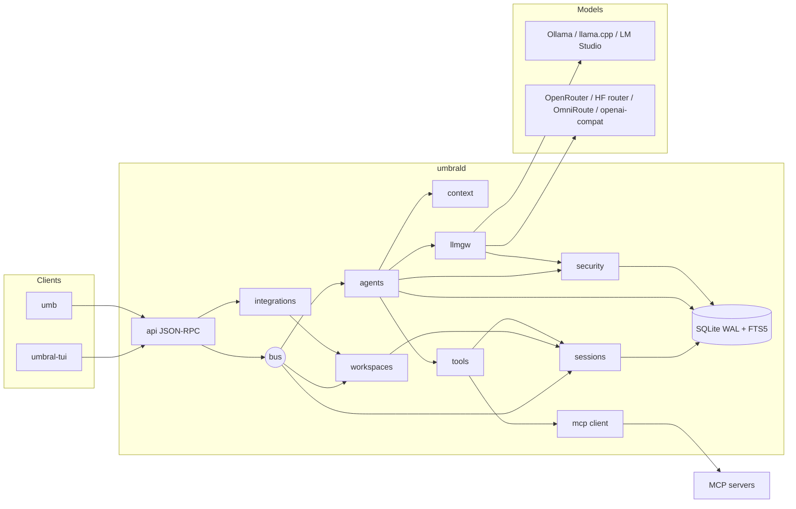
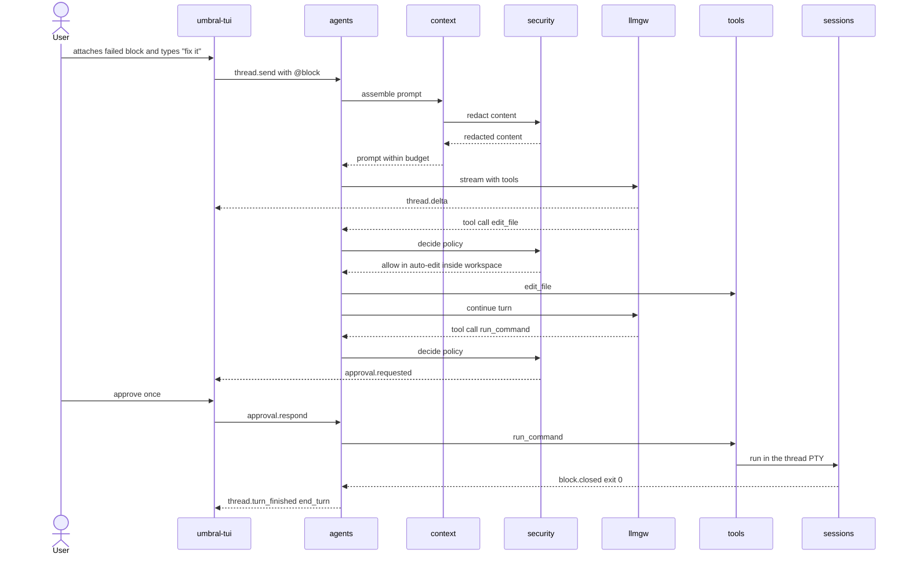

# Umbral MVP — Technical Design Document

## Metadata

| Field | Value |
|---|---|
| **Author** | Ernesto Crespo · assisted draft |
| **Status** | `DRAFT` |
| **Version** | 1.69 |
| **Date** | 2026-10-24 |
| **Related PRD** | `specs/prd/umbral-mvp.md` |
| **Related API Spec** | `specs/api/umbral-daemon-api-v1.md` |
| **Reference architecture** | `docs/ARCHITECTURE.md` · `docs/adr/ADR-0001-architectural-style.md` |

---


> **F1's ratified deltas are all written here.** The last, §9.4's `umb mcp` and §5.3e's
> extensions view, by T-F1-37.
>
> Written by T-F1-33: §5.1's live keys and `[api]` table, §7.2's `umbral_frames_refused_total` and
> §9.4's `umb limits`.
>
> Each task writes its part. Until then, the design is in `changes/_archive/2026-09-*`.

## 1. Context

Umbral is a local Go daemon (`umbrald`) that owns:

- the PTYs and their VT emulation;
- the blocks derived from shell integration;
- the agent runtime;
- the model gateway.

The clients (TUI and CLI in the MVP) are thin and speak JSON-RPC over a Unix socket. Separating the
lifecycle of shells and agents from the window's lifecycle is what enables durable sessions,
multiple clients and, later, background agents.

The style follows ADR-0001: local client-server, with the daemon as a **modular monolith**, a
**hexagonal** interior, a **microkernel** for tools and providers, and an in-process **event bus**.

## 2. Technical Goals

- **Correctness:** VT conformance is the foundation; no block loses output; every agent action is
  persisted before it is notified.
- **Performance:** added latency < 5 ms p95; `session.create` < 300 ms p95; search < 200 ms p95 with
  100,000 blocks.
- **Maintainability:** boundaries verified by `go-arch-lint`; unit coverage ≥ 75 % in `domain` and in
  the policy and router packages.
- **Operability:** traces per turn, metrics per provider, `umb status` as the diagnostic entry point.

## 3. Proposed Architecture

### 3.1 High-Level Diagram (MVP)



### 3.2 Components

| Component | Technology | Responsibility | Main REQs |
|---|---|---|---|
| `api` | own JSON-RPC 2.0 over a Unix `net.Listener` | handshake, auth, dispatch, notification fan-out with a per-client queue | SEC-003, SEC-007 |
| `tui` | Bubble Tea v2 (`charm.land/bubbletea/v2`), go-libghostty for the client's own renderer (DD-001) | tabs, panes, block list, keyboard, agent panel | TUI-* |
| `sessions` | `creack/pty`, go-libghostty, `shell/` bootstrap, `klauspost/compress/zstd` | PTY, VT, blocks, input lock, snapshots | TERM-*, BLK-* |
| `agents` | own runtime over ports | per-turn loop, modes, limits, cancellation, persist-first | AGT-* |
| `context` | `text/template`, a byte estimate of tokens (Q-03) | rules, attachments, git, budget, compaction; the skill store in `context/adapters/skills` — bundles checked, staged and renamed into `skills/` beside the database, recorded in `skills` (delta `2026-10-skill-store`); the catalog of enabled skills each turn lists, through `context/ports.SkillCatalog` (delta `2026-10-skill-catalog`) | CTX-*, SKL-001/002/004/006/007 |
| `tools` | microkernel registry | built-in tools and MCP adapter; JSON Schema validation; `skill_load` behind `tools/ports.SkillReader` (delta `2026-10-skill-catalog`) | AGT-002/006, MCP-001, SKL-004/005 |
| `llmgw` | `charm.land/fantasy` + native Ollama adapter | catalog, candidates per class, fallback, normalized streaming, usage | LLM-* |
| `mcp` | `modelcontextprotocol/go-sdk` | connection, reconnection with backoff, prefixing | MCP-* |
| `security` | own rules + `zalando/go-keyring` | policies, destructive patterns, taint, redaction, egress | SEC-*, AGT-004/009/013/014 |
| `store` | `modernc.org/sqlite` | migrations, repositories, FTS5 | Data Model |
| `workspaces` | own tree + SQLite | workspaces, tabs, panes, identifiers, layouts, rollup, restore | WS-*, TERM-009/010 |
| `waits` | server-owned, event-driven | pinned waits on threads and output | AUT-* |
| `integrations` | socket + env | external state reports, display metadata, authority | INT-* |
| `notify` | client channel | normalization, rate limit, typed reasons | NTF-* |
| `worktrees` | the `git` CLI ≥ 2.34 + SQLite | a thread's worktree outside the repository: create, diff with stable hunk ids, squash merge, discard, missing detection | WT-* (F2) |
| `acp` | `github.com/coder/acp-go-sdk` over stdio | third-party agents hosted through a manifest: launch in an isolated home, `initialize`, `session/new`, prompt, the silence timer | ACP-* (F2) |
| `obs` | OpenTelemetry Go, `log/slog` | traces, metrics | OBS-* |

### 3.3 Main flow: US-003 scenario ("fix it")



**Error and compensation flow:**

1. Provider returns 429/5xx or no first token within the deadline → `llmgw` tries the next candidate
   of the class (REQ-LLM-003). No candidates left → `PROVIDER_UNAVAILABLE` and the turn ends with
   `stop_reason = provider_error`.
2. Invalid call — an unknown tool, input that is not JSON, or input the schema refuses; empty
   input is `{}` → recorded `invalid_args`, counted, and answered with a repair message; the
   model's next step is its one retry, and an invalid call there ends the turn with `tool_error`
   (REQ-AGT-006). A step of only valid calls spends the retry. In the step that fails again, the
   calls before the invalid one keep their results and the ones after it are neither run nor
   recorded. A daemon-side fault (`ErrInvalidEnv`) is a plain tool `error`: no repair, no count
   (delta `2026-10-tool-call-repair`). The repair message carries the schema validator's own
   English text for each failing location — `list_dir: /: additional properties 'depth' not
   allowed` — never the error kind's Go value, which told the model nothing it could act on
   (delta `2026-10-us003-e2e`).
3. `thread.cancel` → the turn's `context.Context` is cancelled and the process groups the thread
   PTY's shell launched get `SIGTERM`; after 300 ms, `SIGKILL` (REQ-AGT-007). `thread.cancel`
   answers once the turn has recorded its end, leaving the thread `stopped` (delta
   `2026-10-thread-cancel`). The shell itself is
   kept (§5.3b; delta `2026-09-builtin-tools`, decision 9).
4. Daemon crash → messages and tool calls are already persisted (REQ-AGT-011). On restart, `running`
   turns become `stopped` and `pending` approvals become `expired`.
5. MCP server lost → a crash, or a call unanswered in 10 s, marks it `unavailable` and fails the
   pending calls; it is reconnected after 1, 2, 4, 8 and 16 s, and only a connection up for a
   minute resets the count. Its tools stay offered meanwhile and fail at once. A call the turn
   cancels leaves the server alone (REQ-MCP-003, delta `2026-10-mcp-client`).

## 4. Design Decisions

### DD-001: The daemon owns the VT state; clients render from bytes

- **Decision:** `umbrald` keeps an authoritative libghostty emulator per session. It is used for
  snapshots, block plain text and alt-screen detection. Clients receive raw bytes
  (`session.output`) and process them with their own renderer.
- **Alternatives:**

| Option | Pros | Cons |
|---|---|---|
| **A: VT in the daemon + bytes to clients (chosen)** | snapshots and blocks independent of the client; simple clients | double parsing (daemon and client) |
| B: the daemon sends cell diffs | single parse | complex custom protocol; couples clients to the cell model |
| C: VT only in the client | simple | no durability and no blocks without a connected client |

- **Consequences:** the snapshot sent on subscribe must be serialized in a format the client can
  replay (**Q-01**). The client's renderer is libghostty too, in `internal/tui/adapters/`, not a
  second VT implementation: the two sides parse the same byte stream, so two emulators would be two
  chances to disagree, and what the user sees would drift from what the block history recorded. The
  price is that `umbral-tui` links cgo and needs `task deps:ghostty`, the same as the daemon.

### DD-002: Blocks from OSC 133 / 633 / 7, with a degraded mode

- **Decision:** blocks derive from OSC sequences emitted by an injected bootstrap
  (`ENV`/`ZDOTDIR`/`--init-file` depending on the shell). No sequences within 5 s →
  `integration: none` (REQ-BLK-003).
- **Discarded alternative:** heuristics on the prompt; they are fragile with custom prompts
  (Starship, p10k).

### DD-003: Per-session input lock (`input_owner`)

- **Decision:** the agent's `run_command` runs in a **PTY dedicated to the thread** (not in the user's
  session). In the MVP the lock applies to that PTY and prepares the ground for Full Terminal Use (F2).
- **Consequence:** REQ-TERM-008 applies to sessions created by the agent when the user tries to type
  into them.

### DD-004: Gateway with task classes and ordered candidates

- **Decision:** the configuration declares classes (`fast`, `code`, `plan`, `embed`), each with an
  ordered list of `provider/model`. The MVP router applies, in order:
  1. offline filter (REQ-LLM-004);
  2. capability filter (tools, window);
  3. health;
  4. declared order.

  F2 (delta `2026-10-policy-router`, T-F2-11) adds vision to the capability filter, a circuit
  breaker per provider after health, and `[router] policy` in place of the declared order:
  `local-first` puts local candidates first, `cost` orders by price (an unpriced remote model
  last), `quality` keeps the declared order; ties keep it, and a pinned model is not reordered.
  `model.route` (API §5.40) answers the same plan a call walks. A breaker counts the failures a
  call falls back on — a 429, a 5xx, a transport failure, a missing first token — and opens at
  `breaker_failures` in a row for `breaker_cooldown`; then one call probes it, a first event
  closing it and a failure reopening it. A 4xx, an unsupported request or a cancel counts
  nothing, and the breakers live in memory, kept across a reload.
- **How the router walks them** (T-F1-07, `internal/llmgw/router.go`):
  - A candidate must be in the catalog: not yet discovered, or `down` for any reason — offline
    included — it is skipped. The capability filter drops it when the request has tools and it
    has none, asks for a response schema or for reasoning it does not advertise, or does not
    fit its window, estimated at four characters a token plus `max_output_tokens`. A class
    with nothing left is `PROVIDER_UNAVAILABLE` before anything is sent (REQ-LLM-004).
  - The request is redacted once, before the first candidate (REQ-SEC-001, all content): the
    system prompt, every message, every tool call's arguments and result, every tool's
    description and every string in its input schema, and every string in the response
    schema (values; a schema's property names are sent as written). The caller's request is
    left as it was. The call's context
    carries its thread, so the egress row of the payload that left — the redacted one — names
    it (REQ-SEC-002).
  - **Fallback is decided before the first event reaches the caller.** A 429, a 5xx, a
    transport failure, a stream that ends empty, or no event within the first-token timeout
    (30 s remote, 120 s local) moves to the next candidate (REQ-LLM-003). The clock starts
    before the request is sent, so a server that holds its headers times out too. A 4xx or a request
    that could not be built ends the call. Once an event is delivered the caller has it, so a
    later failure ends the call rather than starting it again elsewhere. When the last
    candidate fails the call is `PROVIDER_UNAVAILABLE`.
  - An adapter that cannot carry what a request asks for — the Fantasy-based ones and
    reasoning or a response schema, until they do — refuses it before sending, and the
    router moves on without recording a call.
  - **Per-provider queues** (REQ-ORC-005, T-F2-04; delta `2026-10-parallel-turns`): a
    candidate's call first waits for its place in its provider's arrival-order queue, sized by
    the provider's `max_parallel` in `models.toml`: absent, one call at a time for a local
    provider and no limit for a remote one. The first-token clock, `first_token_ms` and the
    latency start once the call holds its place, so time spent behind another thread's call is
    never a timeout; it is logged as `queued_ms` at debug level. A call that must wait first
    yields the router's own `queued` event, and `sent` once it holds its place; no adapter
    produces either. The runtime holds the turn's stall clock between the two, for the main call
    and a compaction's alike, so the wait is not a stall but a provider silent once sent is. A call given up in the queue was never sent and records no
    `usage` row. The place is released when the provider's stream has returned, not when the
    call is abandoned, so a request dropped at its first-token timeout is closed before the next
    one is sent. The limit of a provider `max_parallel` does not name is recomputed from its
    locality on every reload. The breaker is consulted before the queue, so a probe waits there
    holding the breaker's one probe.
  - **Every call that was made is one `usage` row** (REQ-LLM-005), failures included, with
    status `rate_limited`, `timeout` or `error` and the error text. `first_token_ms` is NULL
    when no event arrived. The cost is `(in × price_in + out × price_out) / 10^6` micro-USD,
    rounded to the nearest unit; a model whose price the provider does not publish costs 0.
    A row that cannot be written is logged and does not fail the call.
  - These choices go beyond REQ-LLM-003 and REQ-LLM-005's text and are delta
    `2026-09-router-fallback`.
- **Meta-providers** (OpenRouter, OmniRoute) are just another candidate; their internal fallback is
  not duplicated.

### DD-005: Native Ollama adapter in addition to openai-compat

- **Decision:** Ollama uses the native `/api/chat` to send `num_ctx` (REQ-LLM-006), `keep_alive` and
  `format` with a JSON Schema. llama.cpp and LM Studio use openai-compat through Fantasy.
- **Consequence:** one more adapter to maintain, but it avoids Ollama's short default `num_ctx`.
- **`num_ctx` in every request** (T-F1-06, REQ-LLM-006): the provider's `[providers.options]
  num_ctx` when models.toml sets it; otherwise 32768, capped at the model's own window once
  discovery (`/api/tags`, `details.context_length`) knows it — never Ollama's default. `keep_alive`
  goes at the request's top level and every other option in `options`; `think` is sent only when
  the call asks (`true`/`false` or an effort level), `format` only with a schema. With tool calls,
  Ollama's `done_reason: stop` is reported as `tool_calls`, as the openai-compat adapter reports it.

### DD-006: Policy engine as a pure function

- **Decision:** `Decide(Action, Mode, Rules, Taint) → allow|ask|deny` with no I/O, tested with tables.
  Precedence, highest first:
  1. destructive patterns (always `ask`);
  2. `deny` rules;
  3. taint (`ask` for Exec/Network);
  4. mode (`ask` exposes only ReadOnly; `auto-edit` allows WriteFS inside the workspace; `full-auto`
     also allows Exec whose cwd is inside it);
  5. `allow` rules;
  6. mode default.
- **How it meets the §5.3 table:** an exposure step comes first, a destructive pattern is a floor a
  `deny` rule still overrides, `auto-edit` asks outside the write root whatever the `allow` rules,
  and rules read each command of a line — §5.3 "How the table and DD-006 meet" (delta
  `2026-09-policy-precedence`).

### DD-007: Persist before notifying

- **Decision:** the runtime writes the message, tool call or approval to SQLite in the turn's own
  goroutine, before publishing it on the bus (REQ-AGT-011). Accepted cost: ~0.2 ms per event with WAL.
  Streamed text is persisted chunk by chunk, reasoning is published only, and a write that fails
  stops the turn with `storage_error` (§5.3d; delta `2026-09-agent-runtime`, decisions 1 and 3).

### DD-008: Redaction at the egress edge

- **Decision:** redaction happens in `security` right before `llmgw` serializes the request. Local
  providers also receive redacted content (defense in depth and consistent prompts).
- **`egress_log`** only records non-loopback destinations. It is written by an HTTP transport
  under every adapter (T-F1-05, `llmgw/adapters/fantasyconv`), so model discovery is recorded as
  well as model calls; the row is written before the request is sent, and a row that cannot be
  written stops the request. The daemon's own requests, such as discovery, carry no thread.
- **The rules** (T-F1-04, `internal/security/domain/redact.go`) run in order, each match — or,
  for a `KEY=value` rule, the value only — becoming `[REDACTED:<rule>]`, and a match that already
  is nothing but placeholders is left alone, so redacting twice changes nothing — any other match
  is replaced whole, placeholders it holds included: `pem_private_key`
  (through `-----END…-----`, or to the end of a truncated text), `anthropic_key` (`sk-ant-`),
  `openrouter_key` (`sk-or-v1-`), `openai_key` (`sk-`, `sk-proj-`…), `github_token` (`gh[pousr]_`,
  `github_pat_`), `gitlab_token` (`glpat-`, `gldt-`…), `huggingface_token` (`hf_`),
  `aws_access_key_id` (`AKIA`, `ASIA`…), `aws_secret_access_key`, `gcp_api_key` (`AIza`),
  `gcp_private_key_id`, `jwt`, `slack_token` (`xox?-`) and `dotenv_secret` (an upper-case name
  with a `_`-separated segment `SECRET(S)`, `TOKEN`, `PASSWORD`, `PASSWD`, `PASS`, `PWD`, `KEY`,
  `APIKEY`, `ACCESSKEY`, `CREDENTIAL(S)` or `AUTH`, followed only by `_KEY`, `_SECRET`, `_TOKEN`,
  `_BASE`, `_VALUE`, `_DATA` or digits, and a value of 6 or more characters — so `MAX_TOKENS`,
  `BYPASS_CACHE`, `SSH_KEY_PATH` and `TOKEN_TTL` are not secrets).
  A rule bundle replaces the list (REQ-SEC-010).
- **The generic detector** (`high_entropy`) looks at runs of `[A-Za-z0-9+/=_-]`. REQ-SEC-001's
  two thresholds, ≥ 4.5 bits per character and ≥ 20 characters, are necessary and not sufficient
  ("only fires on"). Two things above them are still not secrets and are left alone: an Umbral id
  (`thr_` + ULID), which the model needs, and a token built like an identifier — split at `_ - + / =`,
  case changes and letter–digit boundaries, no more than a tenth of its characters in pieces
  shorter than three (`TestPolicyAutoEditWorkspace_REQ_AGT_013` reaches 4.56 bits). Measured on
  random keys: the filter costs about 0.05 %, but the 4.5-bit floor itself passes ~98 % of
  40-character keys, ~70 % at 32 and ~5 % at 24 — entropy over a string's own characters cannot
  reach 4.5 bits below 23 characters (log2 22 ≈ 4.46). Short keys of unknown formats rely on
  the named rules. A key containing a `.` is split into candidates, and a lower-case
  `password: …` is caught by no named rule. Delta `2026-09-redaction-thresholds`
  holds these decisions and the PRD amendment they need.

### DD-009: The daemon owns the workspace tree; the client only renders it

- **Decision:** `workspaces` owns workspaces, tabs, panes and their layout; the TUI keeps no private
  structure. Public identifiers (`w1`, `w1:t1`, `w1:p1`) are allocated by the daemon and are the
  addressing surface for the CLI, the API and future clients.
- **Alternative rejected:** keeping tabs and splits inside the TUI. That would make the layout
  unreachable from scripts, would force the F2 desktop client to reinvent it, and would leave no
  place to attach the rollup state.
- **Consequence:** a moved pane changes its identifier; the previous one stays an alias while the
  terminal lives (REQ-WS-007), so long-running commands that captured `UMBRAL_PANE_ID` keep working.

### DD-010: Snapshot plus sequenced events, instead of resynchronizing

- **Decision:** every notification carries a `seq` that is monotonic per session, and
  `session.snapshot` reports the `seq` it contains. A client subscribes first, buffers, takes the
  snapshot and then applies the buffered events with a higher `seq`.
- **Rejected:** having the client ask for a full state refresh after each reconnect: it is expensive
  and still leaves a gap.

### DD-011: Waits belong to the server and pin their turn

- **Decision:** `thread.wait` and the `wait` inside `thread.send` are resolved in the daemon with bus
  events, never by client polling. The wait is pinned to the turn in progress, so a later turn does
  not satisfy it, and `thread.send` with `wait` is one ordered submission.
- **Consequence:** a timeout does not prove that nothing was sent. The contract states it and the CLI
  repeats it, because the safe recovery is to read the thread before resending.
- **How it holds (delta `2026-10-wait-engine`):**
  - **Order and answers.** A wait subscribes before it pins, so no event between the two is lost.
    The daemon does everything a request must do before reading the next one, then answers the
    wait when it settles, out of order, while the connection keeps being served (API §1).
    Closing the connection ends its waits.
  - **A lossy bus.** The bus may drop events (§3), so a thread wait also re-reads the store
    once a second as a backstop. This is not the client polling this decision forbids: the
    client makes one call and gets one answer.
  - **A later turn never answers for the pinned one.**
    - A turn's end event carries the state its end wrote.
    - The runtime remembers the last 4096 ends of its run.
    - A wait that reads a later turn first takes the pinned turn's own end from either of
      those, or answers `unknown`. `unknown` also covers a turn that ended before the daemon
      started and one whose end could not be written.

### DD-012: One state authority per pane, with a fixed precedence

- **Decision:** the attention state of a pane comes from exactly one source, in this order:
  1. Umbral's own agent, for the panes of its threads (it cannot be displaced). A thread hosted by
     an ACP agent is the same authority for the pane whose live session it owns: its attention
     state is written by the same runtime, turn by turn, and its terminals are sessions outside
     the workspace tree (REQ-ACP-002, delta `2026-10-acp-client`);
  2. an external integration that reported with `pane.report_state` and has not released authority;
  3. Umbral's own derivation from the block lifecycle (`running` → `working`, closed → `idle`).
- **Rationale:** the failure mode to avoid is two sources disagreeing. Screen heuristics are
  deliberately left out of the MVP: they are fragile and they would be a third source of truth.
  Third-party agent detection arrives in F2 as the lowest-priority layer, behind hooks and ACP.
- **Detection labels and never decides** (delta `2026-10-agent-detection`, T-F2-10). It names the
  agent running under a pane's shell — `Pane.detected_agent`, from manifests matched against the
  process table — and the state source that agent's manifest declares, but it is not an input of
  this precedence: a detected agent's pane keeps whatever state the three sources above give it
  until the agent itself reports through hooks or ACP. No scan announces `pane.state_changed`.
- **Consequence:** display metadata is a separate channel (DD-013) precisely so that improving what
  is shown never requires touching the state that drives waits.

### DD-013: Semantic state and presentation are different channels

- **Decision:** `pane.report_state` carries semantics; `pane.report_metadata` carries presentation
  (title, displayed name, state labels, tokens with TTL). Metadata never alters waits, rollups or
  notifications, has bounded size and does not survive a restart.

### DD-014: Restore in tiers, each with a written guarantee

| Case | Processes | Structure | Recent screen | Thread |
|---|---|---|---|---|
| Client detaches | keep running | returns | from the live terminal | keeps running |
| Daemon restart | lost | restored (REQ-TERM-009) | only with `pane_history` (REQ-TERM-010) | history restored, turn `stopped` (REQ-AGT-017) |
| Daemon update | lost in the MVP | restored | as above | as above |

Live PTY handoff between daemon versions is F2: it is worth it only once the daemon is something
people leave running for days.

### DD-015: The protocol schema is generated from the code

- **Decision:** the binary can print the JSON Schema of the protocol and CI compares it against the
  API Spec (methods, error codes, notifications). A method that exists in code but not in the
  document turns CI red.
- **Rationale:** it is the cheapest mechanism that keeps Art. 9 ("code and spec must never diverge
  silently") from depending on discipline alone.

### DD-016: Rule material is signed, and recovery never depends on the network

- **Decision:** the redaction rules and the destructive-pattern list travel as a versioned bundle
  with a detached Ed25519 signature. The daemon verifies the signature against a trust store of
  public keys, refuses downgrades, and on three consecutive failures — or with no valid key — it
  disables remote updates and keeps working with what it already has.
- **Key loss is the case that had to be designed for:** `rules.rollback` returns to the previous
  verified bundle and `rules.reset` returns to the rules built into the binary. Both work offline
  and need no key, so losing the signing key degrades the update channel but never the product.
  The local override directory is never touched by any of this.
- **Rejected:** TLS alone. The threat is a compromised endpoint, and TLS does not address it.
- **Cost accepted:** key management (creation, rotation, revocation) and the release process that
  signs each bundle. `docs/runbooks/rule-signing.md` carries it: the Tech Lead is the sole signer,
  the key lives only in an `age`-encrypted offline file with a separate backup, it never enters
  CI, and it rotates yearly. Delta `2026-09-rule-signing-custody` states what follows.
- **Formats:**
  - A bundle is the exact bytes of a UTF-8 JSON document whose top-level `version` is a positive
    integer. The built-in rules are version 0.
  - Its signature is fetched from `[update] rules_url` + `.sig` and holds
    `{"signatures":[{"fingerprint":"SHA256:…","sig":"<base64>"}]}`: Ed25519 over the bundle's
    exact bytes.
  - A public key is its 32 raw bytes in standard base64. Its fingerprint is `SHA256:` and the
    unpadded standard base64 of SHA-256 over those bytes.
  - A bundle verifies when some entry names the fingerprint of a valid key (no `revoked_at`) and
    checks out; `verified_with` records the most recently added such key. It is `unknown_key`
    only when no entry names one.
  - A fetched bundle whose SHA-256 equals the active one's is up to date. It is not a rejection:
    nothing is notified and nothing counts toward the three failures.
  - A fetch that fails — network, HTTP error, 404 — is logged and retried at the next check. It is
    not a failed verification: only a bundle that arrived and was rejected counts.
  - Keys are named by fingerprint on the wire. Their ids are `key_` + ULID (Art. 6).
  - The rules travel as `{"version"?, "redaction"?: [{"name", "pattern", "group"?}],
    "destructive"?: [{"name", "pattern"}]}`, decoded strictly: names match `^[a-z0-9_]{1,64}$`
    and are unique per list, patterns are RE2 of at most 4096 bytes, at most 256 entries a list.
    A local override file has the same shape and its `version` is ignored. A `null` document, an
    unknown member (a `group` on a destructive entry included) or trailing content is invalid.
- **Layers (delta `2026-10-rule-overrides`):** the base is the built-in rules, or the active
  bundle, which replaces them whole. Each file of `$XDG_CONFIG_HOME/umbral/rules/` is layered on
  the base in lexical order: an entry replaces the entry of the same name and otherwise adds to
  it, so a local file can replace a rule, even with one that matches nothing, but never remove
  one. Only regular `*.json` files of at most 1 MiB are read, never through a link, once at
  start. An invalid file is skipped whole with a warning naming it and the reason.
  `cmd/umbrald` holds one active set whose policy the agent runtime and `policy.explain` both
  read, and whose redactor every redaction uses.
- **Applying a bundle (delta `2026-10-signed-rule-bundles`, T-F1-30):** `internal/security`'s
  `Rules` manager owns the decision, over a `RuleStore` port whose SQL adapter writes migration
  0006's tables (Data Model §2.4e).
  - Order: an identical digest is up to date; a digest in `rule_rejections` is skipped silently;
    otherwise the signature (`unsigned`, `unknown_key`, `invalid_signature`), the document
    (`invalid_bundle`: invalid rules or a `version` not positive) and the floor (`downgrade`):
    the higher of the active version and the highest version ever applied, so a reset does not
    let a compromised endpoint replay an older signed bundle. Unverified bytes are never parsed,
    so a rejection before the signature carries version 0.
  - A rejection writes its `rule_rejections` row, the failure count and an `egress_log` row
    `umbral-rules:rejected:<reason>` in one transaction, then counts
    `umbral_rule_updates_rejected_total`, announces `rules.update_rejected` and — through
    `cmd/umbrald`, which subscribes before the manager starts — raises a user notification under
    `umbral:rules`. The rules in force stay. A rejected bundle is never retried; rejections are
    keyed by the bundle's digest, so an endpoint serving the real next bundle with a bad `.sig`
    blocks that one bundle, and the project publishes the next version (accepted).
  - A verified bundle is stored with its exact bytes and `verified_with`, the former active row
    becomes inactive and rows other than the active, the previous and `builtin` are pruned —
    persisted before the active set's base changes (DD-007). At start the active row's bytes are
    checked against its digest; a mismatch falls back to the built-in rules with an error.
  - **Fail closed:** the third consecutive rejection sets a latch, a bundle applied resets the
    count, and a failed fetch or a skipped repeat neither counts nor resets. The store ending up
    without a valid key sets it too, once it has ever held one, so a fresh install takes the first
    key its seed brings. Only `rules.key.add` (or `rotate`'s add) clears it; with it set the
    fetcher makes no request.
  - **Rollback and reset** need no key, no network and no clear latch. `rules.rollback` makes the
    previous bundle active, deletes the row it left and remembers that digest as `rolled_back`;
    `rules.reset` makes `builtin` active and remembers the former digest as `reset`, keeping the
    remote rows for a later rollback. Neither is a rejection.
  - Every trust-store change is a `trust_key_events` row (REQ-SEC-014). `umb rules key add` and
    `rotate` take `--confirm FINGERPRINT`; without it they print the fingerprint and call nothing.
    Removing the last valid key needs `--force`.
  - `tools/rulesign` (`keygen`, `sign`, `verify`) is the runbook's signing tool; it depends on
    `security-domain` only, so `verify` runs the daemon's own verification.
- **Trust on a fresh install:**
  - The binary embeds the project's public keys, a `retired` list and a `revoked` list
    (`internal/security/adapters/rules/trustseed/seed.json`, embedded; it ships empty until the
    Tech Lead creates the project key offline, runbook §4.1), matched by fingerprint. `retired` only keeps a
    rotated-out key's `source` as `builtin`.
  - On start the daemon adds each seed key `trust_keys` lacks, and revokes each listed one not
    yet revoked.
  - The seed never re-enables updates that REQ-SEC-015 disabled. Only a manual
    `rules.key.add` does, and it does so even for a key the seed already inserted.
  - Removing a key sets `revoked_at` rather than deleting the row, so a removed seed key stays
    removed.
- **Planned rotation never revokes:** during the overlap, bundles carry both signatures. The
  retired key moves to the seed's `retired` list, but installed stores keep it. Revocation is for a compromise.
- **Revoking a key discards what it verified:**
  - Every bundle the key verified goes, together with the memory of downgrade rejections.
  - The active bundle stays if it survives. Otherwise the newest remaining `remote` bundle, or
    the built-in rules, becomes active. It is never a `local` row, and the override directory is
    never touched.
  - The highest surviving version becomes REQ-SEC-013's floor (`highest_version`).
  - Without this, a stolen key could sign an enormous version and lock every legitimate bundle
    out.

### DD-017: Waits are observable and cancellable, and a stall is not a failure

- **Decision:** the daemon keeps an inventory of active waits (`wait.list`) with age and a stalled
  flag, allows cancelling a wait without touching what it observes (`wait.cancel`), and marks a turn
  `stalled` when it produces no model event, tool call or output within the window.
- **Rationale:** the realistic failure is not an attack, it is a script that leaks waits or a
  provider that stops answering. Exceeding a limit degrades that operation, never the connection.
- **Consequence:** `stalled` is informational. Umbral notifies and offers the choice; it never kills
  a turn on its own, because a local model can legitimately take minutes.
- **How (delta `2026-10-wait-monitoring`, T-F1-31):**
  - **The inventory.** `internal/waits` registers every wait — `thread.wait`, `thread.send`'s
    `wait` and `block.wait_output` — under a `wt_` id and the connection holding it, before it
    subscribes. The 32-per-connection limit is checked there, over every kind, so a leak is
    refused with `VALIDATION_ERROR` before it costs a subscription, and the connection stays.
    `wait.cancel` ends the wait with `CANCELLED` and touches nothing it observed.
  - **Stall detection lives in the agent runtime,** which already sees every event of its turns:
    `publish` updates a running turn's activity clock before the event reaches the bus, so the
    bus's backpressure can lose no activity. A ticker marks a turn idle for its window stalled,
    publishes `thread.stalled` once and counts `umbral_waits_stalled_total`; the next activity
    clears the mark silently. A turn awaiting an approval waits for the user and never stalls.
  - **Output counts as activity.** `sessions` and `agents` may not import each other, so
    `cmd/umbrald` follows `block.started` (a block carrying a `thread_id` ties its session to
    that thread) and `session.output` on two subscriptions, so an output flood cannot push out
    the ownership, and calls the runtime's `NoteOutput`.
  - **The window** is `[waits] stall_local_s` when any candidate of the thread's model or class
    is a local provider (`Router.Local`), and `stall_remote_s` otherwise.
  - **The report rate** lives in `integrations`: a sliding one-second window per source, 10
    kept reports, shared by `pane.report_state` and `pane.report_metadata`, checked after
    validation and the pane's resolution, and counting only reports that were written. A discarded report answers as a kept one would, writes nothing and counts
    `umbral_reports_rate_limited_total`; it does not use up the window. `release_state` is not
    limited.

## 5. Patterns and Conventions

### 5.1 Code Structure

```
cmd/umbrald/                 # composition root (the only place with wiring)
cmd/umb/                     # CLI
cmd/umbral-tui/              # Bubble Tea v2 client
internal/<module>/domain/    # pure types and rules
internal/<module>/ports/     # published interfaces
internal/<module>/adapters/  # implementations
internal/api/                # JSON-RPC server: the only package that knows the wire format
internal/client/             # JSON-RPC client, daemon autostart; used by cmd/umb and the TUI
internal/config/             # runtime file locations and the TOML configuration
internal/store/              # SQLite, migrations, restart recovery
internal/tui/                # Bubble Tea v2 model and views
internal/tui/ports/          # the screen the model renders from
internal/tui/adapters/       # libghostty renderer (DD-001: the client parses for itself)
internal/bus/                # typed pub/sub
internal/workspaces/         # tree, identifiers, layout, restore
internal/waits/              # pinned waits
internal/integrations/       # external reports and metadata: domain (a report's rules), ports,
                             # adapters/reportstore (pane_state_reports), the service that
                             # announces pane.state_changed (delta `2026-10-integration-surface`)
internal/acp/                # hosted ACP agents (delta `2026-10-acp-client`): domain (entries,
                             # manifests, the environment allowlist, kind→risk, stop reasons),
                             # ports (Secrets, Mediator, Sink), adapters/sdk (the host on
                             # acp-go-sdk) and adapters/sdk/acptest (a fake agent for tests)
shell/                       # bash, zsh, fish bootstrap
testdata/vt/                 # VT conformance suite
```

### Configuration

`$XDG_CONFIG_HOME/umbral/config.toml`, read once when the daemon starts, **except the keys listed
as live**, which the daemon can change while it runs. Today there is one live key,
`api.max_message_bytes`, and only `limits.set` changes it (API Spec §5.38): it rewrites that one
line and applies the value to new connections. Every other key still needs a restart; a general
`config.reload` is T-F1-02's. Three rules, and the second is the one that matters:

- **Absent is the default configuration, not an error.** Umbral runs with no configuration at all;
  a local-first tool owes a new user a working daemon before it owes them a settings file.
- **Malformed refuses to start.** Falling back to defaults after the user asked for something is
  how `pane_history = true` silently becomes false and someone believes their screens are being
  captured when they are not. This is REQ-SEC-010's "SHALL NOT fall back to an empty rule set"
  pointed the other way: when a user has stated an intention, guessing is worse than stopping.
- **An unknown key warns.** A configuration written for a later version still starts this one.

The daemon reads two sections:

```toml
[experimental]
pane_history = false   # REQ-TERM-010: capture and replay pane screens. Off by default,
                       # because pane output can contain secrets.

[api]
max_message_bytes = 4194304   # live. The frame limit after the handshake (API Spec §1):
                              # bytes, or a quoted "8MiB"/"512KiB"; 1 MiB to 64 MiB.
```

A value outside 1–64 MiB is malformed and stops the daemon like any other. The parser is a subset
of TOML, not a TOML library: comments, `[section]` headers and `key = value` lines, where a quoted
value ends at its closing quote and only a comment may follow it. An inline table or an array is
outside the subset and stops the daemon, naming the line, rather than being read as an unknown key
whose settings are silently ignored. `limits.set` edits the file with
the same honesty: the key's own line under `[api]`, or a new `[api]` section; a dotted key or an
inline table holding it is refused as `CONFIG_INVALID` naming the line, and a symlinked file is
rewritten through its target so the link survives.

`[secrets] allow_env` (off by default) lets `env:<VAR>` stand in for a keyring the machine does
not have (REQ-SEC-012).

`[retention]` sets Data Model §4's windows in whole days, 1 to 3650: `raw_output_days` (30),
`plain_output_days` (180), `closed_structure_days` (30) and `audit_days` (365). A value out of
range stops the daemon naming the key. Not live: a change needs a restart (delta
`2026-10-retention`).

`[waits]` sets REQ-AUT-008's stall windows in whole seconds, 5 to 3600: `stall_local_s` (120)
for a turn whose model or class has a local candidate, `stall_remote_s` (30) for every other.
A value out of range stops the daemon naming the key. Not live: a change needs a restart
(delta `2026-10-wait-monitoring`).

`[agents] max_concurrent_turns` is how many agent turns, of all threads, run at once: a whole
number from 1 to 64 (3). A turn over it is held, `queued`, and started in arrival order when a
turn ends (REQ-ORC-002). A value out of range stops the daemon naming the key. Not live: a change
needs a restart (delta `2026-10-parallel-turns`).

`[worktrees] commit_timeout` bounds a worktree merge's commit in whole seconds, 5 to 3600 (60).
It covers the repository's hooks and signing. When it passes, the commit's whole process
group is killed and the merge is refused `commit_failed` (REQ-WT-004). A value out of range
stops the daemon naming the key. Not live: a change needs a restart (delta
`2026-10-worktree-engine`).

`[acp]` and `[[acp.agents]]` are the third-party agents the daemon hosts (REQ-ACP-001). They
need arrays and tables, which the rest of the file's subset refuses, so their lines are split
out and read with `go-toml`, strictly: an unknown key or a value of the wrong type stops the
daemon naming its line. `[acp] silence_timeout` is whole seconds, 5 to 86400 (600), and
`max_terminals` 1 to 32 (4). Each `[[acp.agents]]` has a `name` (lowercase letters, digits and
dashes), a `command`, optional `args`, `manifest` (its name when absent), `env_refs` mapping a
variable to `keyring:<path>` or `env:<VAR>` and never to a value — `PATH`, `HOME`, `LANG`, `XDG_*`
and `UMBRAL_*` are Umbral's to set — and `config`, merged into the configuration the manifest
generates under the keys the manifest allows (for OpenCode `model`, `small_model`, `provider`,
`enabled_providers`, `disabled_providers`). A manifest that does not exist is not a start error:
`thread.create` refuses the entry `no_manifest`. Not live (delta `2026-10-acp-client`).

`[otel] endpoint` (unset by default) exports traces and metrics over OTLP/HTTP (REQ-OBS-003).
- **Local only.** It must be an `http://` or `https://` base URL, with no path, query,
  fragment or credentials, whose host is `localhost` or a loopback address. Anything else stops
  the daemon.
- **Why.** A remote collector would make every export an egress Art. 4 requires to be redacted
  and recorded; a local collector forwards wherever the user sends it.
- **Not live.** It needs a restart, and `config.get` reports the endpoint in use.
- §7 says what is exported.

`[update] rules_check` (off by default) turns on signed rule updates (REQ-SEC-011, DD-016).
`[update] rules_url` is where they come from. Its default is the project's latest release asset,
`https://github.com/ecrespo/umbral/releases/latest/download/rules.json`, and the signature is at
the same URL plus `.sig`. Neither is contacted while `rules_check` is off (Art. 4). On, they are
fetched at start and every 24 h, and each request — each redirect hop included, since the default
URL redirects to another host — is written to `egress_log` before it is sent; a hop off `https` is
not followed, nor is a sixth redirect. Bodies are capped at 4 MiB and only a 200 is accepted; a
failure is logged by host, retried at the next check and offers nothing. `rules_url` must be
`https://` with a host and no credentials, and with `rules_check` on, a URL the active redactor
would change (with or without `.sig`) stops the daemon (Art. 4). Redirect targets are the
server's own and are recorded, not redacted, as `fetch_url`'s are.

**Providers: `models.toml`.** Beside `config.toml`, in the same directory. It names the
providers, the model classes and the routing policy, and never a key: a credential is a
reference. The shape is the reference architecture's (`docs/ARCHITECTURE.md` §7):

```toml
[router]
policy = "local-first"          # local-first | cost | quality
offline = false                 # REQ-LLM-004: local providers only
max_cost_usd_per_thread = 1.5   # micro-USD at load (Art. 6); a thread stops at it (REQ-AGT-008); absent or 0 = no cap
breaker_failures = 3            # REQ-RTR-002: consecutive failed calls that open a provider's breaker, 1-100
breaker_cooldown = 60           # seconds an open breaker skips its provider before one probe, 1-3600

[classes]                       # fast | code | plan | embed: candidates in order
code = ["ollama/gpt-oss:20b", "openrouter/moonshotai/kimi-k2"]

[[providers]]
id = "ollama"                   # [a-z0-9_-], unique
type = "ollama"                 # ollama | openai-compat | lmstudio | llamacpp | openrouter | yzma
base_url = "http://127.0.0.1:11434"
max_parallel = 1                # REQ-ORC-005: calls sent at once, 1-64; absent = 1 local, no limit remote
[providers.options]             # passed to the adapter, e.g. num_ctx, keep_alive
num_ctx = 32768

[[providers]]
id = "openrouter"
type = "openrouter"
base_url = "https://openrouter.ai/api/v1"
api_key = "keyring:umbral/openrouter"   # or "env:<VAR>" where REQ-SEC-012 allows it
```

- **It is real TOML**, read with `pelletier/go-toml/v2` and validated against a JSON Schema
  embedded in the binary (`internal/config/models.schema.json`): unknown keys, unknown types,
  classes or policies, a provider without `id` or `base_url` and duplicate ids are refused. A
  file the schema refuses stops the daemon, like any other malformed setting, and an absent
  file is no providers.
- **A plaintext key refuses its entry, not the file** (REQ-SEC-004). Any `api_key` that is not
  `keyring:<path>` or `env:<VAR>` is a key in the clear: that provider is left out, reported as
  `down` with `plaintext_secret`, and logged with the field and what to write instead, never
  the value. The rest of the file loads. So does an option under `[providers.options]` whose
  name says it is a credential (`key`, `token`, `secret`, `password`, `passwd`, `auth`,
  `credential`, `bearer`): options tune the adapter and never carry a key.
  `max_cost_usd_per_thread` is at most 1e6. A malformed `keyring:` or `env:` reference is a
  malformed file, and its message names the provider and the field, not the value.
- **Credentials resolve at start and on `config.reload`** (API Spec §5.28). `keyring:<path>` is
  `service/account` in the OS keyring (a path without `/` is an account of the `umbral`
  service). The keyring is probed only when a provider names one — asking a locked keyring for
  anything can raise an unlock prompt. If it is unreachable, the daemon starts anyway and every
  keyring provider is `down` with `keyring_unavailable` (REQ-SEC-008). `env:<VAR>` is accepted
  only where the keyring is unavailable and `allow_env` is on, and the provider is then
  `degraded` with `env_secret` (REQ-SEC-012); anywhere else it is `down` with
  `env_secret_not_allowed`. A resolved key lives in memory in a type that prints as
  `[REDACTED]` under every format verb.
- **The catalog** (T-F1-05, `internal/llmgw`). Each provider becomes an adapter —
  `openai-compat`, `lmstudio` and `llamacpp` through Fantasy's openaicompat provider, `openrouter`
  through its OpenRouter provider (whose built-in URL the adapter's HTTP client rewrites to
  `base_url`), `ollama` through the native adapter of DD-005; `yzma` arrives later, and until then
  it is listed with reason `no_adapter`. A provider down for its credential gets no adapter at all, so nothing can
  call it. Discovery reads `<base_url>/models` (`/api/tags` for `ollama`) at start and after every reload, in the background,
  and stores the result in `models`, one row per id: a provider that lists one id twice — Ollama 0.40
  does for a model pulled for two backends — keeps its first entry, in the catalog and for `num_ctx`
  alike (delta `2026-10-duplicate-models`); the models of a provider that does not answer stay, `down`
  with `discovery_failed`. A model's health and reason are its provider's — `ok` once it answered,
  `degraded` when its key came from the environment — with no column of their own. `local` is true
  for a loopback `base_url` only. A gateway on loopback that forwards to the cloud — a self-hosted OmniRoute —
  is therefore local to Umbral: offline mode does not stop it and its onward requests are not in
  `egress_log`, which `examples/models.toml` says next to the preset (delta
  `2026-09-provider-config`, 8e). With `router.offline = true` a remote provider is not contacted
  at all and its models are listed `down` with `offline`. The rows of a provider removed from
  `models.toml` are deleted on the next refresh. A provider's key stays in a type that prints as
  `[REDACTED]` up to the call that puts it in a header.
- **Presets** (T-F1-08, REQ-LLM-007): `config.Presets` holds the Hugging Face router
  (`https://router.huggingface.co/v1`, key `keyring:umbral/huggingface`) and OmniRoute
  (`http://127.0.0.1:20128/v1`, no key), both `openai-compat`. `examples/models.toml` carries
  them beside Ollama and OpenRouter, commented, and a test loads it as shipped.
- **`config.reload` validates both files before applying anything**, and an entry it would
  refuse refuses the reload, with one `details` entry per entry, or one naming the file that
  does not parse. It applies the providers, the `[router]` table and `allow_env`; the other keys
  of `config.toml` still need a restart, as above.
- **The cost cap** (delta `2026-10-cost-cap`). The agent runtime reads
  `max_cost_usd_per_thread` live (`agents.Config.MaxCostMicroUSD`). `Store.BeginTurn` refuses a
  send to a thread whose `cost_micro_usd` has reached it, in the same transaction as the token
  budget. A turn checks the thread's spend plus its own before every priced call — each step,
  and between a step's compaction and its main call — and stops with `budget`. A positive cap
  that rounds to 0 micro-USD is a malformed file.

### 5.2 Dependency rules (Art. 3, verified by `go-arch-lint`)

| From | May import |
|---|---|
| `*/domain` | stdlib and other `*/domain`; `security/domain` also `mvdan.cc/sh/v3/syntax`, the shell parser behind the destructive floor, which does no I/O (delta `2026-10-shell-parser`) |
| `*/ports` | its own `domain` and other `*/domain` |
| `*/adapters` | its own `ports`, its own `domain` and external libraries |
| `agents` | `ports` of `sessions`, `tools`, `context`, `llmgw`, `security`, `store` |
| `llmgw`, `sessions` | never `agents` |
| `api` | `bus`, `store`, `config`, and the `ports` **and `domain`** of the modules it serves. The two arrive together and cannot be separated: a port's method signatures are written in domain types, so importing `sessions/ports` without `sessions/domain` does not compile. The grant is per module, not blanket — `api` may not reach the `domain` of a module whose ports it does not hold |
| `client` | `config` only, and never `api`: the client and the server of one protocol must not depend on each other, so what they share — where the socket and the token live — lives in `config` |
| `tui` | `client`, its own `ports`, and the `domain` packages; never `api`, and never its own adapters — `cmd/umbral-tui` wires those, as `cmd/umbrald` does for the daemon |
| `tui/ports` | `sessions/domain`, for the size and cursor types the daemon already defines |
| `tui/adapters/**` | its own `ports`, `client`, `sessions/domain` and external libraries, like every other module's adapters. The `client` allowance is what keeps method names and parameter shapes in one adapter instead of in the model |
| `tools/adapters` | also `sessions/ports`, for `AgentTerminal` alone: `run_command` runs in the thread's PTY, which the sessions module owns (T-F1-10) |
| `workspaces` | `ports` of `sessions` and `store`; never `agents`, `api` or `waits` |
| `waits` | `ports` and `domain` of `agents` and `sessions`, plus `bus`; never `api`. It reads the store only through the agents runtime, and its own domain reuses the sessions domain's escape-sequence stripper (delta `2026-10-wait-engine`) |
| `integrations` | `ports` of `workspaces` and `store`, plus `bus`; never `agents` or `api`. The tree resolves a pane's state in DD-012's order (`workspaces/domain.ResolveAttention`); `integrations` writes the external reports and announces every change. It hears the changes it did not make — blocks, integration verdicts, exits, thread attention — through events `cmd/umbrald` subscribes it to, and re-reads the whole tree on each (delta `2026-10-integration-surface`). Display metadata is written by `integrations` and read by the tree into a `Pane`'s `metadata`, never on the state path: `ResolveAttention`, the rollup, waits and notifications do not read it, and a written report is announced as `pane.updated` only (delta `2026-10-display-metadata`). Third-party agent detection lives here too (delta `2026-10-agent-detection`): `integrations/adapters/manifests` reads the local manifests and `integrations/adapters/proctree` the process table, without running a command; the detector reaches a pane's shell pid through `integrations/ports.Shells`, which `cmd/umbrald` satisfies with the sessions service, and keeps its labels in memory, keyed by session, for the tree to read through `workspaces/ports.AgentLabels` — never on the state path |
| `notify` | `bus` and stdlib only; it is a sink and imports no other module. `api` implements its `Deliverer` port — the foreground client of API §5.35 — and is handed to it by `cmd/umbrald` once the server exists; `cmd/umbrald` adapts `integrations`' `Notifier` port to it for an external `blocked`. Both modules deliver outside their locks, and `api` through a per-connection queue, so a client that stops reading stalls no source (delta `2026-10-notifications`) |
| `acp` | its own `ports` and `domain`, and `security/domain` for a kind's risk; its adapters use `acp-go-sdk`. It imports no other module. The agents runtime reaches it through a port of its own, `agents/ports.ExternalAgents`, which `cmd/umbrald` adapts, as it does `Worktrees`; `config` reads its entries into `acp/domain.Entry` (delta `2026-10-acp-client`) |
| `worktrees` | its own `ports` and `domain`; its adapters run the `git` binary and use `store`. It imports no other module. Its `ports` publish `Worktrees`, the inbound port `api` serves as `worktree.*`; the agents runtime reaches a thread's worktree through a port of its own, `agents/ports.Worktrees`, which `cmd/umbrald` adapts, and decides through `agents/ports.WorktreeThreads` when one may change: never while the thread's turn runs (T-F2-03). Reading a worktree to show it runs with fsmonitor, filter drivers, external diff and textconv off. Landing it runs as the user's `git commit` would — hooks and signing included — in a session with no terminal, killed whole at `[worktrees] commit_timeout` (delta `2026-10-worktree-engine`) |
| `security` | stdlib, `go-keyring` in its adapter, `bus` in its ports (to name `rules.update_rejected`) and the root `llmgw/domain` (for the egress record a rejection writes). Its root holds policy.explain, which reads a thread's mode, directory and rules through its own `ExplainSource` port and asks the same pure `Decide` a turn uses; `cmd/umbrald` adapts the agent thread store to that port and hands both the runtime and the explainer one `isRepo`, so an explanation and a turn agree about the write root (delta `2026-10-policy-explain`). Its root also holds the `Rules` manager of signed bundles (DD-016), which reaches storage through its own `RuleStore` port and replaces the active set's base through `RuleBase`. `tools/rulesign` depends on `security/domain` only (delta `2026-10-signed-rule-bundles`) |
| `context` | its own `ports` and `domain`, `store` and `bus` in its adapters, and `bus` in its ports, to name `skill.changed` (delta `2026-10-skill-store`) |
| `mcp` | its own `ports` and `domain`, plus `bus`. `tools/adapters` may use `mcp/domain`, for `mcptools`, which offers a server's tools; `api` the `ports` and `domain` of `mcp`; only `cmd/*` wires the manager to the registry (delta `2026-10-mcp-client`) |
| `slots` | stdlib only: the arrival-order semaphore of the runtime's turn slots and the router's per-provider queues (T-F2-04). `agents` and `llmgw` may import it, so neither reaches the other through it |
| `obs` | stdlib, and OpenTelemetry from T-F1-18; imported only by `cmd/*`. Modules count through a port of their own, which `cmd/umbrald` gives the `obs` implementation (delta `2026-10-tool-call-repair`) |
| `cmd/*` | everything |

Each of those four modules needs its own `components` entry and `deps` block in
`.go-arch-lint.yml` before its first file lands, or `task arch` passes by having nothing to
check. T-F0-14, T-F0-15 and T-F0-16 name that file for exactly this reason.

### 5.2b Environment injected into panes (REQ-INT-001)

| Variable | Value |
|---|---|
| `UMBRAL_ENV` | always `1` inside a managed pane |
| `UMBRAL_SOCKET_PATH` | socket of the session that owns the pane |
| `UMBRAL_BIN_PATH` | absolute path of the `umb` binary |
| `UMBRAL_WORKSPACE_ID`, `UMBRAL_TAB_ID`, `UMBRAL_PANE_ID` | location of the pane |
| `UMBRAL_SESSION_ID` | terminal session attached to the pane |
| `TERM` | `xterm-256color` (REQ-TERM-013) |
| `COLORTERM` | `truecolor` (REQ-TERM-013) |
| `UMBRAL_SESSION` | `1`, the marker sessions carried before REQ-INT-001, kept for compatibility |

Umbral's values win over any caller-supplied value — except `TERM` and `COLORTERM`, which
replace only the daemon's own inherited values: a pane or layout that declares them in its `env`
keeps what it declared. The daemon's terminal is never a pane's; under `systemd` or `launchd` it
has none, and a shell with no `TERM` runs readline as a dumb terminal (delta
`2026-09-pane-term`). An integration reports only when
`UMBRAL_ENV=1`, so the same hook is inert outside Umbral.

Every inherited or declared `UMBRAL_*` value is dropped before Umbral's are set, not merely
overridden: a daemon autostarted by `umb` from another daemon's pane inherits that pane's
`UMBRAL_PANE_ID`, and a session in no pane — a thread's PTY — would otherwise keep it. Such a
session gets `UMBRAL_ENV`, `UMBRAL_SESSION_ID`, `UMBRAL_SOCKET_PATH` and `UMBRAL_BIN_PATH`, and no
workspace, tab or pane id. `UMBRAL_BIN_PATH` is the `umb` beside `umbrald`, then the first on
`PATH`; with neither it is left out and the daemon logs a warning. A moved pane's processes keep
the ids they started with, which still reach the pane as aliases (REQ-WS-007). Delta
`2026-10-integration-surface`, decision 11.

### 5.3 Default policies

| Risk | `ask` mode | `normal` mode | `auto-edit` mode | `full-auto` mode |
|---|---|---|---|---|
| ReadOnly | allow | allow | allow | allow |
| WriteFS (inside the write root) | not exposed | ask (with diff) | allow | allow |
| WriteFS (outside the write root) | not exposed | ask | ask (`outside_write_root`) | ask (`outside_write_root`) |
| Exec (cwd inside the write root) | not exposed | ask | ask | allow |
| Exec (cwd outside the write root) | not exposed | ask | ask | ask (`outside_write_root`) |
| Network | not exposed | ask | ask | ask |
| Destructive pattern | — | ask, ignores `always` | ask, ignores `always` | ask, ignores `always` |

**Write root** = the git root of the thread's cwd or, when there is no repo, the cwd itself. It is
the agent's write boundary and has nothing to do with the structural workspace of §3.2 (finding
B-09).

**`full-auto`** (REQ-ORC-004, T-F2-05, delta `2026-10-full-auto`) is a thread's flag, never a
stored mode: `threads.full_auto` sits beside `threads.mode`, the mode the thread returns to. A turn
decides under `full-auto` only while the flag is set **and** its worktree is active, so its write
root is always the worktree (`agents.TurnPlace` reads both, for the turn and for
`policy.explain`). `thread.update` refuses it to a thread without an active worktree, checked by
the runtime and again in the write that sets the flag, and `thread.create` refuses it outright.
Migration 0008's triggers clear the flag in the same write that moves the worktree out of
`active` — a merge, a discard, a `close_group` or the missing check — or takes it from its thread.
Taint and the destructive floor still ask, and so does `Network`, unless a user `allow` rule
allows it as in `normal`.

- **An Exec's cwd** is the directory the turn hands `run_command`: the worktree's directory
  matching the thread's. The thread's PTY keeps its shell between commands, so a line that ran
  `cd` elsewhere leaves the next one starting there; and any line can `cd` out or write outside
  through a path of its own. The policy cannot see either: the worktree is Art. 5's disposable
  boundary for what `full-auto` allows, not a sandbox.
- **An agent's terminal cannot land its own work.** The destructive pattern `umb_worktree_change`
  is a textual barrier: a renamed binary, or a launcher the normaliser does not know, escapes it. So `internal/api` reads the connecting
  process from the kernel (`SO_PEERCRED`, `LOCAL_PEERPID`) and refuses a client inside an agent's
  terminal — a thread's live PTY shell, or a hosted ACP agent's process, is the process or a
  parent of it, or leads its POSIX session — every method marked `userOnly` (API §2 "An agent's terminal"): `worktree.merge`,
  `discard` and `close_group`, `approval.respond`, `thread.update`, the skill, MCP and rule
  changes, `session.input`, and every method that starts a process (`session.create`,
  `pane.split`, `tab.create`, `workspace.create`, `layout.apply`). `cmd/umbrald` composes the check
  from `sessions.Service.AgentShellPIDs`, the ACP host's `AgentPIDs` (delta
  `2026-10-hosted-agent-peer`), `proctree.Ancestors` and `getsid`; the verdict taken
  as the connection starts holds for it, and a peer that cannot be read while an agent's
  terminal is open is refused. Only Linux and macOS report a peer's pid. A process that calls
  `setsid` and then forks away from its parents escapes it, and so does a command handed to a
  launcher outside the terminal (`systemd-run --user`, `at`, `ssh localhost`).
- **An Exec with no cwd asks** under `full-auto`: it is not known to start inside the worktree.

**How the table and DD-006 meet** (T-F1-03, `internal/security/domain/policy*.go`; delta
`2026-09-policy-precedence`):

- **Step 0, exposure, comes first.** A tool the mode does not show the model is `deny` with
  reason `not_exposed`: `ask` shows ReadOnly only (REQ-AGT-009) — a destructive command
  included, which is what the `—` cell means — and an unknown mode shows nothing.
- **A destructive pattern is a floor:** at least `ask`, never offered as `always`, and a matching
  `deny` rule still denies. Otherwise DD-006's order holds.
- **`auto-edit` decides writes at step 4 both ways:** inside the write root `allow`, outside it
  `ask` with `outside_write_root`, whatever the `allow` rules say (REQ-AGT-013). In `normal`, an
  `allow` rule may allow a write anywhere (REQ-AGT-014).
- **Rules** match a glob over the tool name and a glob over the target (the command line, the
  path or the URL); `*` spans `/`. A rule with a `thread_id` applies to that thread only. For a
  command line, split at the separators below: a `deny` rule matches the whole line or any part;
  `allow` rules must match every part; a line with no command is never allowed by a rule.
- **The trace is complete:** every step is evaluated whatever decided; one is marked as
  deciding, and every other match notes that it was overridden (API §5.36, REQ-SEC-009).
- **Destructive patterns** are matched against each simple command of an `Exec` target after
  normalisation. The line is parsed as bash parses it (`mvdan.cc/sh/v3/syntax`), so quotes,
  escapes and separators mean what they mean to the shell and every simple command is found,
  inside `$(…)`, subshells, functions and loops too. Each loses its leading `VAR=value` words and
  the wrappers `sudo`, `doas`, `env`, `xargs`, `nice`, `nohup`, `time`, `command`, `exec` and
  `builtin` with their flags — also `ionice`, `stdbuf`, `timeout` (and its duration), `chroot`
  (and its root), `parallel`, `busybox`, and the launchers `setsid` and `systemd-run`; its
  program is reduced to its base name; and its words, with any output redirection, are joined by
  single spaces. A script the line hands to a shell is normalised again as a line of its own:
  `sh`/`bash`/`zsh -c '…'`, `eval`'s and `watch`'s words, `ssh`'s command after its host, an
  `alias` definition, `trap`'s first operand, the `-c` of `su`, `runuser`, `script` and `flock`,
  find's `-exec`/`-execdir`/`-ok`/`-okdir`, and the here-document or here-string a shell, `at`,
  `batch`, `ssh`, `su` or `source /dev/stdin` reads. A wrapper's flag missing from its table is
  read both ways, as taking a value and not; a shell's unknown long option asks. The inline
  program of an interpreter (`python -c`, `perl -e`, `node -e`, awk) is not shell; its words are
  read with the separator split the normaliser used before the parser. Three things make a line ask with no pattern,
  named in the trace (delta `2026-10-shell-parser`): `dynamic_word`, a word built at run time — a
  variable, a command, process or arithmetic substitution, `$'…'`, a brace expansion, an unquoted
  glob — or arguments taken from stdin (`xargs`, `parallel`) or split from a string (`env -S`);
  `stdin_script`, a shell, `at`, `batch` or `ssh` reading its commands from stdin with no
  here-document or here-string; and `unparseable`, a line bash cannot parse, or scripts nested
  more than three deep; also arithmetic, which evaluates a variable as an expression, an
  interactive shell's history expansion (`!`, `^old^new`, `fc`, `r`), zsh's `=cmd`, `hash -p`,
  and `tmux` or `screen` driving a terminal. A prompt variable (`PS0`…`PS4`, `PROMPT_COMMAND`,
  zsh's `PROMPT`) and `complete -C`/`bind -x` hold scripts, read as such; output redirections
  count on any statement, a block, subshell or loop included. The floor is not a sandbox: a
  program that runs a command it is given and is not in the lists, or a renamed binary, still
  escapes it, which is why the daemon's peer check, not a pattern, refuses an agent's
  terminal the `userOnly` methods. Lines are parsed as bash even in a zsh thread. A word the line spells statically is read as the shell reads it, so
  `env 'A=x y' rm -rf /` is `rm`. The rules' split above is unchanged. The built-in list: recursive `rm`; `git push` with
  `--force`, `-f`, `--force-with-lease`, `--mirror` or a `+refspec`; `git reset --hard`;
  `git clean -f`; `mkfs`; `dd of=`; `kubectl delete`; `terraform destroy`/`apply -destroy`;
  `helm uninstall`; `docker`/`podman system prune` and `volume rm|prune`; `find -delete`;
  `shred`, `wipefs`; `shutdown`, `reboot`, `halt`, `poweroff`; SQL `DROP TABLE|DATABASE|SCHEMA`;
  a redirection onto a block device; recursive `chmod`/`chown` of `/`; `umb skill install`,
  `enable` or `remove` and `umb mcp add`, so the agent cannot change what instructs it or which
  tools it has (REQ-SKL-005, deltas `2026-09-skills-cli`, `2026-09-cli-mcp` and
  `2026-10-skill-catalog`); `umb worktree merge` or `discard`, so it cannot land or drop its own
  work without the user's review (delta `2026-10-worktree-methods`). A rule bundle replaces it (REQ-SEC-010).
- **MCP tools are `Network`**, whatever their transport and whatever the server says of them:
  what they do happens outside Umbral's view. They ask by default (REQ-MCP-004), a tainted turn
  asks for them, `ask` mode does not offer them, and a rule `mcp_<server>_*` or one naming the
  tool decides instead. The target is the call's arguments as compact JSON. Server names are
  `[a-z0-9]{1,32}`, so a server's prefix covers its own tools only (delta `2026-10-mcp-client`).
- **The write-root test is lexical**: the target is resolved against the thread's cwd and
  cleaned, so `..` cannot escape, and a sibling sharing the root's prefix is outside. Resolving
  symlinks is the caller's (the tool, T-F1-09), which does I/O.

### 5.3b Built-in tools (T-F1-09)

The tools module's registry (`internal/tools/adapters/registry`) holds every tool with a JSON
Schema and a risk (REQ-AGT-002); the built-ins are `internal/tools/adapters/builtin`
with `run_command` from T-F1-10. Delta `2026-09-builtin-tools`:

- **Every call goes through the registry**, which validates the input against the schema
  (`invalid_args` otherwise), refuses a cwd or write root that is not absolute, and runs the
  call only under the grant decided on its own action — recomputed at invoke, so a target that
  moved since is refused — when that grant is an `allow` or an approved `ask`. The risk decided
  on is the one the tool registered with.
- **Targets follow symlinks**: the path the policy sees, and the cwd and write root, are
  resolved through the nearest existing ancestor, so a link out of the write root asks. A write
  goes to the target the grant was checked against, resolving nothing again, inside an
  `os.Root` opened on its nearest existing directory, and fails if a component or the target
  became a link since the check.
- **File tools read only regular files of at most 16 MiB**, opened without blocking.
- **`write_file` and `edit_file` preview a unified diff** for `approval.requested`
  (REQ-AGT-012); `edit_file` needs `old_string` to match exactly once unless `replace_all`;
  a write goes through a temporary file and a rename, and keeps an existing file's mode.
- **`fetch_url` is egress** (Art. 4): a URL the redaction rules would change is refused; every
  request, each redirect hop, is recorded in `egress_log` (`provider = 'fetch_url'`, the URL as
  payload) before it is sent, failing closed. It connects to no loopback, private, link-local,
  shared or multicast address, checked at dial time after resolution, redirected or not, with
  no proxy; `http`/`https` only, five redirects, 10 s, 2 MiB (REQ-AGT-018). Its result is
  tainted (REQ-SEC-006).
- **`skill_load` reads an installed skill** (REQ-SKL-004, delta `2026-10-skill-catalog`):
  `{name, file?}`, ReadOnly, its target `name` or `name/file`. It serves an enabled skill only —
  `SKILL.md` whole, or one file of the stored bundle checked as a bundle entry and opened
  through an `os.Root` on the skill's directory, a regular file of at most 1 MiB — cut at
  256 KiB as `read_file` cuts; a file the bundle lacks is `VALIDATION_ERROR`. Its
  result is tainted (REQ-SKL-005, REQ-SEC-006); a refusal is a tool error in the daemon's own
  words. Each turn's system prompt lists the catalog — every enabled skill by name, at most 64,
  its description made one line (whitespace collapsed, control and format characters dropped)
  and cut to 256 characters — under `# Skills`, after the rules files and inside
  the budget, read again for every turn (REQ-SKL-007).
- **A thread with an active worktree runs in it** (REQ-WT-002): each turn reads, as it starts,
  the thread's active worktree through `agents/ports.Worktrees` — the check that marks a gone one
  `missing` included — and runs with the worktree as its write root and, as its cwd, the
  worktree's directory matching the thread's own while its real path stays inside the worktree,
  or the worktree's top otherwise. Attachments resolve there too, and `policy.explain` explains
  with the same directories (`agents.TurnPlace`, which also returns the mode the turn decides under). A git failure here stops the turn
  `storage_error` rather than run it in the main copy. The thread's `cwd` does not change, so a
  merge or a discard puts its next turn back in its own directory. `worktree.create`, `merge` and
  `discard` take the thread's send lock and refuse with `CONFLICT` `running` while the stored
  thread is `running` or `awaiting_approval`, so a turn never changes directory or loses its
  worktree part way; a discarding `close_group` holds every one of its threads' locks, in
  thread-id order, across all its discards. `thread.create` with `worktree` writes the thread,
  then the worktree; when git refuses the worktree the thread is kept without isolation and the
  answer names the refusal (REQ-WT-008), and any other failure deletes the thread (delta
  `2026-10-worktree-methods`).
- **`run_command` runs in the thread's own PTY** (REQ-AGT-003): a session created on first use
  in the thread's cwd, owned by the thread, its input held by the agent, and reused after, so
  the shell's state carries over. A thread whose cwd changes — it moved into its worktree, or
  back out once the worktree was merged or discarded (REQ-WT-002) — has that shell closed and a
  new one started in the new cwd at its next command. The command — one line, with no control character, which the shell's line editor would act on even inside quotes — is typed as the agent; the block
  it opens is marked origin `agent` with the thread, and the call returns when that block
  closes, with the exit code and the last 64 KiB of output, marked not persisted when the
  block's row could not be written. 120 s by default, 600 at most. Cancelling sends SIGTERM to
  the process group of every child of the shell and SIGINT to the shell, then SIGKILL 300 ms
  later, returning within 500 ms with the shell alive (REQ-AGT-007). While the cancelled command
  holds the PTY in silence, the shell is interrupted again every 100 ms. An interrupt that lands
  after the command ended stays pending in bash and zsh and would drop the first byte of the
  next line, so the agent's next command after an interrupt is typed after an empty line, which
  runs nothing and opens no block; the bash integration disarms its DEBUG trap in its first
  `PROMPT_COMMAND` hook, so no hook of the prompt is taken for a command (delta
  `2026-10-agent-pty-settle`).
- **Output is bounded**: `read_file` 256 KiB, `grep` 500 matches of 300 characters, `glob` and
  `list_dir` 1000 entries; searches skip `.git`, binary files and files over 4 MiB.

### 5.3c Context assembly (T-F1-11)

The context module (`internal/context`) gathers what a turn's prompt carries besides the
conversation. The domain renders it with `text/template` (`domain/templates`); the adapter
`adapters/local` reads the machine behind the port `Gatherer`, and `@block` text comes through
the port `Blocks`, which `cmd/umbrald` wires to the block history together with the agent
runtime (T-F1-13).

- **Rules files** (REQ-CTX-001) are searched from the cwd up to the repository root — the same
  root §5.3 calls the write root: the nearest directory at or above the cwd holding `.git`, or the
  cwd alone outside a repository. They are listed in the system prompt highest precedence first,
  and the prompt says the earlier one wins. A candidate is read only if its resolved path stays
  inside the resolved root — a clone can carry `AGENTS.md -> ~/.aws/credentials` — and is a
  regular file with no NUL byte; each is capped like an attachment.
- **Attachments** (REQ-CTX-002, REQ-CTX-005): a `file` is a regular file, opened without
  blocking, relative to the thread's cwd; a `dir` is a one-level listing, sorted, directories
  ending in `/`; a `block` is its command, its exit code (or that it did not report one) and its
  plain text. Each keeps at most 256 KiB, cut on a UTF-8 boundary, and says how many bytes it
  left out, counted against the file's size, not what was read. Content with a NUL byte is
  binary: none of it is included, and the context says so. An attachment that names nothing of
  its kind is `domain.ErrUnknownAttachment`, which `thread.send` answers with `VALIDATION_ERROR`.
  A `stdin` attachment (REQ-CLI-001, delta `2026-10-umb-ai`) arrives inline with the request,
  so the runtime builds it without the gatherer (`domain.NewStdinAttachment`); it takes the same
  256 KiB cap, is recorded with `ref: "stdin"`, and when the client stopped reading before the
  end the context says `[the client stopped reading stdin after <n> bytes; the rest was never
  read]` — bytes past the client's limit were never counted, so no omitted count is given.
- **Git** (REQ-CTX-003): the repository root, the branch (or `(detached at <sha>)`),
  `git status --short` and `git diff --stat`, run at the repository root, 5 s each, each section
  capped at 32 KiB. **No command the repository's configuration names runs**: in `auto-edit` the
  agent may write `.git/config`, and reading context is not a tool call the policy decides on. Git
  runs with `core.fsmonitor=false`, every configured filter driver overridden empty and not
  required, no external diff or textconv, `--ignore-submodules=dirty`, no optional locks and no
  prompt; a filter name no `-c` override can carry stops git reading the worktree. "Not a
  repository", or no git, means no section; any other failure — a timeout, a `safe.directory`
  refusal — is a section saying the state could not be read, and why.
- **Budget and compaction** (REQ-CTX-004, T-F1-12, `domain/budget.go`; delta
  `2026-09-context-budget`): no model's tokenizer is loaded — a BPE table costs tens of MiB of the
  daemon and covers one family — so everything sent is estimated at a token per three bytes of
  UTF-8, rounded up, plus four a message. That over-counts English and code and matches CJK, so the
  error compacts early rather than overflow; the router's looser four-characters filter (DD-004)
  then passes whatever was compacted to fit. The reserve is the call's `max_output_tokens`, or a
  quarter of the window up to 8192, never over half of it; the window is the smallest known among
  the thread's candidates. Over the window minus the reserve, the oldest messages are summarized
  by the `fast` class and the newest that fit are kept, starting with the user's latest request
  (kept verbatim mid-turn) and never with a tool result apart from its call. The summary, at most
  a fifth of the budget, rides in the system prompt under a header; it is persisted as a
  `system_note`, and a later compaction replaces it by summarizing it again. What must stay not
  fitting, or a summary that cannot be made, is `ErrContextOverflow`, with no request sent.
- **Redaction** is not the context module's: the router redacts everything once before the first
  candidate (DD-004), attachments included.

### 5.3d Agent runtime (T-F1-13)

`internal/agents` runs threads (REQ-AGT-001…015). Its core (`agents-service`) reaches the other
modules only through their ports — the thread store (`adapters/threadstore`), the model router
(`Models`: `Stream` with a thread's model or class, and `Window`), the tool registry, the context
gatherer — and publishes through a `Publisher`; `cmd/umbrald` wires them. Delta
`2026-09-agent-runtime`:

- **`thread.send`** validates, returns the original `{turn_id, message_id}` for a client id the
  thread already has (checked first, under a per-thread lock, and again in the store's
  transaction — REQ-AGT-015), reads the attachments, and persists the user message — its text with
  the attachments rendered after it — while marking the thread `running`, in one transaction. A
  turn already running is `CONFLICT`; a spent budget `BUDGET_EXCEEDED`. The turn then runs on the
  runtime's context, not the request's.
- **Turn slots** (REQ-ORC-001, REQ-ORC-002, T-F2-04; delta `2026-10-parallel-turns`): turns of
  different threads run at once, each in its own goroutine with its own PTY, write root,
  approvals and budget, and one thread's turns stay serial under its send lock. At most
  `[agents] max_concurrent_turns` run together. A send takes its place in an arrival-order queue
  (`internal/slots`) before its transaction, and a send over the limit writes the thread
  `running`, `working` and `queued`. Its turn waits for its place before it reads anything,
  clears `queued` once granted, and releases the place after its end is written. A cancel while
  it waits ends it `cancelled` with no model call, and so does a daemon stop; a held turn is not
  stall-checked until it starts, and its stall clock starts then. Nor is a turn while its model
  call waits for its provider, between the router's `queued` and `sent` events (DD-004). The place, not the thread, is what is queued: a
  `worktree.*` change still sees the thread `running` and refuses (§5.2's `worktrees` row).
- **A turn** reads its thread once — so a model change applies from the next turn
  (REQ-AGT-010) — along with its rules, the tools its mode exposes (`ask`: ReadOnly only,
  REQ-AGT-009), the system prompt (§5.3c) and the history rebuilt from the stored messages and
  tool calls. Each step compacts if it must (§5.3c), calls the model, and runs the tools asked
  for through `security.Decide` and the registry: `deny` is `denied_by_policy`, `ask` pauses the
  turn on an approval (below), `allow` runs. It ends at the model's
  answer without tools, at `max_steps`, or when the thread's tokens reach its budget
  (REQ-AGT-008).
- **Persist before notify** (DD-007): the assistant message is inserted with its first text
  delta and each later delta appended before it is published; every tool-call status is saved,
  then published; a compaction's summary is a `system_note` before `context.compacted`; the
  turn's usage and state are written before `thread.turn_finished`. Reasoning deltas are
  published only. **A write that fails stops the turn** with `storage_error`, publishing and
  running nothing it could not record (Analyze C-01); `ErrContextOverflow` is `context_overflow`;
  a routing failure `provider_error`.
- **Approvals** (REQ-AGT-004, 005, REQ-SEC-005, T-F1-14; delta `2026-09-approvals`): an `ask`
  persists the approval — target as `summary`, the tool's diff for writes (REQ-AGT-012) — and the
  thread as `awaiting_approval`, publishes `approval.requested`, and waits. `approval.respond`
  writes the decision, and the rule a `thread` or `always` scope remembers (tool plus the exact
  target), in one transaction, then resumes the turn; a destructive command, a target holding
  `*` or `?`, or a compound command line is kept `once`. A denial is a `denied_by_user` result the model reads; a turn
  cancelled while it waits leaves the approval `expired`.
- **Attention** (REQ-AGT-016, T-F1-24; delta `2026-10-attention-focus`): the runtime keeps, in
  memory, which thread each viewer views — a viewer is an API connection, which `thread.focus`
  names and its close forgets. A turn's end writes `idle` and `seen_at` while any viewer views its
  thread, `done` otherwise; a focus moves `done` to `idle`. Every change of attention — turn start,
  approval asked and answered, turn end, focus — is written, then published as
  `ThreadAttentionChanged`, under a per-thread attention lock that a focus and a turn's check for
  viewers share, so a focus never lands between that check and the write. The answered approval's
  `working` is written by `approval.respond` and published by the resuming turn. The locks live for
  the daemon's run, one per thread. The wait engine subscribes to the event, so a wait for `idle`
  settles on a focus.

### 5.3e The TUI's agent panel (T-F1-20)

The agent panel is part of the TUI model (`internal/tui/agent.go`), not a package of its own. It
shares the model's layout, key routing and event loop. It is a column beside the panes, two
fifths of the window within 30–72 columns. The panes, and `session.resize`, give up its width
and the column that separates it, and do the same for the block list.

- **Keys.**
  - ctrl+space toggles input between the focused shell and the panel (REQ-TUI-002). The key is
    fixed in F1. Leaving agent mode keeps the panel on screen.
  - alt+a attaches the selected block (REQ-TUI-003), and acts only while the block list is
    open. Otherwise it reaches the shell as ESC a.
  - esc clears the input, or closes the panel when the input is empty.
  - In agent mode, ctrl+c stops a turn and never reaches the shell. It stops the turn whose
    approval is shown, else the panel's own. It takes back a message still waiting for
    `thread.create`, and clears the input when there is nothing to stop.
  - Text pasted in agent mode goes into the input.
- **Approvals.**
  - Approvals are every thread's: `approval.list` at start, then `approval.requested`,
    deduplicated by id. The TUI is the client that answers them (API §2).
  - They are answered oldest first, with control chords and never with letters, so a word typed
    as an approval arrives cannot answer it:
    - ctrl+y approves `once`;
    - ctrl+r approves for the `thread`;
    - ctrl+l approves `always`;
    - ctrl+x denies;
    - ctrl+e shows or hides the diff.
  - A thread's `thread.turn_finished`, or a `thread.cancel` answered `stopped_at: null`, takes
    that thread's approvals off the panel.
  - An answer that never reached the daemon puts its approval back. A `CONFLICT` or `NOT_FOUND`
    answer means it was already decided or has expired.
  - In shell mode the status line says the agent is waiting while any approval is pending.
- **Every thread of the focused workspace** (T-F2-06, REQ-ORC-003, delta `2026-10-panel-threads`).
  - Under the extensions view the panel lists the threads of the daemon's focused workspace,
    read with it from one `session.snapshot`, or those of no workspace when none is focused. A
    row is the thread's id, `attention_state`, a hosted thread's agent and `egress_visibility`,
    `queued` when held, worktree id or `no worktree`, pending approvals and title; six rows at
    most, the rest `… n more`. The selected thread is marked `>` and listed even when it belongs
    elsewhere; a selected hosted thread adds a line saying Umbral does not record its agent's own
    network traffic or file reads (REQ-ACP-007, delta `2026-10-acp-cancel-traces`).
  - In agent mode up and down select the previous or next thread; with none selected down takes
    the first. The selected thread is the one viewed (`thread.focus`), shown, sent to and
    stopped. A switch is refused while the panel's thread is being created.
  - The list is read at start, on opening, after the panel creates a thread, and on
    `approval.requested`, `thread.turn_finished`, `thread.attention_changed`, `workspace.focused`
    and `workspace.closed`, and on the first event of a thread listed `queued`. Listings run
    concurrently: one whose snapshot `seq` is below the listing applied is dropped. Rows follow
    the daemon's order, most recently updated first, so a listing can reorder them.
  - A thread is running in the panel once a delta or tool call of it arrives, or a listing shows
    it `running` or `awaiting_approval`, whoever started the turn; only its turn's end, or a
    cancel that stopped nothing, makes it idle again.
  - Once a thread is selected, a message always goes to a selected thread: a TUI run creates at
    most one thread of its own. Picking "no thread" to create another is not offered.
- **The panel's thread.**
  - With none selected, the first message creates a thread in the directory of the focused
    pane's last command, the `cwd` of its latest `block.closed`, and in the focused workspace.
    That is where the command started, so a `cd` counts from the command after it.
  - A pane that has run nothing uses its session's starting directory.
  - The transcript shows the selected thread. Every thread's events are kept in its own view
    from the start of the run, so switching back finds what arrived meanwhile; nothing is read
    back with `thread.get`. A view lives while its thread is listed: each listing drops the views
    of threads it does not list, an ephemeral thread's (`umb ai`) among them. Tool calls are one
    row each, matched by id.
- **What is sent and drawn.**
  - `@block:`, `@file:` and `@directory:` (or `@dir:`) tokens become `thread.send`
    attachments.
  - Every send carries a fresh ULID `client_msg_id`. A message typed while a turn runs is
    refused in the client.
  - Model text, approval summaries and diffs are drawn without escape, control or format
    characters (bidi overrides, zero-width spaces), with tabs expanded.
  - A long approval keeps its head, and it and its diff are cut to the panel's height with
    `… n more lines`, so the keys and the input stay visible.
  - Rows are measured in runes, not terminal cells: wide characters can overflow a row.
- **The extensions view** (REQ-TUI-004, T-F1-37, delta `2026-10-umb-mcp-panel`).
  - Under the header, `mcp:` lists every configured MCP server with its state, and its last
    error cut to 40 runes; `skills:` lists every installed skill, `on` or `off`. Either says
    `none` when empty. Rows break between items, never inside one, and each list takes at most
    two rows, the rest counted as `… n more`. Names, states and errors are made one line
    (sanitized, whitespace and newlines collapsed to a space) before they are drawn.
  - Both lists come from `mcp.server.list` and `skill.list`: at start, whenever the panel
    opens, and on every `mcp.server_state` or `skill.changed`. The client lists again rather
    than patching from the payload; the daemon stores before it publishes (DD-007), so the
    listing sees the change. Removing a server publishes nothing, which is why every opening of
    the panel lists too: ctrl+space, attaching a block, or an approval arriving. A daemon without the module answers `NOT_IMPLEMENTED`, drawn as `none`.
  - The view is read-only: servers are added and removed with `umb mcp`, skills with
    `umb skill`.
  - For each thread's view, a turn's MCP tools (`mcp_*` calls that ended `ok` or `error`,
    not refused or malformed ones) and the skills its successful `skill_load` calls named
    (`args.name`) are gathered once each, and its end adds one row,
    `mcp tools: … · skills loaded: …`, before `turn ended`. A turn that used neither adds none.

### 5.3f Hosted ACP agents (T-F2-07)

A thread created with `agent` (API §5.19) is hosted by a third-party agent that speaks the Agent
Client Protocol, `internal/acp/adapters/sdk` on `github.com/coder/acp-go-sdk`. The runtime keeps
everything else of the thread — the store, the turn's slot, attention, waits, cancel — and swaps
the model loop for one `session/prompt` (delta `2026-10-acp-client`).

- **Launch.** One process per thread, started in the directory its turns run in: the active
  worktree's directory matching `cwd`, or `cwd` itself, which is then its write root
  (REQ-ACP-001). The launch goes through the entry's manifest (REQ-ACP-009):
  - the generated configuration — for OpenCode `"*"` and every named permission `ask`, the
    wildcard first since its last matching rule wins, no MCP server, no plugin, no autoupdate, no
    sharing, plus the entry's allowed `config` keys — is written to the thread's isolated home;
  - that home is `acp/<thread_id>/` of the daemon's runtime directory: `home`, `config`, `data`,
    `cache` and `state`, made `0700` afresh at every launch and removed when the process ends;
  - the environment is `PATH` and `LANG` of the daemon's, `HOME` and `XDG_*` of the isolation,
    the manifest's variable naming the configuration (`OPENCODE_CONFIG`) and the entry's resolved
    `env_refs` — resolved like an MCP server's, the keyring or the env fallback of REQ-SEC-012 —
    and nothing else. An `env_refs` key the manifest reserves as the agent's own configuration
    (for OpenCode `OPENCODE_*`: `OPENCODE_CONFIG_CONTENT`, `OPENCODE_PERMISSION`, …) stops the
    daemon at start, since it would set a permission around the generated file;
  - the process leads its own session, and so its own process group, which a kill ends whole,
    and has no controlling terminal. It counts for the agent's-terminal check of §5.3 from its
    launch. On Linux, when it exits, every process left in its session — whatever its
    process group, found in `/proc` — is killed and then it stops counting, all while it is
    still an unreaped zombie (`waitid` with `WNOWAIT`), so nothing reaches a process that
    reused its pid; each is signalled through a pidfd after its session is read again, and a
    signal a close would send after that is skipped. A session not seen empty within 2 s keeps
    the pid listed for good (fail closed). A pid is counted, not set, so an older agent's
    release never unlists a newer one that reused it. macOS has no `WNOWAIT`:
    there it counts until the thread's agent is closed, so what it left is refused until then,
    and a child it left behind is not killed (delta `2026-10-hosted-agent-peer`);
  - its stderr is `/dev/null`, as an MCP server's is discarded — a pipe would keep the exit
    from being seen while a child of the agent still held it: it holds the `env_refs`' credentials, and a
    provider's error often prints the key it refused (Art. 7). No log line and no
    `agent_unavailable.message` carries it. An error the agent answers a request with is
    reported by its JSON-RPC code alone, for the same reason.
- **Lifetime.** The process runs until it fails, its thread's launch directory changes (a
  worktree made or left — the next send relaunches in the new one) or the daemon stops; F2a
  does not stop an idle agent.
- **Refusals.** `thread.create` checks the entry, the manifest, the `config` keys and the
  repository configuration in `cwd` and above it, up to the nearest `.git` git would take for a
  repository (a gitdir — `HEAD`, and `objects` and `refs` there or under its `commondir`, as a
  linked worktree's — a symlink to one, or a `gitdir:` file naming one),
  before writing anything. Every launch checks them again in the launch directory: the worktree
  comes from the same repository, and the agent itself could have written `opencode.json` since
  the last one. Found in a worktree `thread.create` has just made, the thread and its worktree are
  kept and the answer carries `agent_unavailable.reason = project_config`; found at a later
  launch, the turn ends `agent_error` and the reason is logged (PRD F2 0.6, REQ-ACP-009).
- **Handshake.** `initialize` advertises `fs.readTextFile`, `fs.writeTextFile` and `terminal`, then
  `session/new` opens a session in the launch directory with no MCP server. A relaunch opens a new
  session; `session/load` is not used in F2a. Its deadline is `[acp] silence_timeout`, so a
  `thread.create` with `agent` can wait that long for an agent that starts but does not answer.
- **A turn.** The persisted user message is the prompt, rendered as Umbral's own turn renders it:
  an attachment is read by Umbral and its text goes to the agent, whose own model call Umbral
  neither sees nor redacts (the thread is `egress_visibility = unobserved`). Message chunks are appended to the turn's
  assistant message, made at the first chunk or tool call, and published as `thread.delta`;
  thought chunks are published, not kept; each tool call and update is written to `tool_calls`
  with `via = acp`, `tool = acp:<kind>` — a kind outside API §4's nine, `switch_mode` included,
  is `other` — the kind's risk and `decision = unmediated`, then
  published. Every write precedes its notification (DD-007), and a failed write ends the turn
  `storage_error` with the process killed.
- **What the agent asks of Umbral** (delta `2026-10-acp-mediation`). Permissions, `fs/*` and
  `terminal/create` go to the sink of the turn running when they arrive — the agent runtime's,
  which holds the thread's mode, rules, write root and approval queue; one arriving between turns
  is refused.
  - *Permissions* are decided per target: an `edit`, `delete` or `move` on each location,
    resolved like `write_file`'s; an `execute` as `run_command` on `raw_input.command` in its
    `cwd` or `workdir`; a `fetch` on `raw_input.url`; a call naming nothing, or of any other kind,
    asks. The strictest verdict wins, under the tool `acp:<kind>`, so a remembered approval
    matches the same kind and target. Umbral answers `allow_once` or `reject_once`, never
    `allow_always`, and the reported call's row takes the `decision` (`allow`, `deny`, `ask` with
    its approval) — a target Umbral cannot resolve is `deny`; a call never asked about stays
    `unmediated`. Umbral's own calls record their
    `decision` too.
  - *Files* need an absolute path. A read is `ReadOnly` and asks outside the write root in every
    mode; a write is `WriteFS`, its approval showing `write_file`'s diff, and is not asked again
    when an allowed permission of the same turn listed its path. Both are performed by Umbral on
    the decided target with `read_file`'s and `write_file`'s guards (16 MiB, non-blocking open,
    atomic rename), a read returning at most 4 MiB; each is a row of its own,
    `acp:fs/read_text_file` or `acp:fs/write_text_file`.
  - *Terminals.* `terminal/create` is `Exec` on its line — command and args quoted for a POSIX
    shell, `env` as an `env NAME=value` prefix — in its `cwd`, and asks for a cwd outside the write
    root even when a rule allows the line. A control character in the command, an argument or
    `env` is refused before anything is decided: the shell's line editor would act on it. The
    policy also decides the same words with whitespace, separators, quotes and backslashes inside
    each made `_` — a second view of the line, kept from before the normaliser parsed quotes — and the strictest verdict stands; a
    terminal naming a program that runs a script it is given (a shell, busybox, PowerShell, `ssh`,
    `eval`, `watch`, `su`, `script`, `flock`) or `env` with an option outside a safe few always
    asks — a floor, like the destructive list, not a sandbox. At most `[acp] max_terminals` live per thread, counted
    before anything is asked. Allowed, it is `sessions.StartTerminal`: a new session owned by the
    thread, with shell integration, no pane and bash (else zsh; never fish, whose quoting differs,
    and refused without either), whose one command is typed as the agent and recorded as a block with `origin = agent` and `via = acp`; it is never taken
    for the thread's PTY. `terminal/output` serves the stream stripped to plain text, its last
    MiB at most and `outputByteLimit`'s tail, with the exit code once the block closed;
    `kill` stops the command's process group and keeps the shell; `release`, the agent's exit or
    its close end the session. Its row is `acp:terminal/create`.
- **Ending.** A line on the agent's stdout that is not a JSON-RPC 2.0 object (or is over 16 MiB)
  ends the connection at once: the SDK alone would log it and read on. The process exiting, that,
  or `[acp] silence_timeout` without a message end the turn `agent_error`, kill the process and
  leave the next send to relaunch it (REQ-ACP-006). The silence clock restarts while a request of
  the agent's is unanswered or an approval of the thread is pending. A cancelled turn first kills
  the commands of the agent's terminals, as a cancelled `run_command`'s, keeping their sessions
  for the agent to read and release — a terminal still starting then is killed as it is
  registered, until the next turn — then sends `session/cancel`; the process is killed if the
  turn has not ended 5 s later (REQ-ACP-008, delta `2026-10-acp-cancel-traces`). The daemon stops
  the runtime before the host, so a shutdown ends a hosted turn `cancelled`.
- **Traces.** A hosted turn has the turn span of Umbral's own (§7.1). Each tool call the agent
  reports is a child span `tool.acp:<kind>`, opened by its first update or permission and ended by
  the first status that is not `pending` or `in_progress`, or by the turn's end; each mediated
  request is a child span `tool.acp:<method>`, opened as it arrives and ended with its outcome,
  or as an error when it is refused before its row is written (REQ-ACP-007).
- **Disclosure.** `umb thread create --agent` (§9.4) and the agent panel (§5.3e) say that Umbral
  does not record a hosted agent's own network traffic or file reads, from the thread's
  `egress_visibility` (REQ-ACP-007): the CLI on stderr at creation, the panel in the thread's row
  and in a line under the list while the thread is selected.

### 5.4 Error Handling

```go
var (
    ErrNotFound            = errors.New("not_found")             // -32002
    ErrConflict            = errors.New("conflict")              // -32003
    ErrPermissionDenied    = errors.New("permission_denied")     // -32004
    ErrProviderUnavailable = errors.New("provider_unavailable")  // -32005
    ErrBudgetExceeded      = errors.New("budget_exceeded")       // -32006
    ErrInputLocked         = errors.New("input_locked")          // -32008
    ErrConfigInvalid       = errors.New("config_invalid")        // -32009
)
// api translates with errors.Is → JSON-RPC code; every INTERNAL_ERROR includes trace_id.
```

## 6. Security

### 6.1 Attack Surface

| Vector | Mitigation | REQ |
|---|---|---|
| Another local process uses the socket | `0600` socket + per-installation token | SEC-003, SEC-007 |
| Prompt injection from web output or MCP | context taint → ask for Exec/Network | SEC-006 |
| Destructive commands | patterns always ask | SEC-005 |
| Secret exfiltration | redaction + `egress_log` + offline mode | SEC-001, SEC-002, LLM-004 |
| Keys on disk | only `keyring:<path>`; plaintext rejected | SEC-004 |
| Malicious MCP server | `trust = untrusted` by default when added; ask by default; every MCP tool `Network`; its results, reported failures and protocol errors tainted; a stdio process inherits only an allowlist of the environment; a remote server's requests in `egress_log`, secrets refused, redirects to the same host only (delta `2026-10-mcp-client`) | MCP-004, SEC-006, Art. 4 |

### 6.2 Sensitive Data

| Data | Classification | Storage | Access |
|---|---|---|---|
| API keys | secret | OS keyring | `llmgw`, in memory |
| Block output | confidential | local SQLite, unredacted | local user |
| Content sent to models | confidential | redacted; hash in `egress_log` | — |
| Socket token | secret | `0600` file | local clients |

## 7. Observability

### 7.1 Logging

`slog` JSON: `{time, level, msg, trace_id?, span_id?, module, thread_id?, session_id?, duration_ms?}`.
Never prompt contents or output (only sizes and hashes).
- **Which lines have a trace.** `obs.LogHandler` adds `trace_id` and `span_id` to every line
  logged with a turn's context: the runtime's lines about a turn, and the router's when a
  `usage` write fails.
- A line logged outside any turn has neither, because there is no trace for it to name.

### 7.2 Metrics

| Metric | Type | Description |
|---|---|---|
| `umbral_session_output_latency_seconds` | Histogram | PTY read → notification queued (REQ-TERM-006). **Not exported yet**: no REQ asks for it and no task owns it |
| `umbral_llm_first_token_seconds` | Histogram per `provider`/`model` | time to a model call's first event |
| `umbral_llm_tokens_total` | Counter per `direction` (`input`/`output`)/`model` | tokens of each model call |
| `umbral_tool_calls_invalid_total` | Counter per `model` | REQ-OBS-002. Labelled by the model the router reports in the step's usage, else the thread's `model`, else `unknown` |
| `umbral_approvals_total` | Counter per decision/reason | approvals. **Not exported yet**, for the same reason as the latency |
| `umbral_frames_refused_total` | Counter per `direction` (`in`/`out`) | frames over the frame limit (REQ-OBS-005): inbound ones that closed their connection, outbound ones replaced by `RESULT_TOO_LARGE` or `limits.notification_dropped`; `system.status` and `limits.get` carry the same counts under `frames` |
| `umbral_waits_active` | Gauge | REQ-OBS-004: the waits open now, read from the wait engine |
| `umbral_waits_stalled_total` | Counter | REQ-OBS-004: turns marked stalled (REQ-AUT-008), once per stall |
| `umbral_reports_rate_limited_total` | Counter | REQ-OBS-004: reports discarded for their source's rate (REQ-AUT-005), state and metadata together |
| `umbral_rule_updates_rejected_total` | Counter per `reason` | REQ-OBS-004: rule bundles discarded (REQ-SEC-013); counted from T-F1-30 |

**How metrics are exposed.**
- The modules count into `obs.Metrics` through ports of their own; `internal/obs` registers
  the instruments.
- "Exposed" (REQ-OBS-002, REQ-OBS-004) means exported to the `[otel] endpoint` collector every
  30 s, and at shutdown.
- With no endpoint they are not visible anywhere. There is no scrape endpoint and no API
  method for them.

### 7.3 Traces
One root span `agent.turn` per turn, with children `llm.call` and `tool.<name>` (REQ-OBS-001).

- **Who makes them.**
  - The agent runtime and the router trace through ports of their own: `agents/ports.Tracer`
    (`Turn`, `Tool`) and `llmgw/ports.Tracer` (`ModelCall`). Both are required.
  - `cmd/umbrald` adapts them to `internal/obs`, the only package that imports OpenTelemetry.
  - The span lives in the context each method returns. That context is how a turn's model
    calls, tools and log lines join its trace.
- **`agent.turn`.** Every turn starts a new trace.
  - Attributes:
    - `gen_ai.operation.name = invoke_agent`;
    - `gen_ai.conversation.id`, the thread;
    - `umbral.turn.id` and `umbral.turn.stop_reason`;
    - the turn's tokens and cost;
    - `umbral.model`.
  - The stop reasons `provider_error`, `tool_error`, `storage_error` and `context_overflow` are
    errors.
- **`llm.call`.** One for each call the router records in `usage`: a fallback's failed
  attempts count, a candidate the adapter refused to carry does not.
  - It is timed from the call's own start and end.
  - Attributes:
    - `gen_ai.operation.name = chat`;
    - `gen_ai.system`, the provider entry;
    - `gen_ai.request.model`;
    - `gen_ai.usage.input_tokens` and `gen_ai.usage.output_tokens`;
    - `umbral.usage.status`, cost and first-token time.
  - **Never the error's text**, which can echo what was sent.
- **`tool.<name>`.**
  - Attributes:
    - `gen_ai.operation.name = execute_tool`;
    - `gen_ai.tool.name` and `gen_ai.tool.call.id`;
    - `umbral.tool.status` and `umbral.tool.risk`.
  - A tool the registry does not have is `tool.unknown`, so model text never becomes a span
    name.
  - A call that stops before recording a status ends as `error`.
- **Export.**
  - Spans are made whether or not they are exported.
  - With `[otel] endpoint` (§5.1) they go out over OTLP/HTTP, batched, and are flushed at
    shutdown within 5 s.
  - The daemon sets every exporter option itself, so no `OTEL_EXPORTER_OTLP_*` variable can
    redirect the export or add to it.
  - There is no proxy, and an export failure is a `warn` line.

## 8. Testing Strategy

| Level | Target | Tools | What it covers |
|---|---|---|---|
| Unit | ≥ 75 % in domain, policy and router | `go test`, tables | policies, router, redaction, OSC parser, budget |
| VT conformance | 100 % of the MUST cases in §8.1 | `testdata/vt/*.golden` + libghostty Formatter | VT-01 … VT-20: alt-screen, truecolor, bracketed paste, reflow, wide chars, graphemes (REQ-TERM-002) |
| Integration | critical flows | real PTY with bash/zsh/fish in CI; temporary SQLite | blocks, snapshots, cancellation |
| API contract | every method | test JSON-RPC client | errors and notifications from the API Spec |
| Providers | adapters | fake OpenAI-compat and Ollama servers; optionally real Ollama with `-tags live` | streaming, 429/5xx, timeouts |
| E2E | US-003 | `e2e/us003/fixture` + `ollama/gpt-oss:20b`, driven by `e2e/us003/run.sh` (`cmd/umbrald/us003_live_test.go`, `-tags live`) | 70 % target over 20 runs; see below |
| Waits and automation | AUT-* | scripted fake provider + fake PTY | pinning, race between send and wait, timeouts |
| Integrations | INT-* | test process that reports over the socket | authority, stale `seq`, release, metadata limits |
| Rules and signing | SEC-011/013/014/015/016 | test bundles with valid, invalid and unknown-key signatures | verification, downgrade, fail closed, offline recovery |
| Waits under load | AUT-005/006/007/008 | script that leaks waits; provider that stops answering | limits, inventory, cancellation, stall detection |
| Restore | TERM-009/010, AGT-017 | daemon restart in a temporary directory | structure, optional screen, thread history |
| Protocol contract | API-* | generated schema vs. API Spec | drift between code and spec |
| Performance | NFRs | `go test -bench`, 100,000-block fixture | TERM-006, BLK-006, TERM-001 |

Convention: every test that verifies a REQ cites it, e.g. `TestBlockClosedOnOSC133D_REQ_BLK_002`.

**The live US-003 run** (T-F1-21, delta `2026-10-us003-e2e`). Each of `UMBRAL_US003_RUNS` runs
(20 by default) copies the fixture — a module of its own, outside `./...` and excluded from
`go-arch-lint` — commits it under git, types `go test ./...` in a new pane, and sends `fix it`
with the failing block attached to an `auto-edit` thread in the copy.

- **Approvals:** `run_command` is approved `once` only for a plain `go test` — one command, no
  quote or shell metacharacter, package patterns inside the repository, and only `-v`,
  `-race`, `-short`, `-failfast`, `-run`, `-count` and `-timeout`. Anything else asked about is
  denied. A turn gets 10 minutes and is then cancelled.
- **Success:** `go test -count=1 ./...` passes outside the daemon, the test file is
  byte-identical, and git reports no path changed but the fixed file.
- **Offline, shown:** `[router] offline = true` with a remote candidate listed first in every
  class, `GOTOOLCHAIN=local` and `GOPROXY=off` in the daemon's environment, and after the run
  zero rows in `egress_log` and zero `usage` rows for the remote provider. The daemon has its
  own XDG directories and `HOME`; the Go build and module caches are the developer's.
- **The report** (`docs/reports/us003-<date>.md`): runs green, the egress and remote counts,
  invalid calls before and after repair (PRD §4.1), repairs that failed, latency p50/p90/max,
  tokens, and per run its stop reason, calls, deltas, tools, approvals and denials, every
  invalid call with its repair message and every failed `usage` row.

### 8.1 Appendix: VT conformance cases (finding A-02)

Closed list that defines "100 % of the MUST cases" in REQ-TERM-002. Each case is a
`testdata/vt/VT-NN-<slug>.in` / `.golden` pair: the `.in` file holds the byte stream fed to the
emulator, the `.golden` file the expected screen as plain text plus the per-cell attributes.
Sources: `vttest`, `esctest` and the Ghostty VT reference.

| ID | Case | Priority |
|---|---|---|
| VT-01 | Cursor movement CUP/CUU/CUD/CUF/CUB and screen bounds | MUST |
| VT-02 | Erase ED/EL (0, 1, 2) | MUST |
| VT-03 | DECSTBM scroll region with IND/RI/NEL | MUST |
| VT-04 | Basic SGR: 16 colors, bold, italic, underline, inverse, reset | MUST |
| VT-05 | SGR 256 colors (38;5 / 48;5) | MUST |
| VT-06 | SGR truecolor (38;2 / 48;2) | MUST |
| VT-07 | Alternate screen 1049: enter, exit and restore content and cursor | MUST |
| VT-08 | Bracketed paste 2004 | MUST |
| VT-09 | SGR 1006 mouse reporting | MUST |
| VT-10 | Wide characters (CJK) with width 2 | MUST |
| VT-11 | Grapheme clusters (ZWJ emoji) as one logical cell | MUST |
| VT-12 | Combining characters | MUST |
| VT-13 | DECAWM autowrap at the right margin | MUST |
| VT-14 | Reflow of wrapped lines on resize | MUST |
| VT-15 | HT/HTS/TBC tabs with default stops | MUST |
| VT-16 | DECSC/DECRC cursor save/restore | MUST |
| VT-17 | IL/DL/ICH/DCH insert/delete | MUST |
| VT-18 | OSC 0/2 (title) | MUST |
| VT-19 | OSC 7 (cwd) | MUST |
| VT-20 | OSC 133 A/B/C/D and OSC 633;E intercepted without visible effects | MUST |
| VT-21 | Kitty keyboard protocol (push/pop of flags) | SHOULD |
| VT-22 | OSC 8 hyperlinks | SHOULD |

A MUST case with no `.in` / `.golden` pair on disk fails the suite; it is never skipped.
Adding or removing a MUST case requires a Delta, because REQ-TERM-002 is measured against this
list. `assertEveryMustCaseIsPresent` in `internal/sessions/adapters/ghostty/conformance_test.go`
enforces both rules, with `mustCases` pinned to the 20 MUST rows above.

## 9. Migration / Rollout Plan

- New project, no data migration.
- 0.1 distribution:
  - Linux binaries (tar.gz + `.deb`) and macOS (tar.gz, unsigned in 0.1);
  - `umbrald` as a user service (`systemd --user` / `launchd`).
- Compatibility: `protocol_version = 1`, N and N-1 supported (API Spec §9).

### 9.4 The `umb` surface

Commands: `umb status`, `umb block last`, `umb ai`, `umb api schema`, `umb limits`, `umb notify` (API Spec §5.35), `umb policy explain` (API Spec §5.36), `umb rules` (API Spec §5.34: `status`, `key list|add|remove|rotate`, `rollback`, `reset`), `umb wait ls` and `umb wait cancel WAIT_ID` (API Spec §5.33), `umb thread` (below), `umb skill` (API Spec §5.37, below), `umb mcp` (API Spec §5.27, below), `umb version`,
`umb help`, and the workspace tree below. Flags shared by every command: `--socket PATH` (default: the runtime
directory of API Spec §2), `--daemon-path PATH` (default: `PATH`, then the directory holding
`umb`), `--no-autostart`, and `--json`, which every command but `umb ai` takes.

**`umb ai`** (REQ-CLI-001; delta `2026-10-umb-ai`). `umb ai PROMPT… [--model M] [--timeout D]`;
positionals are joined with spaces and may come before or after the flags, and an empty prompt
is exit 1 before anything is read or sent. There is no `--json`: the output is the answer.

- **stdin.** A terminal is never read; an empty pipe attaches nothing. Otherwise stdin is read to
  its end, or to 1 MiB and one byte, before anything is sent — a pipe that never closes is waited
  on, as by any filter, and `--timeout` bounds the turn, not the input. Past 1 MiB the first
  1 MiB is sent with `truncated: true` and stderr says so. What is sent also fits the frame limit
  `system.hello` announced: the request is measured without the data, the largest prefix whose
  base64 fits (64 bytes kept for the id) is sent, marked `truncated`, and stderr says why with
  the next limit to set, as for `RESULT_TOO_LARGE` below.
- **The thread.** `thread.create {mode: "ask", cwd: <the shell's directory>, ephemeral: true,
  title: "umb ai", model?}`: read-only tools only (§5.3). Never reused; Data Model §4 purges it.
- **The send.** A ULID `client_msg_id` and `wait: {until: ["done", "stopped", "blocked"],
  timeout_ms}`; `--timeout` is 10 min by default, 1 s to 1 h. `idle` is not a target: a turn
  nobody views ends `done`, and a wait for `idle` would run to its deadline (API Spec §5.29).
- **Streaming.** Every `thread.delta` of its thread whose `kind` is `text` is printed as it
  arrives; reasoning and other threads' deltas are not. One goroutine drains the stream and holds
  this thread's events, unbounded, for the printer, so a slow stdout never fills the client's
  bounded buffer. The output ends with a newline.
- **Exit codes** (REQ-CLI-004): 0 only for `thread.turn_finished` with `end_turn`; 1 naming any
  other `stop_reason`; 1 after cancelling the turn when the wait answers `blocked` (`umb` cannot
  answer an approval), on `TIMEOUT`, and on Ctrl-C (the cancel with its own 3 s deadline); 1 when
  the wait answered but no `thread.turn_finished` arrived within 5 s; 1 for a daemon error; 69
  when the daemon is unavailable.

**The frame limit** (REQ-OBS-005, REQ-CLI-007; delta `2026-09-frame-limit-monitoring`).

- `umb limits [--json]` calls `limits.get` and prints the limit new connections get, then the
  `frames` line.
- `umb limits set --max-message <size>` reads the size — bytes, or with `KiB` or `MiB` — and calls
  `limits.set` with it in bytes. A size `umb` cannot read is exit 1 before connecting; the range
  check and the write are the daemon's, so there is nothing for `umb` to roll back.
- `umb status` shows each provider's health with its reason when it has one —
  `providers: hf (down: keyring_unavailable), openrouter (degraded: env_secret)` (REQ-SEC-008,
  REQ-SEC-012).
- `umb status` gains one line, the same one `umb limits` prints:

  ```
  frames: limit 4.0 MiB · largest in 12 KiB, out 3.1 MiB · refused 0 in, 2 out · near limit 5
  ```

- When any command receives `RESULT_TOO_LARGE`, it exits 1 and says, with the smallest
  power-of-two MiB that holds the answer:

  ```
  umb: the answer is larger than the 4.0 MiB frame limit (5.3 MiB).
       Raise it with: umb limits set --max-message 8MiB
  ```

  Past the 64 MiB ceiling there is nothing to raise it to, and the second line says so instead.

**`umb thread`** (REQ-CLI-009; delta `2026-10-cli-thread-wait`). One call per command, to the
`thread.*` method of the same name, each printing the one value a script's next step needs.

- `umb thread create [CWD] [--mode M] [--title T] [--model M] [--agent A]` prints the thread id;
  `CWD` defaults to `.` and is made absolute; the flags are sent only when given. With `--agent`,
  stderr says the agent's own network traffic and file reads are not recorded, and why the agent
  did not start when the answer carries `agent_unavailable` (delta `2026-10-acp-cancel-traces`).
- `umb thread send THREAD TEXT… [--wait STATES] [--timeout D]` joins the text with spaces and
  prints the turn id, or `<turn id> <final_state>` with `--wait`.
- `umb thread wait THREAD --until STATES [--timeout D]` prints the state the wait answered, which
  may lie outside `--until` (API Spec §5.29); a missing `--until` is exit 1 before connecting.
- `umb thread get THREAD` asks for pages of 1000 and follows `next_cursor` to the last, so the
  turn's answer is there however long the thread is. It prints the thread's id and attention
  state, then `role: content` per message, oldest first, with control runes escaped and a
  message's extra lines indented by two spaces, so model text can neither drive the terminal nor
  pass for a message of its own; a script reads `--json`, which holds every page's messages.
  `umb thread cancel THREAD` prints `cancelled THREAD`.
- Positionals and flags may be interleaved; a word of `send`'s text that starts with `-` goes
  after `--`, as in `umb thread send thr_… -- --help me`.
- `STATES` is comma-separated. `--timeout` defaults to 10 minutes; the daemon checks its range
  (API Spec §8), and the call is given that plus the usual 10 s.
- `--json` prints the method's result. `TIMEOUT` is exit 1 naming `data.last_state`; every other
  error is exit 1 too (REQ-CLI-004).

**`umb skill`** (REQ-SKL-001, REQ-SKL-003; deltas `2026-09-skills-cli` and `2026-10-umb-skill`).
`umb skill install PATH [--yes] [--replace]`, `list`, `show NAME [--body]`, `enable NAME`,
`disable NAME` and `remove NAME`, each one `skill.*` method of API Spec §5.42.

- **The path.** A local `PATH` is made absolute against `umb`'s working directory, because the
  daemon's means nothing to the user. A remote one (`://`, `git@`, `user@host:path`) is sent as
  typed, so the daemon's classification is the one that refuses it (REQ-SKL-006).
- **Install** calls `skill.inspect`, prints the manifest — name, version, description, every
  file with its size, the total and the digest — and then calls `skill.install` with that
  manifest's `sha256` as `expected_sha256`, and `replace: true` with `--replace`. Between the
  two it needs a confirmation: `--yes`, or, when stdin is a terminal, a `y` or `yes` typed after
  a prompt on stderr. Anything else, end of input included, installs nothing and exits 1. With
  no terminal and no `--yes` it exits 1 after the manifest, saying to run again with `--yes`;
  `skill.install` is never called.
- **`--json`** prints the method's result verbatim: the `Skill` for install, enable and disable,
  `{items}` for list, `{skill, body}` for show and `{}` for remove. Install's manifest then goes
  to stderr, so stdout holds one JSON document.
- **`show --body`** sends `include: "body"` and prints SKILL.md's body after the fields;
  without it `include` is not sent. A skill an install stored disabled, because 64 were
  enabled, is said to be so.
- **Untrusted text.** A skill's name, version, description, file paths, source and body come
  from a bundle the user has not yet trusted, and the manifest is what they confirm. Every rune
  a terminal would act on rather than show — C0 and C1 controls, DEL, newlines, bidi and other
  format characters — is printed as its Go escape (`\x1b`, `\n`, `\u202e`), so a path cannot
  hide a file or draw a fake line. `show --body` keeps the body's newlines and tabs. `--json`
  output is JSON-escaped already.
- **Deadlines.** Each call has its own 10 s deadline, and install's starts after the
  confirmation, so the time spent reading the manifest never counts against it.
- **Exit codes** are REQ-CLI-004's: a daemon error is 1, with its message and domain code.

**`umb mcp`** (REQ-CLI-008; deltas `2026-09-cli-mcp` and `2026-10-umb-mcp-panel`).
`umb mcp add NAME --stdio [--env NAME=REF]… -- COMMAND [ARGS…]`, `umb mcp add NAME --http URL`,
`list` and `remove NAME`, each one `mcp.server.*` method of API Spec §5.27.

- **Always untrusted.** `add` sends `trust: "untrusted"` explicitly and has no flag to change
  it: trusting a server is a policy decision, not a line in a copied script. The daemon holds
  the rule too, refusing any other `trust` from a `cli` connection (API §5.27).
- **`--env`** takes `NAME=keyring:<path>` or `NAME=env:<VAR>`, repeatable, and becomes
  `env_refs`. Anything else, an empty reference included, exits 1 before `umb` connects. It is
  taken out of the arguments before the flag parser sees them, because that parser quotes an
  invalid value in its error and the value may be the secret; the error names the variable,
  never the value. Whether an `env:` reference is accepted is the daemon's (§5.27, the
  degraded mode of REQ-SEC-012).
- **The command** is everything after `--`, so the server's own flags are not `umb`'s. A
  `stdio` server needs one; an `http` server takes none and no `--env` (§5.27), and either
  mistake exits 1 without sending anything.
- **`list`** prints one line per server: name, transport, trust, state and, when there is one,
  the last error, separated by two spaces and escaped like `umb skill`'s text. `--json` prints
  `{items}`, `add`'s `McpServer` and `remove`'s `{}` verbatim.

**The workspace tree** (REQ-CLI-005, REQ-CLI-006; deltas `2026-09-cli-workspace-surface` and
`2026-09-cli-allowlist`). Every command is one call to the method named `<family>.<subcommand>`
and prints its result; `--json` prints the daemon's answer verbatim. Identifiers are positional
and passed through untouched — resolving them, aliases included, is the daemon's (REQ-WS-007).
Positionals may come before or after the flags.

| Command | Parameters sent |
|---|---|
| `umb workspace create [dir] [--label L] [--tab-label L] [--no-focus]` | `cwd` = `dir` made absolute against the shell's directory, default the shell's directory |
| `umb workspace list` · `focus <w>` · `rename <w> <label>` · `close <w>` | `workspace_id`, `label` |
| `umb tab create <w> [--label L] [--no-focus]` · `list <w>` · `focus <t>` · `rename <t> <label>` · `close <t>` | `workspace_id` / `tab_id`, `label` |
| `umb pane split <p> [--direction right\|down] [--ratio R] [--cwd D] [--no-focus] [-- cmd args…]` | `direction` defaults to `right`; `ratio` only when given, zero included; `cwd` made absolute; everything after `--` is `command`, verbatim |
| `umb pane list <t>` · `get <p>` · `focus <p>` · `rename <p> <label>` · `close <p>` | `tab_id` / `pane_id`, `label` |
| `umb layout export [t]` | `tab_id`; without one the daemon's focused tab (API Spec §5.7) |
| `umb layout apply <w> --from FILE\|- [--tab-label L] [--no-focus]` | `workspace_id`, and `root` read from the file or stdin |
| `umb pane report_state <state> [p] --source S [--agent A] [--message M] [--seq N]` | `pane_id` (default `$UMBRAL_PANE_ID`), `state`, `source`; `agent`, `message` when non-empty; `seq` only when given (API Spec §5.31) |
| `umb pane release_state [p] --source S` | `pane_id` (default `$UMBRAL_PANE_ID`), `source` |

`report_state` and `release_state` keep the method's underscore, like every tree command, and
print nothing on success: a hook's answer is its exit code. Outside a pane, with none named, they
fail before connecting. The socket does **not** default to `$UMBRAL_SOCKET_PATH`; a hook passes
`--socket "$UMBRAL_SOCKET_PATH"`, so no other `umb` started from a pane — a test run included — is
redirected to that pane's daemon unasked.

`--no-focus` sends `focus: false`; an omitted flag is an omitted parameter, so the daemon's
default applies. Only `pane split` takes a command after `--`; any other command given one is
exit 1. `layout apply --from` accepts what `layout export --json` writes — a whole Layout, of
which only `root` is portable — or a bare node, and refuses anything else before connecting.
Its warnings (API Spec §5.8) go to stderr in human mode, so a person sees them and a pipe does
not carry them; with `--json` they are in the object. A misspelled subcommand is exit 1 with
the family's usage, and never opens a connection. `pane.move` has no command (the CLI delta's
decision 3). A label that begins with `-` cannot be given, since it parses as a flag.

Exit codes are REQ-CLI-004. Two output rules go with them: `--json` prints one object per
line, so the output composes with a shell loop and with `jq`; and a write that fails is
exit 1 rather than a silent 0, except for `EPIPE`, which is what `| head` does on purpose.

An autostarted daemon is detached (`setsid`) so it outlives the `umb` that started it, and
its stdout and stderr are appended to `umbrald.log` in the runtime directory. They cannot
come back to the terminal, where they would corrupt `--json` output, and they must not go
to the null device, which would discard the structured log Art. 7 requires from every
daemon started the ordinary way.

Before it recovers the database or binds the socket, a daemon takes an exclusive advisory
lock on `umbrald.lock` in the runtime directory, and a daemon that cannot take it exits 0
without serving. Startup recovery (Data Model §6) rewrites live rows on the premise that
the previous process is gone; a second daemon running it over a first one's sessions would
destroy state that is not stale, and autostart makes two daemons starting at once ordinary.
`flock` rather than a pid file, so a killed daemon leaves nothing to clean up.

Recovery's premise is about the database, and that lock is about the runtime directory; the two
coincide only while both are defaulted. So, after the instance lock and before opening the
database, a daemon also takes an exclusive `flock` on `<database>.lock` beside the database file
(`umbral.db.lock` by default) — a file of its own, because SQLite takes POSIX locks on the
database and mixing lock families on one file differs across platforms. A daemon that cannot
take it is one of *another* runtime directory pointed at a database already in use: it logs
which database, does not open it, and exits **75** (`EX_TEMPFAIL`) — not 0, since nothing serves
the caller's socket (delta `2026-09-database-lock`). Neither lock file is ever removed: a daemon
that had opened the file when the holder let go would lock that inode while the removal
unlinked it, and a third would then lock a fresh one — two owners. Under `flock` a leftover
file means nothing. The lock is keyed on the database's directory, so a symlinked data
directory shares it; a symlink to the database *file* from elsewhere does not.

A shell's bootstrap files — the generated rc that injects the OSC 133 markers — live in
`shellinteg-<random>/` inside that same runtime directory, not in the shared temporary
directory. The session removes its own when the shell exits, which is what keeps a
long-running daemon tidy; a daemon killed with `SIGKILL` cannot, and the directory name is
recorded nowhere, so the next start would have no way to learn it existed. Immediately after
taking the instance lock and before restoring the tree, a daemon therefore deletes every
`shellinteg-*` it finds there (REQ-TERM-012).

The lock is what makes the sweep safe rather than an age heuristic: holding it means no other
daemon of this installation is running, so everything under that directory belongs to a
process that is gone. Sweeping the shared temporary directory instead would race a daemon of
another installation starting a session at that moment. A removal that fails is logged and
startup continues — the litter is kilobytes, and refusing to serve over it would turn a
cosmetic problem into an outage.

### 9.3 Visual identity and packaging

Folded from `changes/_archive/2026-09-visual-identity/`.

- **Single source:** `assets/branding/umbral-icons/tools/svgs.py` holds every shape and
  `tools/build.py` renders every format. The 16 and 24 px sizes have their own hand-hinted
  sources; 32 px and above come from the 128 master.
- **Linux:** the `share/icons/hicolor` tree plus `io.github.ecrespo.Umbral.desktop`. The
  Breeze variant is shipped in the kit but not installed by default.
- **Windows (F2):** `umbral.ico` plus the MSIX `Assets/` set.
- **macOS (F2):** the layers in `macos/icon-composer-layers/` are assembled in Icon Composer
  into `appicon.icon`; `umbral.icns` is the fallback for macOS ≤ 15.
- **Debian package (release 0.1, delta `2026-10-deb-package`):** one package, `umbral`, built by
  `packaging/deb/build.sh` with `dpkg-deb` from binaries already built. `umbrald`, `umb` and
  `umbral-tui` go in `/usr/bin`, the kit's eleven `hicolor` files and `.desktop` file in
  `/usr/share` as they are (REQ-PKG-006), and the licence in `/usr/share/doc/umbral/copyright`.
  `Depends: libc6 (>= N)`, N the newest `GLIBC_` symbol version the binaries reference, since
  libghostty-vt is static; `Recommends: git`. The version comes from `git describe`: only a
  `vMAJOR.MINOR.PATCH` tag is a release, a prerelease maps to `~`, commits after a tag to
  `+N.gHASH`, and an untagged build to `0.0.0+git.HASH`, below every release. `postinst` and
  `postrm` run `gtk-update-icon-cache` and `update-desktop-database` where they exist. Modes and
  mtimes (`SOURCE_DATE_EPOCH`, the commit's time) are fixed, so one commit builds one package.
  The maintainer is GitHub's no-reply address.
- **Verification:** `scripts/icons_check.sh`, run by `task icons` and by the `icons` CI job.
  It verifies `CHECKSUMS.sha256`, regenerates the kit with `build.py` and compares every
  artifact byte for byte, then validates the `.desktop` file and asserts the release 0.1
  launcher. The regeneration step is what REQ-PKG-006 needs: checking the checksums alone
  would pass a source edit committed together with its new checksum. The package is verified
  by the `deb` CI job and `task deb`/`task deb:smoke`: `packaging/deb/check.sh` compares what
  `dpkg -c` lists with the kit, its selftest proves it rejects four broken packages and checks
  the version ordering, and `smoke.sh` installs and uses it in a clean Ubuntu 26.04 container.
  `task ci` does not run them, because they need `dpkg-deb` and docker.

## 10. Open Questions

- [ ] **Q-01**: does libghostty's `Formatter` serialize the screen in a replayable VT format (with styles) for the snapshot? If not, fallback: replay the raw byte buffer, bounded to the last N lines. — Owner: Tech Lead, before T-F0-06.
- [ ] **Q-02**: which local models meet the < 5 % invalid tool call threshold? Candidates: `gpt-oss:20b`, Qwen3-Coder. — Owner: Tech Lead, during F1.
- [x] **Q-03**: tokenizer per family (tiktoken for OpenAI/gpt-oss, ×1.1 approximation for the rest). Is it enough for REQ-CTX-004? — **Answered by T-F1-12:** no tokenizer is loaded; every family is estimated at a token per three bytes, deliberately high (§5.3c, delta `2026-09-context-budget`).

## Constitution check

- **Art. 3:** §5.2 rules encoded in `.go-arch-lint.yml` (T-F0-01). `security/domain`'s one vendor, the shell parser, is the Art. 3 amendment of 2026-10-24 (delta `2026-10-shell-parser`), granted to that component alone.
- **Art. 4 and 5:** DD-006 and DD-008 plus the §5.3 table.
- **Art. 6:** prefixed ULIDs and UTC ms timestamps (Data Model). The workspace tree uses the structural identifiers `w<n>`, `w<n>:t<m>` and `w<n>:p<m>` (DD-009), which is the exception written into Art. 6 by the amendment of 2026-09-20 (delta `2026-09-art6-structural-ids`).
- **Art. 7:** §7.3.
- **No exceptions.**

## Change History

| Version | Date | Author | Changes |
|---|---|---|---|
| 1.0 | 2026-09-11 | E. Crespo (assisted draft) | Initial version |
| 1.1 | 2026-09-11 | E. Crespo (assisted draft) | delta `2026-09-analyze-fixes`: appendix §8.1 with the VT conformance cases VT-01…VT-22 (A-02) |
| 1.2 | 2026-09-11 | E. Crespo (assisted draft) | delta `2026-09-visual-identity`: §9.3 visual identity and packaging |
| 1.3 | 2026-09-11 | E. Crespo (assisted draft) | delta `2026-09-block-lifecycle-decisions`: `klauspost/compress/zstd` recorded as a `sessions` dependency in §3.2 |
| 1.4 | 2026-09-20 | E. Crespo (assisted draft) | Adds the `workspaces`, `waits`, `integrations` and `notify` modules, DD-009 to DD-015, the injected environment and the new test levels |
| 1.5 | 2026-09-20 | E. Crespo (assisted draft) | Closes the Analyze findings: DD-016 (signing and recovery), DD-017 (wait observability), renames the agent's boundary to "write root" (B-09) and adds two test levels. §8.1 was already folded in 1.1 |
| 1.6 | 2026-09-20 | E. Crespo (assisted draft) | delta `2026-09-art6-structural-ids`: the Constitution check records the Art. 6 exception behind DD-009 (C-05) |
| 1.7 | 2026-09-20 | E. Crespo (assisted draft) | delta `2026-09-cli-surface`: §5.1 lists the packages that existed but were unlisted, §5.2 gains the `api`, `client` and `tui` rows, and §9.4 records the `umb` surface, the daemon log and the instance lock |
| 1.8 | 2026-09-20 | E. Crespo (assisted draft) | delta `2026-09-tui-renderer`: §5.1 lists the TUI's `ports` and `adapters`, §5.2 gains their rows, and DD-001 records which renderer the client uses and why it is the daemon's |
| 1.9 | 2026-09-20 | E. Crespo (assisted draft) | delta `2026-09-restore-semantics`: a Configuration section specifies `$XDG_CONFIG_HOME/umbral/config.toml`, its `[experimental] pane_history` key and that a malformed file stops the daemon rather than falling back to defaults |
| 1.10 | 2026-09-20 | E. Crespo (assisted draft) | delta `2026-09-bootstrap-sweeper`: §9.2 places a shell's bootstrap files in the runtime directory and specifies the sweep at start, with the instance lock as the argument for why it needs no age heuristic |
| 1.11 | 2026-09-26 | E. Crespo (assisted draft) | delta `2026-09-cli-allowlist`: §9.4 writes down the grammar of `umb workspace`/`tab`/`pane`/`layout` — positionals, flags, defaults, the `--` rule for `pane split`, what `layout apply --from` accepts and where its warnings go — and lists `umb api schema`, which it had omitted |
| 1.12 | 2026-09-26 | E. Crespo (assisted draft) | delta `2026-09-database-lock`: §9.4 adds the database lock — `<database>.lock` beside the database, taken after the instance lock and before opening it, exit 75 when a daemon of another runtime directory holds it — so recovery cannot run over live sessions through a shared `--db` |
| 1.13 | 2026-09-26 | E. Crespo (assisted draft) | delta `2026-09-pane-term`: §5.2b gains `TERM` and `COLORTERM` (REQ-TERM-013) and their precedence |
| 1.14 | 2026-09-27 | E. Crespo (assisted draft) | delta `2026-09-frame-limit-monitoring` (T-F1-33): §5.1 names live keys — today only `api.max_message_bytes`, changed by `limits.set` — adds the `[api]` table and says how a quoted value and its comment are read; §7.2 adds `umbral_frames_refused_total`; §9.4 adds `umb limits`, `umb limits set`, the `frames` line of `umb status` and the `RESULT_TOO_LARGE` hint |
| 1.15 | 2026-09-27 | E. Crespo (assisted draft) | T-F1-02: §5.1 specifies `[secrets] allow_env` and `models.toml` — the reference architecture's shape, real TOML validated by an embedded JSON Schema, credentials as references, a plaintext key refusing its entry, the keyring probed only when needed, the REQ-SEC-008/012 outcomes and what `config.reload` applies; §9.4's `umb status` shows each provider's reason. Delta `2026-09-provider-config` (proposed). |
| 1.16 | 2026-09-27 | E. Crespo (assisted draft) | T-F1-03: §5.3 writes down how the table's "not exposed" cells and DD-006's precedence meet — in `ask` mode a tool that is not ReadOnly is denied as `not_exposed` before any step, destructive included — lists the built-in destructive patterns and how a command line is normalised, and states how rules read a compound line and what the trace holds. Delta `2026-09-policy-precedence` (proposed). |
| 1.17 | 2026-09-27 | E. Crespo (assisted draft) | T-F1-04: DD-008 lists the built-in redaction rules and how the generic detector reads REQ-SEC-001's thresholds — as necessary conditions, with Umbral ids and identifier-shaped tokens left alone — and records the recall the 4.5-bit floor allows at each length. Delta `2026-09-redaction-thresholds`. |
| 1.18 | 2026-09-27 | E. Crespo (assisted draft) | T-F1-05: §5.1 gains the `llamacpp` provider type (REQ-LLM-001 names it; the reference architecture's list did not) and describes the catalog: which adapter serves each type, background discovery, a down or offline-remote provider never contacted, and the reasons `discovery_failed`, `no_adapter`, `invalid_config` and `offline`; DD-008 says `egress_log` is written at the HTTP transport, discovery included, and fails closed. Delta `2026-09-provider-config` (proposed). |
| 1.19 | 2026-09-27 | E. Crespo (assisted draft) | T-F1-06: DD-005 says which `num_ctx` every Ollama request carries when models.toml sets none (32768 capped at the model's window), where `keep_alive`, `think` and `format` go, and how a tool call's finish reason is reported; §5.1's catalog serves `ollama`. Delta `2026-09-provider-config` (proposed). |
| 1.20 | 2026-09-27 | E. Crespo (assisted draft) | T-F1-07: DD-004 says how the router walks candidates — which filters drop one, when a failure falls back and when it ends the call, when the first-token clock starts, redaction of all content once before the first candidate, and what `usage` records for each call, failures included. Delta `2026-09-router-fallback`. |
| 1.21 | 2026-09-27 | E. Crespo (assisted draft) | T-F1-08: §5.1 lists the REQ-LLM-007 presets and says that a loopback gateway which forwards to the cloud counts as local. Delta `2026-09-provider-config` (8e, proposed). |
| 1.22 | 2026-09-27 | E. Crespo (assisted draft) | T-F1-09: §5.3b describes the tool registry and the built-ins — the grant every call needs, symlink resolution of targets, the diff preview, `fetch_url` as Art. 4 egress with its address checks, and output bounds. Delta `2026-09-builtin-tools` (proposed). |
| 1.23 | 2026-09-27 | E. Crespo (assisted draft) | T-F1-10: §5.3b adds `run_command` — the thread's PTY made on first use and reused, the command's block marked as the agent's and waited for, its time bound, a result that does not wait on its row, and a cancel that sends SIGTERM then SIGKILL to what the command launched and keeps the shell; §3 step 3 and §5.2 follow. Delta `2026-09-builtin-tools` (decisions 6–10, proposed). |
| 1.24 | 2026-09-27 | E. Crespo (assisted draft) | Ratifies deltas `2026-09-provider-config`, `2026-09-policy-precedence`, `2026-09-redaction-thresholds`, `2026-09-router-fallback` and `2026-09-builtin-tools`: their sections lose "proposed", and DD-006 points at §5.3's reconciliation with the table. |
| 1.25 | 2026-09-27 | E. Crespo (assisted draft) | T-F1-11: §5.3c describes context assembly — rules files from the cwd up to the write root, highest precedence first, never followed out of it; `file`, `dir` and `block` attachments capped at 256 KiB with the omitted bytes stated, binary content left out; git context run without any command a repository's config can name (fsmonitor, filter drivers, diff drivers), bounded, and a failing git stated. Delta `2026-09-context-assembly` (proposed). |
| 1.26 | 2026-09-27 | E. Crespo (assisted draft) | T-F1-12: §5.3c adds the budget and compaction; Q-03 is answered — no tokenizer, a deliberately high byte estimate — and §3's module table says so. Delta `2026-09-context-budget` (proposed). |
| 1.27 | 2026-09-27 | E. Crespo (assisted draft) | T-F1-13: §5.3d describes the agent runtime — `thread.send`'s idempotency and transaction, a turn's loop and limits, persist-before-notify for streamed text and tool calls, and `storage_error` for a failed write (Analyze C-01). Delta `2026-09-agent-runtime` (proposed). |
| 1.28 | 2026-09-27 | E. Crespo (assisted draft) | T-F1-14: §5.3d adds the approval flow — pause, persist-then-resume, what `thread` and `always` remember, which decisions stay `once`, and what a cancel leaves. Delta `2026-09-approvals` (proposed). |
| 1.29 | 2026-09-27 | E. Crespo (assisted draft) | Ratifies the four deltas of T-F1-11…T-F1-14 as written: `2026-09-context-assembly` (§5.3c), `2026-09-context-budget` (§3, §5.3c, Q-03), `2026-09-agent-runtime` (§5.3d, DD-007) and `2026-09-approvals` (§5.3d). Analyze C-01 is closed by `storage_error`. |
| 1.30 | 2026-09-27 | E. Crespo (assisted draft) | Closes Analyze C-02: DD-016 points at `docs/runbooks/rule-signing.md` for custody, and states the bundle and signature formats, the trust seed built into the binary, rotation with two signatures instead of revocation, removal as revocation, and revocation discarding the bundles a key verified; §4 gains `[update] rules_check`/`rules_url`. Delta `2026-09-rule-signing-custody` (ratified). |
| 1.31 | 2026-10-01 | E. Crespo (assisted draft) | Ratifies delta `2026-10-tool-call-repair` (T-F1-15): §3.3 item 2 says what an invalid call is, what the one retry is and what the failing step leaves; §5.2 gains the `obs` row; §7.2 gives `umbral_tool_calls_invalid_total` its label and its interim home |
| 1.32 | 2026-10-01 | E. Crespo (assisted draft) | Ratifies delta `2026-10-thread-cancel` (T-F1-16): §3.3 item 3 says `thread.cancel` answers once the turn has ended, leaving the thread `stopped` |
| 1.33 | 2026-10-01 | E. Crespo (assisted draft) | Ratifies delta `2026-10-mcp-client` (T-F1-17): §3.3 item 5 (losing an MCP server), §5.2 the `mcp` row, §5.3 MCP tools are `Network`, §6.1 the MCP threat row |
| 1.34 | 2026-10-03 | E. Crespo (assisted draft) | Ratifies delta `2026-10-wait-engine` (T-F1-23): DD-011 says how waits hold — subscribe before pinning, out-of-order answers, the store backstop, a replaced turn answering with its own end or `unknown`; §5.2's `waits` row names the domains it uses |
| 1.35 | 2026-10-03 | E. Crespo (assisted draft) | Ratifies delta `2026-10-agent-panel`, amended after review (T-F1-20): §5.3e records the agent panel's keys, its approvals of every thread and how they are answered and dropped, the thread's directory, what is sent and how model text is drawn; §3.2's `tui` row names the panel |
| 1.36 | 2026-10-03 | E. Crespo (assisted draft) | Ratifies delta `2026-10-otel` (T-F1-18): §5.1 adds `[otel] endpoint`, local only; §7.1 says which lines carry a trace id; §7.2 adds the four REQ-OBS-004 metrics, the labels, and what "exposed" means; §7.3 says who makes each span, what it carries and how it is exported |
| 1.37 | 2026-10-04 | E. Crespo (assisted draft) | Ratifies delta `2026-10-umb-ai` (T-F1-19): §5.3c builds the `stdin` attachment inline and says what a client's truncation tells the model; §9.4 adds `umb ai` — stdin, the frame-limit fit, the thread, the wait's targets, streaming and exit codes — and `--json` is not among its flags |
| 1.38 | 2026-10-04 | E. Crespo (assisted draft) | Ratifies delta `2026-10-us003-e2e` (T-F1-21): §3.3 item 2 says the repair message carries the validator's text; §8 describes the live US-003 run — approvals, success, offline evidence and the report |
| 1.39 | 2026-10-04 | E. Crespo (assisted draft) | Ratifies delta `2026-10-retention` (T-F1-22): §5.1 adds `[retention]` and its four keys |
| 1.40 | 2026-10-04 | E. Crespo (assisted draft) | Ratifies delta `2026-10-cost-cap`: §5.1 says what enforces `max_cost_usd_per_thread`, and that a reload applies the `[router]` table |
| 1.41 | 2026-10-17 | E. Crespo (assisted draft) | Ratifies delta `2026-10-attention-focus` (T-F1-24): §5.3d says how the runtime keeps views, writes and announces attention under a per-thread lock, and wakes the waits |
| 1.42 | 2026-10-17 | E. Crespo (assisted draft) | Ratifies delta `2026-10-integration-surface` (T-F1-25): §5.1 lays out `internal/integrations`; §5.2's `integrations` row says the tree resolves DD-012 and how the module hears the changes it did not make; §5.2b drops inherited `UMBRAL_*` values, leaves a thread PTY's location out and says how `UMBRAL_BIN_PATH` is found; §9.4 adds `umb pane report_state` and `release_state` |
| 1.43 | 2026-10-18 | E. Crespo (assisted draft) | Ratifies delta `2026-10-display-metadata` (T-F1-26): §5.2's `integrations` row says display metadata is written by the module, read by the tree and kept off the state path |
| 1.44 | 2026-10-18 | E. Crespo (assisted draft) | Delta `2026-10-notifications` (T-F1-27): §5.2's `notify` row says how the sink reaches a client and how `integrations` reaches the sink without importing it, both outside their locks; §9.4 lists `umb notify` |
| 1.45 | 2026-10-18 | E. Crespo (assisted draft) | Delta `2026-10-policy-explain` (T-F1-28): §5.2 gains a `security` row for policy.explain's root, which reads threads and rules through its own port; §9.4 lists `umb policy explain` |
| 1.46 | 2026-10-18 | E. Crespo (assisted draft) | Delta `2026-10-rule-overrides` (T-F1-29): DD-016 gives the rules' JSON shape, a bundle replacing the built-ins and local files layered by name on top; §4 says when rules are fetched, that each redirect hop is recorded and that a `rules_url` carrying a secret stops the daemon; the trust seed moves under `internal/security/adapters/rules/` |
| 1.47 | 2026-10-18 | E. Crespo (assisted draft) | Delta `2026-10-signed-rule-bundles` (T-F1-30): DD-016 states how a bundle is verified, applied, rejected and never retried, the fail-closed latch, rollback and reset, the trust-key history and `tools/rulesign`; §5.2's `security` row gains the `Rules` manager and its imports; §9.4 lists `umb rules`. The floor is the higher of the active and the highest applied version, so a reset reopens no older bundle; a rejection also notifies the user under `umbral:rules` |
| 1.48 | 2026-10-18 | E. Crespo (assisted draft) | Delta `2026-10-wait-monitoring` (T-F1-31): DD-017 says where the wait inventory, the limit, stall detection, the output bridge and the report rate live; §5.1 adds `[waits]`; §9.4 lists `umb wait` |
| 1.49 | 2026-10-18 | E. Crespo (assisted draft) | Delta `2026-10-skill-store` (T-F1-34): §3.2's `context` row names the skill store; §5.2 gains a `context` row whose ports name `skill.changed`; the pending note keeps the catalog, `skill_load`, the destructive patterns and §9.4 |
| 1.50 | 2026-10-18 | E. Crespo (assisted draft) | Delta `2026-10-umb-skill` (T-F1-35): §9.4 writes `umb skill` — install's inspect, manifest, confirmation and digest; the path resolved by `umb` unless remote; `--json` keeping stdout for the result; bundle text printed escaped; one deadline per call |
| 1.51 | 2026-10-18 | E. Crespo (assisted draft) | Delta `2026-10-skill-catalog` (T-F1-36): §3.2's `tools` row gains `skill_load`; §5.3's built-in destructive list gains `umb skill install|enable|remove` and `umb mcp add`; §5.3b gains `skill_load` and the per-turn catalog; the pending note keeps only §9.4's `umb mcp` |
| 1.52 | 2026-10-18 | E. Crespo (assisted draft) | Delta `2026-10-umb-mcp-panel` (T-F1-37): §9.4 writes `umb mcp` — always untrusted, `--env` references taken out before flag parsing, the command after `--`, the list format; §5.3e gains the extensions view; the pending-from-F1 note is closed |
| 1.53 | 2026-10-18 | E. Crespo (assisted draft) | Delta `2026-10-duplicate-models`: §5.1's discovery stores one row per id, a provider's first entry for an id it lists twice |
| 1.54 | 2026-10-22 | E. Crespo (assisted draft) | Ratifies delta `2026-10-cli-thread-wait` (T-F1-38): §9.4 adds `umb thread` |
| 1.55 | 2026-10-22 | E. Crespo (assisted draft) | Ratifies delta `2026-10-agent-pty-settle` (T-HRD-03): §5.3b says how a cancelled command's shell is settled before the agent's next command. 1.54 is delta `2026-10-cli-thread-wait`'s |
| 1.56 | 2026-10-22 | E. Crespo (assisted draft) | Delta `2026-10-worktree-engine` (T-F2-02): §3.2 and §5.2 add `worktrees`; §5.1 adds `[worktrees] commit_timeout` |
| 1.57 | 2026-10-22 | E. Crespo (assisted draft) | Delta `2026-10-agent-detection` (T-F2-10): DD-012 says detection labels a pane and never decides its state; §5.2's `integrations` row adds the manifests and process-tree adapters, the `Shells` port and the in-memory labels |
| 1.58 | 2026-10-22 | E. Crespo (assisted draft) | Delta `2026-10-policy-router` (T-F2-11): DD-004 adds vision, the breakers and the policies; §5.1's `[router]` gains `breaker_failures` and `breaker_cooldown` |
| 1.59 | 2026-10-22 | E. Crespo (assisted draft) | Delta `2026-10-worktree-methods` (T-F2-03): §5.2's `worktrees` row names its inbound port and the runtime's two; §5.3b says a thread with an active worktree runs in it and its PTY follows its cwd; §5.3's destructive list gains `umb worktree merge` and `discard` |
| 1.60 | 2026-10-23 | E. Crespo (assisted draft) | Delta `2026-10-parallel-turns` (T-F2-04): §5.1 adds `[agents] max_concurrent_turns` and a provider's `max_parallel`; DD-004's walk queues each call per provider before its first-token clock; §5.2 adds `slots`; §5.3d's runtime holds turns over the limit, `queued`, in arrival order |
| 1.61 | 2026-10-23 | E. Crespo (assisted draft) | Delta `2026-10-full-auto` (T-F2-05): DD-006 step 4 and §5.3's `full-auto` column; §5.3 says when a turn decides under it, how the flag follows the worktree, and that an agent's terminal is refused the methods that land, drop or approve its work |
| 1.62 | 2026-10-23 | E. Crespo (assisted draft) | Delta `2026-10-panel-threads` (T-F2-06): §5.3e lists every thread of the focused workspace, switches with up and down, keeps a transcript per thread and creates the panel's thread in the focused workspace |
| 1.63 | 2026-10-23 | E. Crespo (assisted draft) | Delta `2026-10-acp-client` (T-F2-07): §3.2 and §5.2 add `acp`; §5.1 lays out `internal/acp` and adds `[acp]` and `[[acp.agents]]`; DD-012 makes a hosted ACP thread the level-1 authority of its pane; §5.3f describes the host |
| 1.64 | 2026-10-24 | E. Crespo (assisted draft) | Delta `2026-10-acp-mediation` (T-F2-08): §5.3f — the running turn mediates a hosted agent's permissions, files and terminals; the `Mediator` port is gone |
| 1.65 | 2026-10-24 | E. Crespo (assisted draft) | Delta `2026-10-acp-cancel-traces` (T-F2-09): §5.3f — a cancel kills the terminals' commands before `session/cancel`, a hosted turn's spans, the disclosure; §5.3e the panel's hosted-thread row and notice; §9.4 `umb thread create --agent` |
| 1.66 | 2026-10-24 | E. Crespo (assisted draft) | T-HRD-03, references only: §9.4's `umb skill` points at API §5.42, where `skill.*` moved from the duplicated §5.37 |
| 1.67 | 2026-10-24 | E. Crespo (assisted draft) | Delta `2026-10-deb-package` (T-PKG-03): §9.3 the Debian package — layout, `Depends`, version scheme, maintainer scripts, reproducibility and its verification |
| 1.68 | 2026-10-24 | E. Crespo (assisted draft) | Delta `2026-10-hosted-agent-peer` (T-HRD-05): §5.3 the agent's-terminal check counts hosted ACP agents; §5.3f a hosted agent leads its own session, and its group is killed when it exits |
| 1.69 | 2026-10-24 | E. Crespo (assisted draft) | Delta `2026-10-shell-parser` (T-HRD-06): §5.2 `security/domain` may use the shell parser; §5.3 the destructive floor parses the line as bash does, reads `setsid` and `systemd-run` as wrappers and `ssh`, here-documents and `alias` as scripts, and asks for a word built at run time, a script read from stdin or a line it cannot parse; the Constitution check names the Art. 3 amendment |
